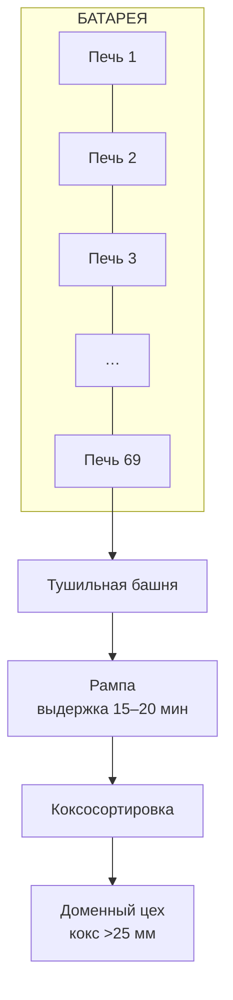
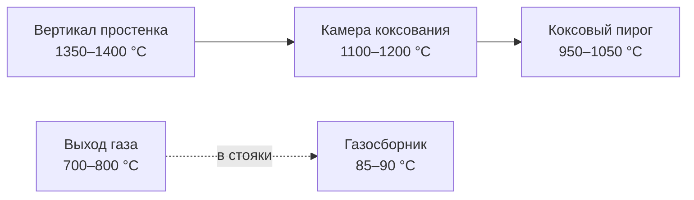
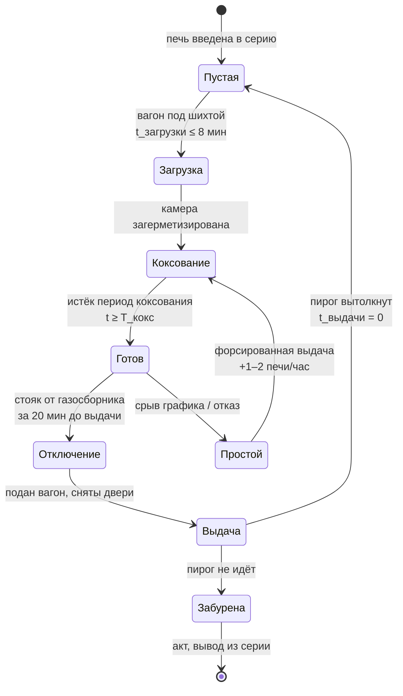

# 00. Предметная область: физика процесса и терминология

Документ объясняет, **что именно планирует система**. Без этого любая модель данных
будет набором бессмысленных полей.

---

## 1. Что такое коксовая батарея

Коксовая батарея — агрегат для производства кокса из каменного угля. Это ряд
камер, поставленных в ряд вплотную и разделённых отопительными простенками.



| Параметр | Значение |
|---|---|
| Число печей в батарее | 45–75 |
| Ширина камеры | 400–450 мм |
| Длина камеры | 14–17 м |
| Полезный объём камеры | 30–41 м³ |
| Расстояние между осями камер | 1260–1400 мм |

Типовая батарея обслуживается **одним комплектом машин**: коксовыталкиватель,
двересъёмная машина, углезагрузочный вагон. На **две** батареи — один тушильный
вагон с электровозом, одна угольная башня, одна тушильная башня, одна рампа.

---

## 2. Три ключевых понятия, которые нельзя путать

Это самая частая ошибка при проектировании — развести их в модели данных.

| Понятие | Определение | Типовое значение |
|---|---|---|
| **Период коксования** | От загрузки камеры шихтой до выдачи из неё кокса | 13–18 ч; рабочий — задаётся помесячно, не ниже минимально допустимого |
| **Оборот печи** | Период коксования **плюс** время обработки печи | 14–15 ч при периоде коксования ~13,5–14 ч |
| **Цикл (оборот батареи)** | Полный цикл по цикличному графику: рабочая часть + ремонтная остановка | рабочая часть + 1,0–1,5 ч ремонта (при обороте 14–15 ч) |

> Рабочий период коксования устанавливается **ежемесячно** для каждой батареи
> отдельно и не может быть ниже утверждённого минимально допустимого.

---

## 3. Физика: что происходит в камере

Коксование — нагрев угля **без доступа воздуха**. Камера работает как
периодический реактор: загрузили, выдержали, выдали, вычистили — и снова.

| Стадия | Температура | Что происходит |
|---|---|---|
| Сушка | до 100–120 °C | испаряется влага |
| Нагрев | до 300–350 °C | улетучиваются CO₂, CO |
| Размягчение | 350–500 °C | уголь плавится, начинается спекание |
| Полукокс | 500–600 °C | затвердение расплава |
| Прокаливание | 600–1100 °C | удаляются летучие, формируется кристаллический кокс |

**Температурные поля:**



Обогрев идёт **через боковые стенки**: в отопительных простенках сжигается смесь
коксового и доменного газа. Печь — это по сути вертикальная труба, нагреваемая с боков,
а газ отводится из верхней части через стояк в сборный газосборник.

Выход кокса — 75–78 % от массы угля. Сырой коксовый газ — 300–350 м³ на тонну сухой шихты.

---

## 4. Глоссарий

> Это то, что должно быть в справочнике объектов и в UI без перевода на человеческий.

| Термин | Значение |
|---|---|
| **Камера / печь** | Ячейка батареи, в которой идёт коксование. В проекте — единица планирования |
| **Простенок** | Стена между двумя камерами, внутри которой сжигается отопительный газ |
| **Вертикал** | Канал в простенке для прохода газа. По вертикалам контролируют температурный режим |
| **Стояк** | Труба отвода газа из камеры в газосборник |
| **Газосборник** | Общий коллектор парогазовой смеси вдоль батареи |
| **Ампераж** | Ток выталкивающей штанги при сдвиге пирога. Норма 210 А, предел 260 А. Превышение — «тугой ход» |
| **Планёр** | Штанга, разравнивающая шихту в камере |
| **Серийность** | Правило очерёдности выдачи кокса (2-1, 5-2, 9-2). Подробно — в [05](05-алгоритмы-планирования.md) |
| **Пустая камера** | Камера, из которой выдали кокс, но ещё не загрузили шихтой. Допускается не более одной |
| **Цикличный график** | График выдачи с ремонтной остановкой once за оборот. Это норма, а не исключение |
| **Полуцикличный график** | Две ремонтные остановки за оборот: после нечётных серий и после чётных |
| **Кравн (Красч)** | Расчётный коэффициент равномерности выдачи — формула ниже |
| **ОEE (ОЕЭ)** | Overall Equipment Effectiveness, общая эффективность оборудования |
| **«Тугой ход» пирога** | Пирог не идёт при выталкивании. Требует разбора и акта |
| **Забуренная печь** | Печь, из которой кокс не вышел даже при повторном толчке. Выводится из серии |

---

## 5. Формулы, которые живут в проекте

Все три формулы — из нормативной практики, а не придуманы для проекта.

### 5.1 Расчётный коэффициент равномерности выдачи

```
К_расч = (м − а) / м
```

- `м` — число печей, задано графиком к выдаче за смену
- `а` — число печей, включённых в график **с отклонением периода коксования более чем на 5 мин**

Смысл: какая доля выдач идёт строго по графику. Планировщик **оптимизирует** эту метрику —
именно она является критерием «какой алгоритм лучше».

### 5.2 Исполнительный коэффициент равномерности

```
К_исп = (п − з) / п
```

- `п` — фактически выданных печей
- `з` — выдано с нарушением графика (отклонение факта от плана > 5 мин)

Разница между `К_расч` и `К_исп` — это и есть «вина» конкретной бригады.

### 5.3 Норма выдачи за смену

```
норма_выдачи = N_печей / T_смены_ч  →  печей/час
```

где `N_печей = T_оборота × N_печей_батареи / T_оборота` — упрощённо: за оборот
выдаётся каждая печь батареи ровно один раз. Отсюда интервал между выдачами:

```
Δt_выдачи = T_рабочей_части_цикла / N_печей_батареи
```

Именно из этой формулы рождается «допустимый шаг между операциями» — ручка из
блока «Управление графиком» на макете.

---

## 6. Жёсткие временны́е ограничения

Это не «рекомендации», а ограничения, нарушение которых ломает кладку печи или график.
Они должны быть **проверяемыми правилами** в системе.

| Ограничение | Норма | Нарушение |
|---|---|---|
| Отклонение периода коксования от заданного | ≤ **5 мин** | печь считается «вне графика» |
| Отклонение фактической выдачи от графика | ≤ 5 мин (динасовые) / ≤ 10 мин (шамотные) | нарушение расчётного графика |
| Время между выдачей и загрузкой камеры | ≤ **8 мин** | нарушение режима |
| То же при работе с одной пустой камерой | ≤ **18 мин** | нарушение режима |
| То же при работе через две пустые камеры | ≤ **20 мин** | требует разрешения гл. инженера |
| Печь с открытой дверью | ≤ **5 мин** | риск разграфичивания кладки |
| От снятия дверей до их установки | ≤ **10 мин** | сохранность кладки |
| Отключение от газосборника | не ранее чем за **20 мин** до выдачи | нарушение режима |
| Отключение стояка (при обороте ≥ 20 ч) | за **2–3 ч** до выдачи | — |
| Пароинжекция при загрузке | ≤ **6 мин** | — |
| Задержка загрузочного вагона над открытыми люками | ≤ **5 мин** | — |
| Открытые крышки стояков на батарее | не более **3** печей одновременно | — |
| Форсирование выдачи после простоя | не более **1–2 печи/час** сверх нормы | ухудшение качества обработки печей |
| Цикличная остановка | ≥ **2 ч** | — |
| Плановая остановка | ≤ **8 ч** | — |
| Высота подсводового пространства после планёрного распределения | **250–350 мм** | неполная загрузка |

---

## 7. Что система имитирует, а что — реальность

Кейс допускает, что состояние оборудования и события поступают **из симулятора**.
Это ключевое допущение проекта, и его надо отразить в модели данных явно:

| Категория | Источник в MVP | Комментарий |
|---|---|---|
| Состав и геометрия батарей, печей, машин | Справочник (вручную / импорт) | реальные КТТХ |
| Характеристики шихты (зольность, влажность, ситовый состав) | Импорт CSV/JSON | партии шихты |
| Температура пирога, камеры, вертикала | **Симулятор** | замеренные или модельные ряды |
| Ампераж выталкивания | **Симулятор** | норма 210 А / предел 260 А |
| Факт выдачи, загрузки, простои | **Симулятор** | для проверки метрик план/факт |
| Отказы оборудования | **Симулятор** | с вероятностями |

> Игорь просил разрешить формат данных загрузки «целиком на наше усмотрение»
> и предложил смоделировать поступление плана выпуска и партий шихты.
> Эта схема — в [04-форматы-файлов.md](04-форматы-файлов.md).

---

## 8. Жизненный цикл одной камеры коксования



Обратите внимание: состояние **«Простой»** в этой схеме — не авария, а штатный
сценарий. Он порождает главную проблему проекта: рассогласование периодов
коксования, а значит неравномерность графика и разброс качества кокса.