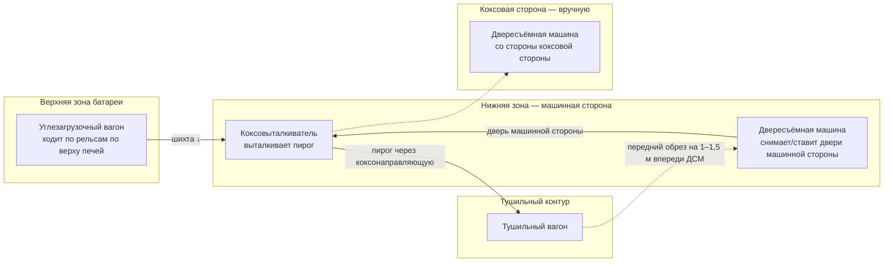
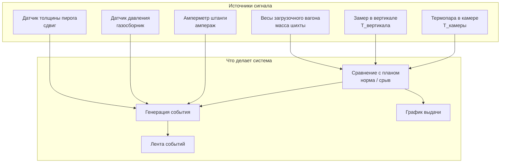
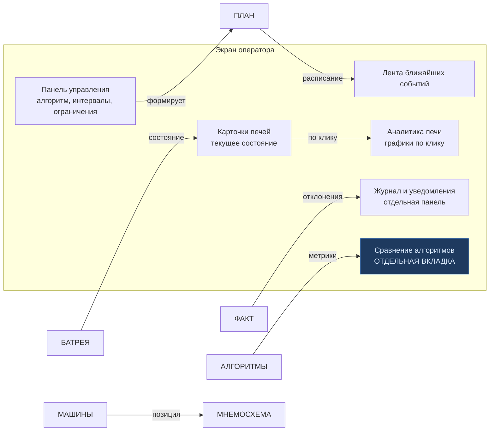
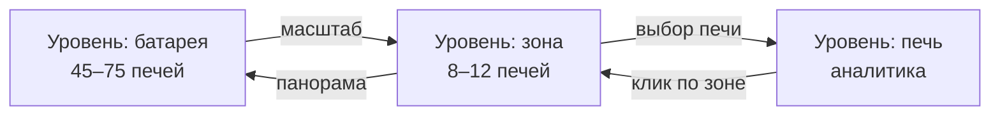

# 01. Технологическая мнемосхема

Схема потока для отрисовки главного экрана оператора. На первом макете фронт
уже делал нечто подобное («Путь №1. Приёмка шихты», карточки печей, вагоны) —
здесь фиксируем **систему координат и связи**, чтобы бэк отдавал фронту координаты,
а фронт не рисовал их от руки.

---

## 1. Поток технологического процесса

```mermaid
flowchart LR
  subgraph SRC["ИСТОЧНИКИ СЫРЬЯ"]
    СКЛАД["Угольный склад<br/>марки Г, ГЖ, Ж, К, КО, ОС"]
    БАШНЯ["Угольная башня<br/>№1"]
  end

  subgraph БАТ["КОКСОВАЯ БАТАРЕЯ"]
    direction TB
    ЗАГР["Загрузочный вагон<br/>бездымная загрузка"]
    ПЕЧИ["Камеры коксования<br/>45–75 шт."]
    ВЫТ["Коксовыталкиватель<br/>+ двересъёмная машина"]
    СТОЯКИ["Стояки → газосборник"]
  end

  subgraph ТУШ["ТУШЕНИЕ И СОРТИРОВКА"]
    ТВ["Тушильный вагон<br/>+ электровоз"]
    ТБ["Тушильная башня"]
    РАМПА["Рампа<br/>15–20 мин"]
    СОРТ["Коксосортировка"]
  end

  subgraph ОТГР["ОТГРУЗКА"]
    БУНК["Бункеры<br/>крупный / средний / мелочь"]
  end

  СКЛАД --> БАШНЯ --> ЗАГР --> ПЕЧИ
  ПЕЧИ --> ВЫТ --> ТВ --> ТБ --> РАМПА --> СОРТ --> БУНК

  ПЕЧИ -.->|"700–800 °C"| СТОЯКИ
  СТОЯКИ -.->|"85–90 °C"| ХИМУЛ[("Цех химулавливания<br/>ПКГ, бензол, смола")]

  classDef src fill:#1f2937,stroke:#6b7280,color:#e5e7eb
  classDef bat fill:#14532d,stroke:#22c55e,color:#dcfce7
  classDef tsh fill:#78350f,stroke:#f59e0b,color:#fef3c7
  classDef out fill:#4c1d95,stroke:#a78bfa,color:#ede9fe
  class СКЛАД,БАШНЯ src
  class ЗАГР,ПЕЧИ,ВЫТ,СТОЯКИ bat
  class ТВ,ТБ,РАМПА,СОРТ tsh
  class БУНК out
```

**Сплошные стрелки** — движение материала. **Пунктирные** — отвод газа параллельно
основному потоку. Это важно для UI: газовый контур не является частью графика выдачи,
но является источником событий (перепад давления в газосборнике).

---

## 2. Система координат мнемосхемы

Фронту не нужно угадывать, где что рисовать. Бэк отдаёт координаты вместе
со справочником.

| Ось | Что отражает | Диапазон |
|---|---|---|
| `x` | Позиция вдоль батареи | 0…`ovenCount − 1`, индекс номера печи |
| `y` | Тип объекта | 0 — печь, 1 — стояк, 2 — тушильный вагон, 3 — углезагрузочный вагон |
| `z` | Сторона | `machine` (машинная) / `coke` (коксовая) |

Боковые разъезды машин:

> **Замечание для фронта.** Игорь просил обозначить положение коксовыталкивателя
> и вагонов «полоской или чем-то ещё символически около печей». Схема выше даёт
> основание: у выталкивателя и тушильного вагона есть **реальная позиция вдоль батареи**
> (момент, когда они стоят под конкретной печью). Это не декорация, а данные:
> `machineId` + `currentPositionOvenIndex` в телеметрии.

---

## 3. Точки съёма телеметрии

Каждой точке соответствует поле в телеметрии и событие в ленте.

| Точка | Что отслеживаем | Порог / норма |
|---|---|---|
| Термопара в камере | Перегрев сверх нормы | > 1200 °C — аварийная остановка обогрева |
| Температура вертикала | Рассогласование теплового режима | отклонение > ±(заданное) °C |
| Ампераж штанги | Затруднённое выталкивание | норма 210 А, предел 260 А → «тугой ход» |
| Давление в газосборнике | Колебания из-за разной стадии коксования камер | — |
| Масса загрузки шихты | Неполнота загрузки, отклонение от нормы | — |
| Толщина пирога | Просадка уровня шихты | — |

---

## 4. Отображение на экране оператора

Соответствие между объектом мнемосхемы и элементом UI:

> Решение зафиксировано по итогам обсуждения с куратором от 13.10.2026:
> **сравнение алгоритмов выносится из экрана оператора** в отдельное окно/вкладку —
> оператору оно нужно примерно никогда, а для отчётов, презентаций и продаж — обязательно.
> Диаграмма ниже показывает, что куратор просил «символически обозначить» положение
> машин — это отдельная подсистема координат, см. раздел 2.

---

## 5. Масштабирование на 45–75 печей

Отдельная задача, обозначенная куратором: оператор не должен прокручивать 70 печей.
Предлагаемое решение — три уровня детализации, все три обслуживаются одним
API с разным `zoom`.

| Уровень | `zoom` | Что видно | Для кого |
|---|---|---|---|
| **Обзор** | `battery` | Все печи как цветные полосы; высота = загрузка, цвет = статус, отклонение = подсветка | вся батарея на одном экране |
| **Зона** | `zone` | 8–12 соседних печей крупно, с вагонами и стояками | локальная работа |
| **Печь** | `oven` | Одна камера + аналитика | разбор отклонения |

Требование к API: **любой** эндпоинт списка принимает `zoom` и возвращает
декодированный уровень детализации, а фронт не перезапрашивает данные при переключении.