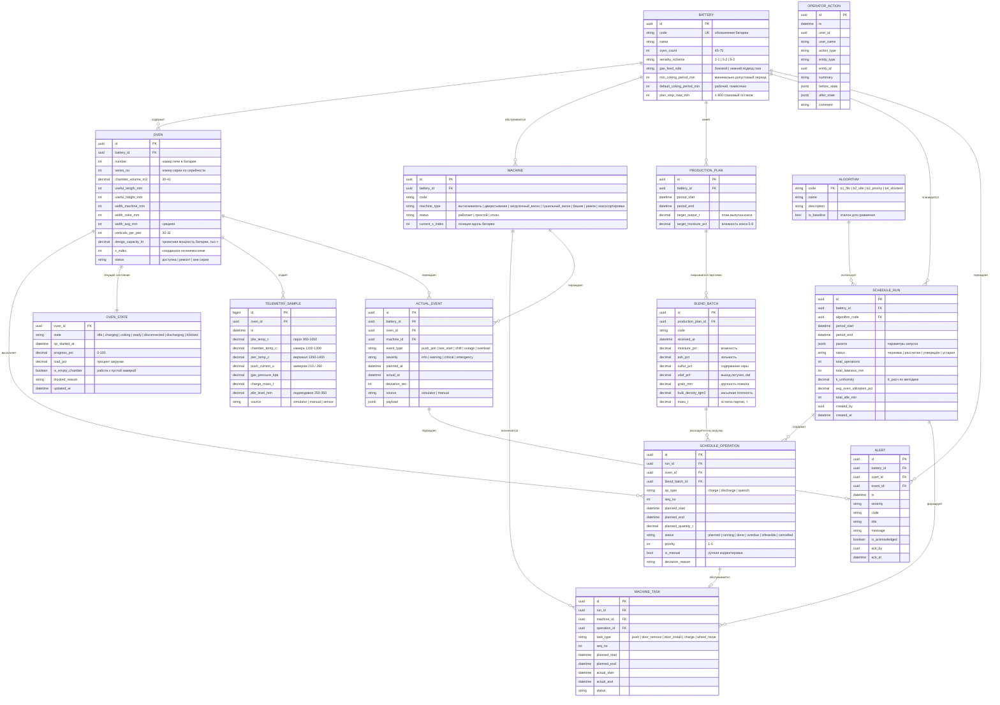
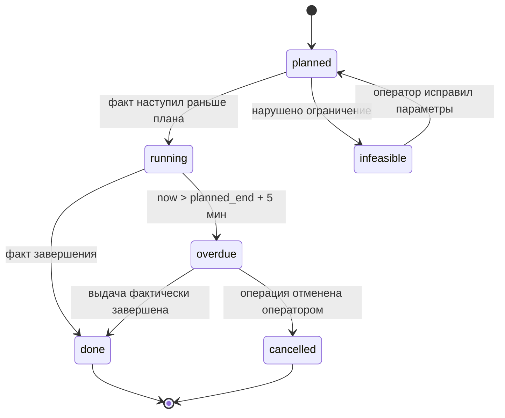

# 02. Модель данных

ER-диаграмма и описание сущностей. Диаграмма в mermaid — рендерится в GitLab,
VS Code и на GitHub. При необходимости импортируется в draw.io / dbdiagram.io.

---

## 1. ER-диаграмма



---

## 2. Описание сущностей

### Справочники оборудования

**`BATTERY` — коксовая батарея.** Корневая сущность. Код приходит из импорта
справочника оборудования. `default_coking_period_min` меняется помесячно —
историю таких изменений держим в журнале действий, а не отдельной версией таблицы.

**`OVEN` — камера коксования.** Ключевое поле — `series_no`: номер серии,
которому печь принадлежит при текущей серийности. Оно **пересчитывается** при
смене схемы работы батареи (2-1 → 5-2 → 9-2), поэтому хранится в батарее как
производное, а не как справочное.

> Игорь: «Точно выбор самой схемы работы батареи (2-1, 5-2, 9-2)».
> Схема — это ручка планировщика, которая меняет и порядок выдачи, и состав серий.

**`MACHINE` — машина комплекта.** Поле `current_x_index` — текущая позиция
машины вдоль батареи. Именно её фронт рисует «полоской около печей».

> Игорь: «Совсем круто было бы положение коксовыталкивателя и вагонов как-то
> полоской или чем-нибудь ещё символически около печей обозначить».

### Входные данные

**`BLEND_BATCH` — партия угольной шихты.** Характеристики напрямую определяют
температурный режим: от влажности и ситового состава шихты зависит требуемая
температура в вертикалах, а значит и период коксования.

**`PRODUCTION_PLAN` — план выпуска кокса** на период. Покрывается партиями шихты.

> Игорь: «целиком смоделировать поступление планов по выпуску указанного объёма
> выпуска продукции, и партии поступающей шихты». Ровно эти две сущности.

### Планирование

**`ALGORITHM` — вариант алгоритма формирования расписания.** Справочник, потому
что сравнение алгоритмов — обязательное требование кейса, и его нужно уметь
перезапускать на одних и тех же входных данных.

**`SCHEDULE_RUN` — один прогон планировщика.** Содержит метрики результата,
рассчитанные **по формулам из [00-предметная-область.md](00-предметная-область.md)**:
`k_uniformity` — К_расч, `total_lateness_min` — сумма просрочек, `avg_oven_utilization_pct` —
равномерность загрузки, `total_idle_min` — время простоя.

> Игорь: «Сравнение алгоритмов — это точно какой-то дашборд в перспективе».
> Значит `SCHEDULE_RUN` — персистентный, а не временный объект: несколько прогонов
> одного периода разными алгоритмами должны одновременно существовать и сравниваться.

**`SCHEDULE_OPERATION` — одна операция графика.** Уровень планирования — печь.
`op_type` ∈ {`charge` — загрузка шихты, `discharge` — выдача кокса, `quench` — тушение}.

**`MACHINE_TASK` — задание конкретной машине.** Уровень планирования — машина.
Это то, что превращает «график печей» в «график работы комплекта машин».
Без него не проверить, что один коксовыталкиватель не должен быть в двух печах
одновременно.

### Факт и телеметрия

**`OVEN_STATE` — текущее состояние камеры.** Отделено от телеметрии, потому что
показывается на каждом экране и читается постоянно. Телеметрия — для графиков.

**`TELEMETRY_SAMPLE` — ряд измерений.** Одна строка на печь на интервал опроса.
Именно этот ряд рисуется в карточке печи.

**`ACTUAL_EVENT` — событие процесса.** Событие — это и есть «журнал событий»
из UI. `deviation_sec` = `actual_at − planned_at`, ключевое поле для расчёта
план/факт.

> Куратор: «Логично предусмотреть какие-нибудь фильтры логов событий по
> оборудованию (печи, вагоны) и типу событий за интервал времени».

**`ALERT` — уведомление об отклонении.** Отдельная от события: одно событие
может не породить уведомление, а уведомление требует подтверждения оператором.

**`OPERATOR_ACTION` — журнал действий пользователя.** Требование методички
«журнал изменений и действий пользователя». Хранит before/after, чтобы
ручную корректировку графика можно было откатить и расследовать.

---

## 3. Статусная модель операции

Статусы из методички: `запланировано → выполняется → выполнено / просрочено / невозможно выполнить`.



**Правило перехода `running → overdue`** — это ровно тот порог в 5 минут, который
описан в нормативной практике. Он же обосновывает цветовую схему на макете:
жёлтый — срыв графика, а не просто «требует внимания».

> Игорь: «Я бы конкретизировал только, и цветами не внимание оператора обозначал,
> а срывы графика — оттенками жёлтого — масштабы простоя. А красным — потенциальные
> аварии из стимулятора».

Цвет привязан к `severity`, а не к наличию события:

| Цвет | `severity` | Источник |
|---|---|---|
| Зелёный | `info` | штатное событие |
| Жёлтый градаций | `warning` | просрочка; насыщенность = масштаб простоя |
| Оранжевый | `critical` | ампераж выше нормы, печь вне серии |
| Красный | `emergency` | аварийная остановка обогрева |

---

## 4. Ключевые индексы

Приводятся как миграция Flyway `V1__init.sql`. В приложении `spring.jpa.hibernate.ddl-auto`
выключен — схемой управляет только Flyway, иначе версия БД разъезжается с репозиторием.

```sql
-- выборка ленты событий с фильтрами (основной запрос UI)
CREATE INDEX ix_event_battery_time    ON actual_event (battery_id, planned_at DESC);
CREATE INDEX ix_event_oven_time      ON actual_event (oven_id, actual_at DESC);
CREATE INDEX ix_event_type_severity  ON actual_event (event_type, severity);

-- график на таймлайне
CREATE INDEX ix_op_run_start          ON schedule_operation (run_id, planned_start);
CREATE INDEX ix_op_oven_start        ON schedule_operation (oven_id, planned_start);
CREATE INDEX ix_op_status            ON schedule_operation (status, planned_end)
       WHERE status IN ('planned', 'running', 'overdue');

-- графики в карточке печи
CREATE INDEX ix_telemetry_oven_ts     ON telemetry_sample (oven_id, ts DESC);

-- задания машин, чтобы ловить пересечения
CREATE INDEX ix_task_machine_start    ON machine_task (machine_id, planned_start);

-- журнал действий
CREATE INDEX ix_action_entity        ON operator_action (entity_type, entity_id, ts DESC);
```

Партиционирование `telemetry_sample` по месяцу — при интервале опроса 1 мин на
69 печей это ~100 тыс. строк в сутки, за семестр набегает заметно. Разбиение
на партиции делается отдельной миграцией `V3__partition_telemetry.sql`.

**Enum-ы хранятся как `varchar`, не как PostgreSQL `enum`.** Причина практическая:
добавление нового значения в `enum` требует `ALTER TYPE`, а в `varchar` — просто
`UPDATE`. Меняем `MachineType` или `Severity` без блокировки таблицы.

Соответствие типов на Java:

| Тип в БД | Тип в Java | Комментарий |
|---|---|---|
| `uuid` | `UUID` | Генерируем приложением |
| `timestamptz` | `Instant` | **Не** `LocalDateTime` — теряется зона |
| `date` | `LocalDate` | Период плана, границы смен |
| `time` | `LocalTime` | Начало смены батареи |
| `numeric(5,2)` | `BigDecimal` | Проценты, температуры |
| `int` | `Integer` / `int` | |
| `boolean` | `Boolean` | |
| `jsonb` | `String` + `JsonNode` | Маппинг Hibernate 6 через `@JdbcTypeCode(SqlTypes.JSON)` |

---

## 5. Что осознанно не вошло в MVP

| Не вошло | Почему | Когда вернуть |
|---|---|---|
| Модель углеподготовки и коксового газа | Куратор ограничил MVP коксовой батарей | после сдачи MVP |
| План по поступающему коксу / объёму выпуска как ограничение | Куратор: «за пределами MVP» | подтвердить у Игоря |
| Ролевая модель и права доступа | Безопасность — отдельный кейс (кейс 2) | если попросит заказчик |
| Обезличенные исторические данные реального ЕКС | Данных нет, используется симулятор | при наличии выгрузки |
| `OPERATION_TYPE`, `EVENT_TYPE` как таблицы-справочники | Пока реализуем как enum в коде | если начнут плодиться типы |