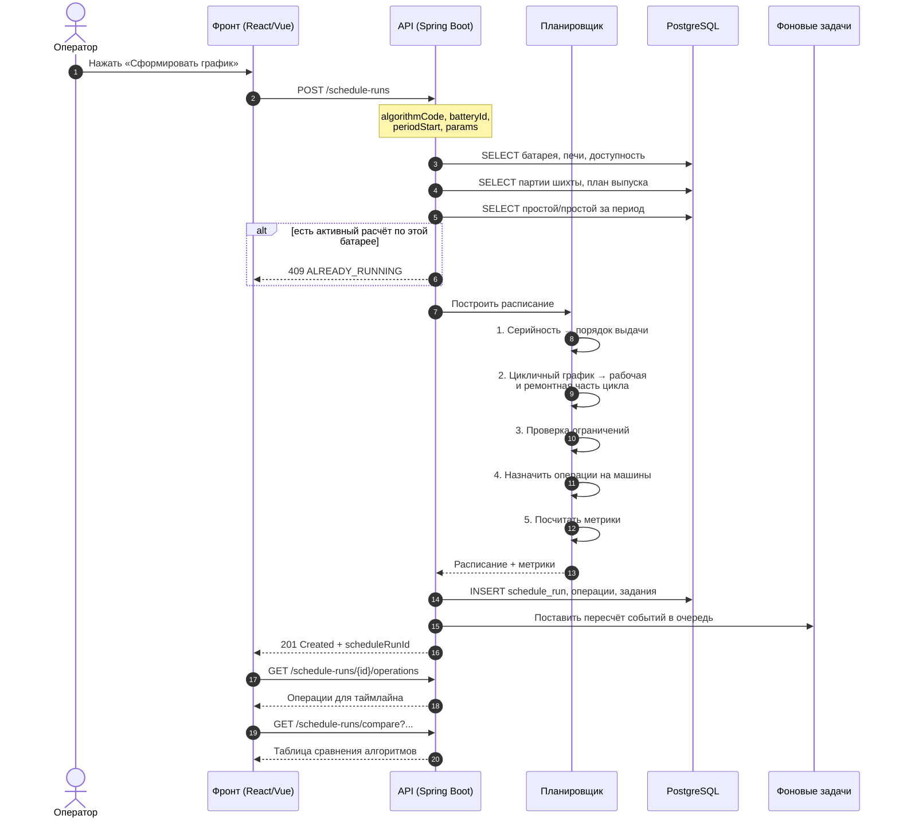

# 03. Контракт API

Версия 0.1 — черновик для согласования с фронтом. Открытый контракт, генерируется
из кода аннотациями **springdoc-openapi**, спецификация отдаётся на `/v3/api-docs`.

**Base URL:** `/api/v1`
**Стек:** Java 21 LTS + Spring Boot 3.4, Spring Web MVC, Spring Data JPA (Hibernate 6),
PostgreSQL 16, Flyway, Quartz Scheduler, WebSocket/STOMP для реального времени.
Обоснование отклонения от рекомендованного методичкой стека C#/.NET —
в [07-технический-стек.md](07-технический-стек.md).

---

## 1. Соглашения

### Формат ответа

Оборачиваем в единый конверт — фронт пишет один интерсептор:

```json
{
  "success": true,
  "data": { "...": "полезная нагрузка" },
  "error": null,
  "meta": {
    "requestId": "01J8X4K2P9",
    "elapsedMs": 42
  }
}
```

Ошибка:

```json
{
  "success": false,
  "data": null,
  "error": {
    "code": "SCHEDULE_CONSTRAINT_VIOLATED",
    "message": "Нарушена серийность выдачи: печь П-17 выдаётся раньше П-16 в серии 5-2",
    "details": [
      {
        "field": "operations[12].ovenId",
        "issue": "Серийный порядок нарушен",
        "constraint": "seriality:5-2",
        "ovenNumber": 17
      }
    ]
  },
  "meta": { "requestId": "01J8X4K2P9", "elapsedMs": 118 }
}
```

### Формат времени и интервалов

| Правило | Формат | Пример |
|---|---|---|
| Дата-время | ISO 8601, **всегда UTC, с суффиксом `Z`** | `2026-10-05T11:05:00Z` |
| Чистая дата | `YYYY-MM-DD` | `2026-10-05` |
| Длительность | секунды, целое | `480` |
| Температура | °C, `decimal` | `1008.4` |
| Проценты | `0…100`, `decimal(5,2)` | `54.20` |
| Масса | тонны | `40.1` |
| Ток | амперы | `212` |

Смещение смены — это бизнес-параметр батареи (`shiftStartLocal`), **не** смещение
таймзоны. График строится в местном времени предприятия, наружу отдаётся в UTC.

### Списки

Пагинация курсорная, чтобы работало на ленте событий с постоянным ростом:

```json
{
  "items": [ "..." ],
  "page": {
    "nextCursor": "eyJpZCI6IjAxSjhYNEwzIn0",
    "hasMore": true,
    "limit": 100
  }
}
```

---

## 2. Последовательность формирования графика

Главный пользовательский сценарий. Фронт нажимает «Сформировать график».



Планировщик — CPU-связная задача. Если батарея большая (69 печей × цикл),
расчёт уходит в фонового воркера, а эндпоинт возвращает `202 Accepted` со
статусом `pending`. Для 5 печей демо-инстанса хватает синхронного ответа.

---

## 3. Справочники оборудования

### `GET /api/v1/batteries`

Список коксовых батарей с агрегатами планирования.

```json
{
  "success": true,
  "data": [
    {
      "id": "9f1c2d40-0001-4a00-8000-000000000001",
      "code": "Б-1",
      "name": "Коксовая батарея №1",
      "ovenCount": 69,
      "serialityScheme": "9-2",
      "gasFeedSide": "side",
      "cokingPeriodMin": 840,
      "cokingPeriodRangeMin": [780, 960],
      "planStopMaxMin": 480,
      "shiftStartLocal": "07:00",
      "coordinates": { "lengthM": 112.0, "heightM": 7.0 }
    }
  ]
}
```

### `GET /api/v1/batteries/{batteryId}/ovens`

Печи батареи. Параметр **`zoom`** обязателен — он определяет уровень детализации
(см. [01-мнемосхема.md](01-мнемосхема.md), раздел 5).

| Параметр | Тип | По умолчанию | Описание |
|---|---|---|---|
| `zoom` | `battery` \| `zone` \| `oven` | `battery` | Уровень детализации |
| `zoneStart` | `int` | — | Номер первой печи зоны, при `zoom=zone` |
| `zoneSize` | `int` | `12` | Размер зоны, при `zoom=zone` |
| `status` | `string[]` | — | Фильтр по статусу |
| `onlyInSeries` | `bool` | `false` | Только печи в серии |

Ответ при `zoom=battery` — компактный, для 69 печей укладывается в один экран:

```json
{
  "success": true,
  "data": {
    "zoom": "battery",
    "batteryId": "9f1c2d40-0001-4a00-8000-000000000001",
    "ovens": [
      {
        "number": 1,
        "state": "coking",
        "loadPct": 100,
        "progressPct": 54,
        "status": "active",
        "opLabel": "Коксование",
        "severity": "info",
        "deviationMin": 0
      },
      {
        "number": 2,
        "state": "coking",
        "loadPct": 58,
        "progressPct": 58,
        "status": "active",
        "opLabel": "Коксование",
        "severity": "warning",
        "deviationMin": 6
      }
    ]
  }
}
```

### `GET /api/v1/ovens/{ovenId}`

Паспорт камеры: геометрия, характеристики, текущая серия, история простоя.

### `GET /api/v1/machines`

Комплект машин с текущими позициями — источник для отрисовки «полоски машин».

```json
{
  "success": true,
  "data": [
    {
      "id": "…0021",
      "code": "КВ-1",
      "machineType": "pusher",
      "machineTypeName": "Коксовыталкиватель",
      "status": "running",
      "currentOvenNumber": 3,
      "currentXIndex": 2,
      "busyUntil": "2026-10-05T11:42:00Z"
    },
    {
      "id": "…0022",
      "code": "ТВ-1",
      "machineType": "quenchWagon",
      "machineTypeName": "Тушильный вагон",
      "status": "running",
      "currentOvenNumber": null,
      "currentXIndex": null,
      "location": "ramps"
    }
  ]
}
```

---

## 4. Импорт данных

Формат файлов — наше усмотрение (Игорь: «Формат файлов — полностью на наше
усмотрение»). Подробно — в [04-форматы-файлов.md](04-форматы-файлов.md).

| Эндпоинт | Назначение |
|---|---|
| `POST /api/v1/import/equipment` | Справочник батарей, печей, машин (CSV или JSON) |
| `POST /api/v1/import/blend-batches` | Партии угольной шихты |
| `POST /api/v1/import/production-plan` | План выпуска кокса |
| `POST /api/v1/import/actuals` | Факт выдачи/загрузки для сверки |
| `GET /api/v1/import/templates/{kind}` | Скачать шаблон с примером |
| `GET /api/v1/import/jobs/{jobId}` | Статус асинхронного импорта |

Импорт идёт через очередь **Quartz Scheduler** (`importJobDetail`) — файлы бывают
большие. Ответ `202 Accepted` с `jobId`, статус забирается опросом или приходит
по STOMP-каналу `/topic/import`.

```json
{
  "success": true,
  "data": {
    "jobId": "01J8X5M2Q4",
    "status": "queued",
    "acceptedRows": 4820,
    "rejectedRows": 3
  }
}
```

---

## 5. Планирование

### `POST /api/v1/schedule-runs`

Сформировать график выдачи.

```json
{
  "batteryId": "9f1c2d40-0001-4a00-8000-000000000001",
  "algorithmCode": "b2_idle",
  "periodStart": "2026-10-05T00:00:00Z",
  "periodEnd": "2026-10-12T00:00:00Z",
  "params": {
    "serialityScheme": "9-2",
    "maxIntervalBetweenDischargesMin": 30,
    "leadTimeToFailureMin": 45,
    "emergencyOrders": [
      { "ovenNumber": 17, "priority": "high", "note": "срочный заказ" }
    ],
    "dryCokeTargetMoisturePct": 6.0
  }
}
```

Параметры `params` — это ровно те ручки из блока «Управление графиком»,
которые куратор утвердил как нужные:

> «Очень хорошая идея вынести туда параметры, которые влияют на возникновение
> событий (как сейчас — время до срыва, максимальное время между выдачами и
> приоритетность). Точно выбор самой схемы работы батареи (2-1, 5-2, 9-2).»

Плюс блок ограничений, который на макете был подписан «Временные ограничения»
и «Доступность оборудования» — они описывают, какие печи выведены из серии
и какие есть технологические окна.

Ответ `201 Created`:

```json
{
  "success": true,
  "data": {
    "id": "01J8X6A1B2",
    "status": "calculated",
    "algorithmCode": "b2_idle",
    "totalOperations": 968,
    "metrics": {
      "lateOperationsCount": 3,
      "totalLatenessMin": 31,
      "kUniformityCalculated": 0.9969,
      "kUniformityTarget": 1.0,
      "avgOvenUtilizationPct": 91.2,
      "minOvenUtilizationPct": 84.5,
      "maxOvenUtilizationPct": 100.0,
      "utilizationSpreadPct": 15.5,
      "totalIdleMin": 140,
      "violatedConstraintsCount": 2
    },
    "violations": [
      {
        "code": "EMPTY_CHAMBER_NOT_ALLOWED",
        "message": "Печь П-21 осталась пустой на 22 мин при пределе 18 мин",
        "ovenNumber": 21,
        "severity": "warning"
      }
    ]
  }
}
```

### `GET /api/v1/schedule-runs/{id}/operations`

Операции для таймлайна и ленты. Основной запрос экрана.

| Параметр | Тип | Описание |
|---|---|---|
| `from`, `to` | `datetime` | Окно времени, обязательное |
| `ovenNumbers` | `int[]` | Фильтр по печам |
| `opTypes` | `charge`\|`discharge`\|`quench` | Фильтр по типу |
| `statuses` | `planned`… | Фильтр по статусу |
| `severities` | `info`… | Фильтр по важности |
| `includeManual` | `bool` | По умолчанию `true` |

### `GET /api/v1/schedule-runs/{id}/feed`

**Лента ближайших событий** — то, чем заменили диаграмму Ганта.

```json
{
  "success": true,
  "data": {
    "generatedAt": "2026-10-05T11:05:00Z",
    "items": [
      {
        "ovenNumber": 4,
        "eventType": "discharge_start",
        "title": "Печь П-4: начало выгрузки",
        "plannedAt": "2026-10-05T11:37:00Z",
        "deviationMin": null,
        "severity": "info",
        "relativeLabel": "через 27 мин"
      },
      {
        "ovenNumber": 3,
        "eventType": "discharge_start",
        "title": "Печь П-3: выдача кокса (ручная)",
        "plannedAt": "2026-10-05T12:30:00Z",
        "deviationMin": 25,
        "severity": "warning",
        "relativeLabel": "через 1 ч 25 мин"
      },
      {
        "ovenNumber": 5,
        "eventType": "infeasible",
        "title": "Печь П-5: выдача невозможна",
        "plannedAt": "2026-10-05T22:00:00Z",
        "severity": "emergency",
        "relativeLabel": "через 10 ч 55 мин"
      }
    ]
  }
}
```

### `PATCH /api/v1/schedule-operations/{id}`

Ручная корректировка графика оператором.

```json
{
  "plannedStart": "2026-10-05T13:15:00Z",
  "reason": "Перенос по согласованию с цеховым мастером"
}
```

Обязательное `reason` — попадает в журнал действий. Ответ содержит
предупреждения, если корректировка нарушает ограничения.

### `POST /api/v1/schedule-runs/compare`

Сравнение алгоритмов на одних и тех же входных данных.

```json
{
  "batteryId": "…",
  "periodStart": "2026-10-05T00:00:00Z",
  "periodEnd": "2026-10-12T00:00:00Z",
  "algorithmCodes": ["b1_fifo", "b2_idle", "b3_priority"],
  "params": { "serialityScheme": "9-2" }
}
```

```json
{
  "success": true,
  "data": {
    "criteria": [
      { "code": "late_operations",    "label": "Просрочено операций", "better": "lower", "unit": "шт" },
      { "code": "uniformity",         "label": "Равномерность",      "better": "higher", "unit": "%" },
      { "code": "idle_min",           "label": "Простой",            "better": "lower", "unit": "мин" },
      { "code": "constraint_violations", "label": "Нарушений (тех.)", "better": "lower", "unit": "шт" }
    ],
    "runs": [
      {
        "algorithmCode": "b1_fifo",
        "algorithmName": "FIFO",
        "values": { "late_operations": 3, "uniformity": 18, "idle_min": 140, "constraint_violations": 2 }
      },
      {
        "algorithmCode": "b2_idle",
        "algorithmName": "Простой",
        "values": { "late_operations": 1, "uniformity": 75, "idle_min": 95, "constraint_violations": 0 }
      }
    ]
  }
}
```

Критерии — ровно те четыре, что перечислены в методичке:
количество просроченных операций, равномерность загрузки, время простоя
оборудования, соблюдение технологических ограничений.

---

## 6. События и журналы

### `GET /api/v1/events`

С фильтрами, которые просил куратор.

| Параметр | Описание |
|---|---|
| `batteryId` | Обязательный |
| `from`, `to` | Интервал, **обязательный** |
| `ovenNumbers[]` | По оборудованию: печи |
| `machineIds[]` | По оборудованию: машины |
| `types[]` | Тип события |
| `severities[]` | Важность |
| `cursor`, `limit` | Постранично |

> Куратор: «Логично предусмотреть какие-нибудь фильтры логов событий по
> оборудованию (печи, вагоны) и типу событий за интервал времени. Чтобы можно
> было посмотреть, например, аварии конкретной печи. Или срывы всех печей за
> последнее сколько-то время».

### `GET /api/v1/alerts`, `POST /api/v1/alerts/{id}/ack`

Уведомления и подтверждение оператором.

### `GET /api/v1/operator-actions`

Журнал действий пользователя с фильтрами `entityType`, `entityId`, `from`, `to`.

---

## 7. Аналитика печи

### `GET /api/v1/ovens/{ovenId}/analytics`

Данные для карточки «Аналитика печей — сравнение», которая открывается по клику.

| Параметр | Описание |
|---|---|
| `from`, `to` | Окно |
| `includeTelemetry` | Ряд температур (`bool`, по умолчанию `true`) |
| `includeDowntime` | Простои (`bool`) |

```json
{
  "success": true,
  "data": {
    "ovenNumber": 3,
    "batteryId": "…",
    "summary": {
      "currentState": "coking",
      "pileTempC": 1020,
      "oeePct": 84.5,
      "yieldT": 42.5,
      "blendCode": "КЖ + К + СС",
      "statusLabel": "Срыв графика",
      "idleHours": "01 ч 15 мин",
      "plannedToActualShiftMin": 25,
      "projectedToShiftEndMin": null
    },
    "telemetry": {
      "unit": "°C",
      "points": [
        { "ts": "2026-10-05T08:00:00Z", "pileTempC": 985, "chamberTempC": 1115 },
        { "ts": "2026-10-05T09:00:00Z", "pileTempC": 1002, "chamberTempC": 1140 },
        { "ts": "2026-10-05T10:00:00Z", "pileTempC": 1016, "chamberTempC": 1162 },
        { "ts": "2026-10-05T11:00:00Z", "pileTempC": 1020, "chamberTempC": 1170 }
      ],
      "targetBandC": [950, 1050]
    },
    "downtime": [
      {
        "from": "2026-10-04T22:10:00Z",
        "to": "2026-10-04T23:25:00Z",
        "minutes": 75,
        "reason": "Плановый ремонт коксовыталкивателя"
      }
    ],
    "history": [
      {
        "plannedDischargeAt": "2026-10-04T12:30:00Z",
        "actualDischargeAt": "2026-10-04T12:30:00Z",
        "cokingPeriodMin": 840,
        "deviationMin": 0,
        "wasInSchedule": true
      }
    ]
  }
}
```

`projectedToShiftEndMin` — прогноз срыва на конец смены. Отдельное поле,
потому что «опоздал уже на 25 мин» и «опоздает ещё на 40 мин до конца смены» —
разные ситуации для оператора.

---

## 8. Симулятор

Игорь: «Параметры в нём задаются достаточно редко, отрывать под него большую
часть экранного пространства на постоянной основе — не стоит».

| Эндпоинт | Назначение |
|---|---|
| `GET /api/v1/simulator/config` | Текущие вероятности и параметры |
| `PUT /api/v1/simulator/config` | Изменить |
| `POST /api/v1/simulator/control` | `{"action": "start"｜"pause"｜"step"｜"reset"}` |
| `GET /api/v1/simulator/state` | Время симуляции, скорость, счётчики |

Параметры симулятора:

```json
{
  "speedFactor": 60,
  "randomSeed": 20261005,
  "failureProbabilities": {
    "pushJam": 0.004,
    "doorGearFailure": 0.0015,
    "ovenHeatingFault": 0.0008,
    "quenchTowerFault": 0.0005
  },
  "amplitudeDefaults": {
    "pushCurrentMeanA": 210,
    "pushCurrentLimitA": 260
  }
}
```

> Куратор: «Возможно, параметров для симуляции будет больше — всякая частота
> возникновения новых событий и вероятности возникновения событий-отказов».

---

## 9. Реальное время

**WebSocket + STOMP** (`spring-boot-starter-websocket`, конфигурация
`WebSocketMessageBrokerConfigurer`). Фронт подключается к `/ws` с SockJS-fallback,
подписывается на топик `/topic/battery/{batteryId}`. Рассылка — через
`SimpMessagingTemplate`.

Топики:

| Топик | Назначение |
|---|---|
| `/topic/battery/{id}` | Все события батареи (основной) |
| `/topic/battery/{id}/telemetry` | Телеметрия отдельным топиком, чтобы не смешивать с управляющими |
| `/topic/import` | Статусы фоновых задач импорта |

```java
// рассылка из сервиса
template.convertAndSend("/topic/battery/" + batteryId, Map.of(
    "event", "OvenStateChanged",
    "data", ovenStateDto
));
```

| Событие | Payload | Когда |
|---|---|---|
| `OvenStateChanged` | `{ ovenNumber, state, loadPct, progressPct, severity }` | Смена состояния камеры |
| `TelemetryReceived` | `{ ovenNumber, ts, pileTempC, pushCurrentA }` | Новый замер |
| `EventCreated` | Объект `ACTUAL_EVENT` | Новое событие |
| `ScheduleUpdated` | `{ runId, reason }` | Ручная корректировка |
| `AlertCreated` | Объект `ALERT` | Новое уведомление |
| `ImportJobFinished` | `{ jobId, status, acceptedRows }` | Завершение импорта |

**Масштабирование.** Простой in-memory брокер Spring теряет сообщения при рестарте
и не работает на нескольких инстансах. Для MVP (один инстанс) достаточно, но
переключение на внешний брокер (`enableStompBrokerRelay` + RabbitMQ) должно быть
одной настройкой — иначе позже придётся переписывать рассылку.

Переподключение и догон пропущенных событий — через
`GET /events?after=<cursor>`, чтобы при разрыве связи лента не теряла записи.

---

## 10. Коды ошибок

| Код | HTTP | Смысл |
|---|---|---|
| `VALIDATION_FAILED` | 400 | Ошибка валидации тела запроса |
| `SCHEDULE_CONSTRAINT_VIOLATED` | 422 | Нарушено технологическое ограничение |
| `EMPTY_CHAMBER_NOT_ALLOWED` | 422 | Более одной пустой камеры |
| `SERIALITY_VIOLATION` | 422 | Нарушен порядок серийности |
| `PERIOD_BELOW_MINIMUM` | 422 | Период коксования ниже минимально допустимого |
| `DEVICE_UNAVAILABLE` | 422 | Печь выведена из серии / машина в простое |
| `ALREADY_RUNNING` | 409 | Активный расчёт по этой батарее |
| `RUN_NOT_FOUND` | 404 | Прогон не найден |
| `IMPORT_ROW_INVALID` | 422 | Часть строк файла не прошла валидацию |
| `SIMULATOR_NOT_READY` | 409 | Симулятор не инициализирован |
| `INTERNAL_ERROR` | 500 | Непредвиденная ошибка |

Каждый код сопоставлен с `error.details[].constraint`, чтобы фронт мог подсветить
конкретную операцию в расписании, а не показывать общее сообщение.

---

## 11. Что фронт получает для разных экранов макета

| Экран макета | Эндпоинты |
|---|---|
| Панель «Управление графиком» | `GET /batteries/{id}`, `PUT /simulator/config`, `POST /schedule-runs` |
| Карточки печей (верхний ряд) | `GET /batteries/{id}/ovens?zoom=battery`, STOMP `OvenStateChanged` |
| Индикаторы машин | `GET /machines` |
| Аналитика печи (по клику) | `GET /ovens/{id}/analytics` |
| Лента ближайших событий | `GET /schedule-runs/{id}/feed`, STOMP `EventCreated` |
| Сравнение алгоритмов | `POST /schedule-runs/compare` |
| Уведомления и журналы | `GET /alerts`, `GET /events`, `GET /operator-actions` |
| Справочник оборудования | `GET /equipment`, `POST /import/equipment` |
| Сравнение ПК и Факт | `GET /schedule-runs/{id}/operations` + `GET /ovens/{id}/analytics?includeDowntime=true` |