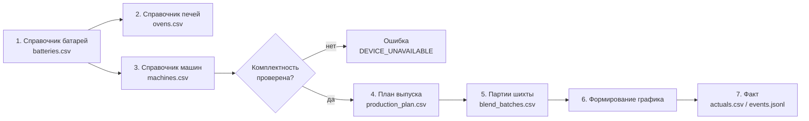

# 04. Форматы файлов импорта

Игорь: **«Формат файлов — полностью на наше усмотрение, можно погуглить примеры
технологических данных. Или целиком смоделировать поступление планов по выпуску
указанного объёма выпуска продукции, и партии поступающей шихты»**.

Ниже — пять форматов. Первые три — обязательные, остальные опциональны.
Каждый доступен в CSV и JSON; CSV — основной, JSON — для сложных вложенных объектов.

## Общие правила

| Правило | Значение |
|---|---|
| Кодировка | UTF-8 **без BOM** (или windows-1251 — определяем автоматически) |
| Разделитель CSV | `;` (точка с запятой), настраивается параметром |
| Заголовки | Обязательны, в первой строке |
| Разделитель даты | `YYYY-MM-DD` |
| Разделитель даты-времени | ISO 8601 `YYYY-MM-DDTHH:MM:SSZ`, всегда UTC |
| Разделитель чисел | `.` (точка), без разделителя тысяч |
| Единицы измерения | Как в [06-справочник-нормативов.md](06-справочник-нормативов.md). Колонки называются `mass_t`, `temp_c`, `moisture_pct` — единица в имени, чтобы не гадать |
| Пустое значение | Пустая ячейка или `null` в JSON. Не «ноль» и не «-» |
| Комментарии | Строки, начинающиеся с `#`, игнорируются |

**Приём отчёта об ошибках.** Импорт не падает целиком. Строки, не прошедшие
валидацию, возвращаются в отчёте с указанием номера строки и причины.

```json
{
  "success": true,
  "data": {
    "jobId": "01J8X5M2Q4",
    "status": "completed_with_errors",
    "totalRows": 4820,
    "acceptedRows": 4817,
    "rejectedRows": [
      {
        "row": 812,
        "column": "moisture_pct",
        "value": "12,5",
        "code": "FORMAT_INVALID",
        "message": "Не удалось распарсить число: использован запятый как десятичный разделитель"
      },
      {
        "row": 2210,
        "column": "blend_code",
        "value": "КЖ-XX",
        "code": "REFERENCE_NOT_FOUND",
        "message": "Марка угля не найдена в справочнике"
      }
    ]
  }
}
```

---

## 1. Справочник батарей — `batteries.csv`

| # | Колонка | Тип | Обяз. | Описание |
|---|---|---|---|---|
| 1 | `code` | string | да | Обозначение, уникально в пределах системы |
| 2 | `name` | string | нет | Отображаемое имя |
| 3 | `oven_count` | int | да | Число печей, 45–75 |
| 4 | `seriality_scheme` | enum | да | `2-1`, `5-2`, `9-2` |
| 5 | `gas_feed_side` | enum | нет | `side` (боковой подвод газа), `bottom` (нижний) |
| 6 | `min_coking_period_min` | int | да | Минимально допустимый период коксования, мин |
| 7 | `default_coking_period_min` | int | да | Текущий рабочий период, мин |
| 8 | `plan_stop_max_min` | int | нет | Максимум планового останова, ≤ 480 |
| 9 | `shift_start_local` | time | нет | Начало смены по местному времени |
| 10 | `length_m` | decimal | нет | Габарит батареи для мнемосхемы |

```csv
code;name;oven_count;seriality_scheme;gas_feed_side;min_coking_period_min;default_coking_period_min;plan_stop_max_min;shift_start_local;length_m
Б-1;Коксовая батарея №1;69;9-2;side;780;840;480;07:00;112.0
Б-2;Коксовая батарея №2;58;5-2;bottom;720;810;480;07:00;94.5
```

---

## 2. Справочник печей — `ovens.csv`

| # | Колонка | Тип | Обяз. | Описание |
|---|---|---|---|---|
| 1 | `battery_code` | string | да | Ссылка на `batteries.code` |
| 2 | `number` | int | да | Номер печи в батарее, 1…`oven_count` |
| 3 | `status` | enum | да | `active`, `repair`, `out_of_series` |
| 4 | `chamber_volume_m3` | decimal | нет | Полезный объём камеры |
| 5 | `useful_length_mm` | int | нет | Полезная длина |
| 6 | `useful_height_mm` | int | нет | Полезная высота |
| 7 | `width_machine_mm` | int | нет | Ширина с машинной стороны |
| 8 | `width_coke_mm` | int | нет | Ширина с коксовой стороны |
| 9 | `width_avg_mm` | int | нет | Средняя ширина |
| 10 | `verticals_per_pier` | int | нет | Вертикалов в простенке |
| 11 | `design_capacity_kt` | decimal | нет | Проектная мощность, тыс. т |

```csv
battery_code;number;status;chamber_volume_m3;useful_length_mm;useful_height_mm;width_machine_mm;width_coke_mm;width_avg_mm;verticals_per_pier
Б-1;1;active;30.1;14100;5200;385;435;410;30
Б-1;2;active;30.1;14100;5200;385;435;410;30
Б-1;3;repair;30.1;14100;5200;385;435;410;30
```

> Печи, перечисляющиеся с пропуском номеров, в серию не входят — это штатная
> ситуация при реконструкции.

---

## 3. Справочник машин — `machines.csv`

| # | Колонка | Тип | Обяз. | Описание |
|---|---|---|---|---|
| 1 | `battery_code` | string | да | Батарея |
| 2 | `code` | string | да | Обозначение машины |
| 3 | `machine_type` | enum | да | `pusher`, `door_machine`, `charging_wagon`, `quench_wagon`, `coal_tower`, `quench_tower`, `ramp`, `sorting` |
| 4 | `status` | enum | да | `running`, `idle`, `failed` |
| 5 | `block` | string | нет | Обслуживаемый блок батарей (для общего тушильного вагона) |

```csv
battery_code;code;machine_type;status;block
Б-1;КВ-1;pusher;running;Б-1
Б-1;ДСМ-1;door_machine;running;Б-1
Б-1;ЗВ-1;charging_wagon;running;Б-1
Б-1;ТВ-1;quench_wagon;running;Б-1_Б-2
Б-1;УТБ-1;coal_tower;running;Б-1_Б-2
Б-1;ТШБ-1;quench_tower;running;Б-1_Б-2
Б-1;РП-1;ramp;running;Б-1_Б-2
Б-1;КС-1;sorting;running;Б-1_Б-2
```

Комплектность проверяется при импорте: на каждую батарею должен приходиться
ровно один `pusher`, один `door_machine`, один `charging_wagon`. Нарушение →
`DEVICE_UNAVAILABLE`, импорт не проходит.

---

## 4. Партии угольной шихты — `blend_batches.csv`

Ключевой файл: именно характеристики шихты определяют требуемый температурный
режим, а через него — период коксования.

| # | Колонка | Тип | Обяз. | Диапазон | Описание |
|---|---|---|---|---|---|
| 1 | `batch_code` | string | да | | Обозначение партии |
| 2 | `received_at` | datetime | да | | Поступление на площадку, UTC |
| 3 | `coal_grade` | string | нет | | Марка угля: `Г`, `ГЖ`, `Ж`, `КЖ`, `К`, `К2`, `ОС`, `С`, `СС` |
| 4 | `mass_t` | decimal | да | > 0 | Масса партии, т |
| 5 | `moisture_pct` | decimal | да | 6–12 | Влажность |
| 6 | `ash_pct` | decimal | да | 5–12 | Зольность |
| 7 | `sulfur_pct` | decimal | да | 0.3–3.5 | Содержание серы |
| 8 | `vdaf_pct` | decimal | нет | 15–37 | Выход летучих веществ, на сухое беззольное |
| 9 | `grain_mm` | decimal | да | 0.1–3.0 | Крупность помола |
| 10 | `bulk_density_tgm3` | decimal | нет | 0.6–0.9 | Насыпная плотность |
| 11 | `supplier` | string | нет | | Поставщик |

```csv
batch_code;received_at;coal_grade;mass_t;moisture_pct;ash_pct;sulfur_pct;vdaf_pct;grain_mm;bulk_density_tgm3;supplier
Ш-2026-0412;2026-10-04T22:00:00Z;КЖ;520;8.4;7.2;0.62;24.5;0.35;0.74;Шахта А
Ш-2026-0413;2026-10-05T06:30:00Z;ГЖ;480;9.1;8.8;0.71;28.2;0.40;0.71;Шахта Б
Ш-2026-0414;2026-10-05T14:00:00Z;К;450;7.9;6.5;0.54;19.8;0.30;0.76;Шахта А
```

**JSON-эквивалент** — для случая, когда партия составная (шихта из нескольких углей):

```json
{
  "batchCode": "Ш-2026-0415",
  "receivedAt": "2026-10-06T02:00:00Z",
  "massT": 610.5,
  "moisturePct": 8.1,
  "ashPct": 7.0,
  "sulfurPct": 0.58,
  "vdafPct": 23.9,
  "grainMm": 0.35,
  "composition": [
    { "coalGrade": "КЖ", "sharePct": 45, "massT": 274.7 },
    { "coalGrade": "ГЖ", "sharePct": 35, "massT": 213.7 },
    { "coalGrade": "К",   "sharePct": 20, "massT": 122.1 }
  ],
  "supplier": "Шахта А"
}
```

> Характеристики шихты напрямую определяют качество кокса: с ростом доли газовых
> углей падает прочность кокса, растут реакционная способность и пористость.

---

## 5. План выпуска — `production_plan.csv`

| # | Колонка | Тип | Обяз. | Описание |
|---|---|---|---|---|
| 1 | `battery_code` | string | да | Батарея |
| 2 | `period_start` | datetime | да | Начало периода |
| 3 | `period_end` | datetime | да | Конец периода, > `period_start` |
| 4 | `target_output_t` | decimal | да | План выпуска кокса, т |
| 5 | `target_moisture_pct` | decimal | нет | Влажность кокса, 5–8 % |
| 6 | `shift_count` | int | нет | Число смен в сутки, по умолчанию 4 |

```csv
battery_code;period_start;period_end;target_output_t;target_moisture_pct;shift_count
Б-1;2026-10-05T00:00:00Z;2026-10-12T00:00:00Z;17400;6.0;4
```

---

## 6. Факт выдачи и загрузки — `actuals.csv`

Нужен, чтобы считать план/факт и коэффициенты равномерности.

| # | Колонка | Тип | Обяз. | Описание |
|---|---|---|---|---|
| 1 | `battery_code` | string | да | Батарея |
| 2 | `oven_number` | int | да | Номер печи |
| 3 | `op_type` | enum | да | `charge`, `discharge`, `quench` |
| 4 | `planned_at` | datetime | нет | Плановое время по графику |
| 5 | `actual_at` | datetime | да | Фактическое время |
| 6 | `charge_mass_t` | decimal | нет | Масса загруженной шихты, т |
| 7 | `coke_mass_t` | decimal | нет | Масса выданного кокса, т |
| 8 | `push_current_a` | int | нет | Ампераж выталкивания. Норма 210, предел 260 |
| 9 | `coking_period_min` | int | нет | Фактический период коксования |
| 10 | `was_in_schedule` | bool | нет | Выдано по графику без нарушений |

```csv
battery_code;oven_number;op_type;planned_at;actual_at;charge_mass_t;coke_mass_t;push_current_a;coking_period_min;was_in_schedule
Б-1;1;discharge;2026-10-05T10:20:00Z;2026-10-05T10:22:00Z;;38.2;208;841;true
Б-1;2;discharge;2026-10-05T11:03:00Z;2026-10-05T11:09:00Z;;37.8;215;846;false
Б-1;3;discharge;2026-10-05T12:30:00Z;2026-10-05T12:55:00Z;;40.1;232;868;false
Б-1;1;charge;2026-10-05T10:26:00Z;2026-10-05T10:33:00Z;40.5;;;;true
```

---

## 7. События симулятора — `events.jsonl`

Потоковая загрузка для воспроизведения сценария. Формат — JSON Lines:
один объект на строку, читается потоково и не требует загрузки в память целиком.

```jsonl
{"ts":"2026-10-05T09:10:00Z","battery":"Б-1","oven":5,"type":"charge_complete","severity":"info","payload":{"massT":39.8}}
{"ts":"2026-10-05T10:20:00Z","battery":"Б-1","oven":1,"type":"push_jam","severity":"critical","payload":{"currentA":262,"limitA":260}}
{"ts":"2026-10-05T10:35:00Z","battery":"Б-1","machine":"ЗВ-1","type":"wheels_ready_for_loading","severity":"info","payload":{}}
{"ts":"2026-10-05T11:05:00Z","battery":"Б-1","oven":1,"type":"coking_complete","severity":"info","payload":{"pileTempC":1048}}
```

Допустимые `type`: `charge_start`, `charge_complete`, `coking_complete`,
`discharge_start`, `push_jam`, `push_complete`, `quench_start`, `quench_complete`,
`wheels_ready_for_loading`, `door_removed`, `door_installed`, `oven_out_of_series`,
`oven_back_in_series`, `machine_failure`, `emergency_stop`.

---

## 8. Шаблоны для выгрузки

`GET /api/v1/import/templates/{kind}`, где `kind` ∈ `equipment`, `blend-batches`,
`production-plan`, `actuals`. Отдаёт CSV с заполненными шапками и 2–3 строками
примера с комментариями, поясняющими допустимые значения.

---

## 9. Порядок загрузки данных



Базовая последовательность для демо:

```bash
# Скачать шаблоны
curl -O $BASE/api/v1/import/templates/equipment
curl -O $BASE/api/v1/import/templates/production-plan
curl -O $BASE/api/v1/import/templates/blend-batches

# Загрузить
curl -X POST $BASE/api/v1/import/equipment \
     -H 'Content-Type: text/csv' \
     --data-binary @equipment.csv
```

Порядок жёсткий не из логики предметной области, а из ссылочной целостности:
печь ссылается на батарею, план — на батарею, партия — на план.