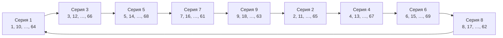
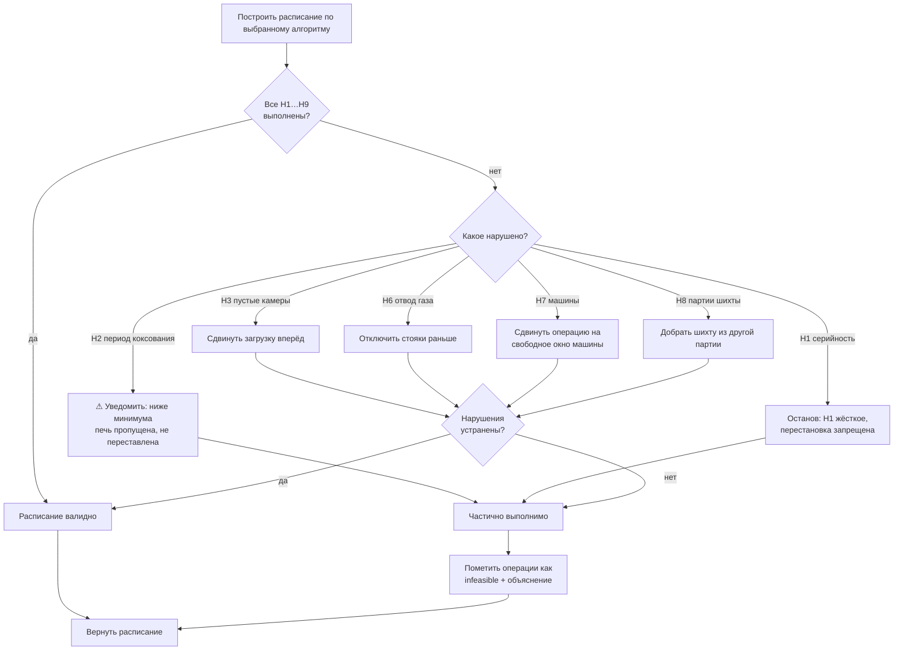
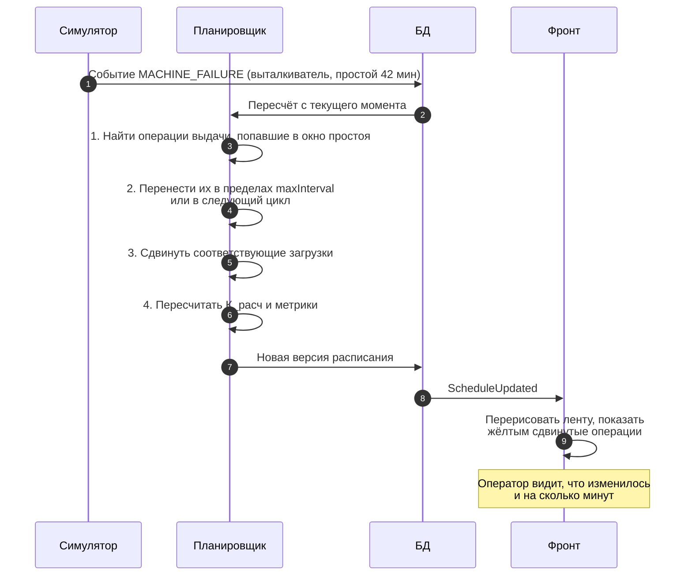

# 05. Алгоритмы планирования: математика

Документ отвечает на вопрос «что именно считает планировщик». Методичка требует
**несколько вариантов алгоритма формирования расписания и их сравнение** по четырём
критериям — значит, это не одна функция, а пространство решений.

---

## 1. Базовые величины

### 1.1 Времена цикла

```
T_кокс   — период коксования (загрузка → выдача), задаётся помесячно
T_обр    — время обработки печи (двери + выталкивание + уборка)
T_рем    — ремонтная часть цикла, 60…90 мин
T_об     — T_кокс + T_обработки   ← это ОБОРОТ печи
T_ц      — T_ц_раб + T_рем        ← это ЦИКЛ графика выдачи
```

**`T_обр` ≈ 15–20 мин**, собирается из нормативов:

| Этап | Норматив |
|---|---|
| Снятие дверей (коксовая + машинная стороны) | от снятия до установки ≤ **10 мин** |
| Печь с открытой дверью | ≤ **5 мин** |
| Выталкивание пирога, ампераж контроль | норма 210 А, предел 260 А |
| Уборка пода, рамы, дверей | входит в ремонтную часть либо в `T_обр` |
| От выдачи до загрузки шихты | ≤ **8 мин** |

**`T_рем` = 1,0–1,5 ч** при обороте 14–15 ч. Цикличная остановка — не менее 2 ч.

### 1.2 Интервал выдачи — центральная величина

За рабочую часть цикла каждая печь батареи выдаётся ровно один раз:

```
Δt_выдачи = T_ц_раб / N_печей
```

**Пример для батареи в 69 печей:**

| Параметр | Значение |
|---|---|
| `T_кокс` | 825 мин |
| `T_обр` | 15 мин |
| `T_об` (оборот печи) | 840 мин = 14,0 ч |
| `T_рем` | 75 мин (1,25 ч) |
| `T_ц` (цикл) | 915 мин = 15,25 ч |
| `T_ц_раб` | 840 мин |
| **`Δt_выдачи`** | **840 / 69 = 12,2 мин** |

Отсюда становится понятна нормативная практика «**поминутного графика с точностью
до одной минуты**»: при 69 печах точность в минуту — это уже 8 % межвыдавочного
интервала, грубее нельзя.

И обратно: **допустимый шаг между операциями** — ручка из блока «Управление графиком»
на макете — это `Δt_выдачи ± допуск`. Максимальное время между выдачами
(`maxIntervalBetweenDischargesMin`, 30 мин в примере контракта) — это примерно
2,5 × `Δt`.

`maxInterval` — **мягкий порог, а не мандат на перестановку**. Превышение не даёт права
нарушить серийность: H1 остаётся жёстким. Порог запускает трёхступенчатую политику:

1. **держать** — пока перестой кокса в пределах допуска (`toleranceMin`, 5 мин);
2. **уведомить** — после `holdNotifyMin` оператор получает карточку с правом вывести
   печь из серии;
3. **пропустить** — по решению оператора, либо автоматически после `holdAutoSkipMin`,
   если авто-пропуск включён в настройках прогона.

Пропуск не ускоряет поток и не переставляет печи: он вырезает одну печь, остальные идут
в свои слоты. Полная механика — [`10-исключение-печей.md`](10-исключение-печей.md).

### 1.3 Норма выдачи за смену

```
норма_выдачи = N_печей × (T_смены / T_об)
```

Для смены 8 ч при обороте 840 мин: `69 × 480/840 ≈ 39 печей за смену`.
В конце смены выдачу уменьшают — на уборку машин и передачу смены уходит **≈20 мин**.

---

## 2. Серийность: математика порядка выдачи

Серийность — не косметика. Она обеспечивает **одинаковый тепловой режим простенков
по длине батареи** и сохранность кладки.

### 2.1 Формат записи

Серийность записывается двумя цифрами: `S–K`.

| Цифра | Что означает |
|---|---|
| **Первая (`S`)** | Число серий. Одновременно — шаг между номерами печей внутри одной серии |
| **Вторая (`K`)** | Шаг перехода к следующей серии по номеру серии. Следующая серия: `((i − 1 + K) mod S) + 1` |

В MVP используется сквозная нумерация печей `1…N`; номера, оканчивающиеся
на ноль, не пропускаются.

Для `9-2` это означает:

- девять серий;
- внутри серии печи идут через девять: `1, 10, 19, 28, …`;
- следующая серия выбирается с шагом два: `1 → 3 → 5 → 7 → 9 → 2 → 4 → 6 → 8`;
- после серии `9` идёт серия `2`, после серии `8` — снова `1`.

### 2.2 Построение серий

Печь с номером `n` принадлежит серии `((n − 1) mod S) + 1`.
Серии обходятся циклически с шагом `K` по модулю `S`.
Для полного обхода всех серий необходимо `gcd(S, K) = 1`.



### 2.3 Пример для 69 печей

Порядок строк в таблице — это и есть порядок выдачи серий.

| Схема | Серия | Раскладка по серии | Выдач на серию |
|---|---:|---|---:|
| **9-2** | 1 | 1, 10, 19, …, 64 | 8 |
| | 3 | 3, 12, 21, …, 66 | 8 |
| | 5 | 5, 14, 23, …, 68 | 8 |
| | 7 | 7, 16, 25, …, 61 | 7 |
| | 9 | 9, 18, 27, …, 63 | 7 |
| | 2 | 2, 11, 20, …, 65 | 8 |
| | 4 | 4, 13, 22, …, 67 | 8 |
| | 6 | 6, 15, 24, …, 69 | 8 |
| | 8 | 8, 17, 26, …, 62 | 7 |
| **5-2** | 1 | 1, 6, 11, …, 66 | 14 |
| | 3 | 3, 8, 13, …, 68 | 14 |
| | 5 | 5, 10, 15, …, 65 | 13 |
| | 2 | 2, 7, 12, …, 67 | 14 |
| | 4 | 4, 9, 14, …, 69 | 14 |
| **2-1** | 1 | нечётные 1, 3, …, 69 | 35 |
| | 2 | чётные 2, 4, …, 68 | 34 |

Проверка для 9-2: `8 + 8 + 8 + 7 + 7 + 8 + 8 + 8 + 7 = 69` ✓.
Для 5-2: `14 + 14 + 13 + 14 + 14 = 69` ✓.
Для 2-1: `35 + 34 = 69` ✓.

> **Принятая трактовка.** Первая цифра задаёт число серий и шаг внутри серии,
> вторая — шаг между сериями. Это согласовано с примером `9-2`: после серии 1
> идёт серия 3, а не серия 2. Старая трактовка «K — интервал между выдачами»
> отвергнута.

### 2.4 Ограничение серийности

Порядок выдачи строится как конкатенация серий в порядке `S–K`:

```
order = concat(
  [r, r + S, r + 2S, … ≤ N]  для r = 1, 3, 5, 7, 9, 2, 4, 6, 8
)
```

Внутри серии номера печей строго возрастают с шагом `S`.
Серии не перемешиваются: все печи одной серии выдаются до перехода
к следующей серии. `K` — комбинаторный шаг по номерам серий, а не
временной интервал между выдачами.

Нарушение этого порядка — не «сбой оптимальности», а нарушение теплового
режима батареи. В контракте API ему соответствует код `SERIALITY_VIOLATION`.

---

## 3. Формальная модель ограничений

### Жёсткие — нарушение делает расписание недопустимым

| # | Ограничение | Формализация |
|---|---|---|
| H1 | Серийность | порядок выдачи соответствует `S–K` |
| H2 | Период коксования не ниже минимума | `T_кокс ≥ T_кокс_min` |
| H3 | Не более одной пустой камеры | `|{печи с op_выдача < op_загрузка}| ≤ 1` |
| H4 | Время выдача → загрузка | `t_загрузка − t_выдача ≤ 8 мин` (≤ 18 при пустой камере) |
| H5 | Печь с открытой дверью | `≤ 5 мин` |
| H6 | Отвод от газосборника | `t_выдача − t_отключения ≥ 20 мин` |
| H7 | Одна машина — одна операция | `∀ m: интервалы заданий m не пересекаются` |
| H8 | Память партии шихты | суммарный расход ≤ остаток по каждой партии |
| H9 | План выпуска | суммарный выход ≥ `target_output_t` |

### Мягкие — планировщик штрафует, но не запрещает

| # | Ограничение | Штраф |
|---|---|---|
| S1 | Отклонение периода коксования | `w₁ × max(0, |ΔT| − 5 мин)` |
| S2 | Интервал между выдачами одной печи | `w₂ × max(0, интервал − maxInterval)` |
| S3 | Разброс загрузки между печами | `w₃ × (ОЕЭ_max − ОЕЭ_min)` |
| S4 | Простой оборудования | `w₄ × Σ простоев` |
| S5 | Отклонение от плана выпуска | `w₅ × |факт − план|` |

---

## 4. Целевая функция

Минимизируем взвешенную сумму штрафов, **жёсткие ограничения проверяем отдельно**:

```
minimize   F = w₁·Σ S₁  +  w₂·Σ S₂  +  w₃·S₃  +  w₄·S₄  +  w₅·S₅

subject to H1 … H9
```

Веса задаются в `params` расписания и входят в сравнение алгоритмов —
иначе сравнение нечестное.

---

## 5. Варианты алгоритмов

Методичка требует «несколько вариантов алгоритма формирования расписания».
В демо идут **три**, и все три сохраняют один и тот же порядок печей:

| Код | Имя | Что оптимизирует |
|---|---|---|
| `b1_fifo` | B1 FIFO | ничего — эталон с постоянным интервалом |
| `b2_idle` | B2 idle | простой: догоняет долг как можно быстрее |
| `b3_smooth` | B3 smooth | равномерность: размазывает долг по остатку прохода |

Четвёртый вариант, B4 `shortest`, **отвергнут**: он сортирует печи по остатку кокса,
то есть меняет порядок и нарушает H1. Подробнее — в конце раздела.

Главная ось сравнения — **B2 против B3**: два разных способа погасить один и тот же
долг. B1 остаётся контрольной точкой, без него «B3 сэкономил 30 минут» не измерить.

### B1 `fifo` — равномерный FIFO (базовый)

```
1. Разбить печи на серии по S–K
2. Построить очередь: серия за серией, внутри серии — по номеру
3. t[i] = t[0] + i × Δt_выдачи
4. t_загрузка[i] = t_выдача[i] + T_обработки
```

Не учитывает простои. Все срывы «съезжают» на последние печи цикла —
это и делает его плохим эталоном.

### B2 `idle` — догон долга

B1 и B2 строят один и тот же порядок и один и тот же базовый слот. Разница — что делать
с задержкой, которую дал отказ.

```
1. Построить базовый FIFO: t_i = i × Δt
2. На позиции возмущения вычислить долг D = факт(i₀) − план(i₀)
3. Гасить долг как можно быстрее: каждый следующий интервал сжимать
   до minInterval (≈ 8,7 мин), пока долг не погашен или пока не упёрлись
   в готовность печи (readyAt) и занятость машин
4. Непогашенный остаток переносится на следующий проход
5. Проверить H1…H9; при нарушении — уменьшить сжатие, а не откатывать всё
```

Целевой показатель — минимальный `totalIdleMin`: чем раньше поток вернётся к норме,
тем меньше печей и машин стоят. Плата — рваный ритм: после отказа несколько интервалов
короткие, потом снова ровные.

#### Почему B1 нельзя убрать, хотя B2 его доминирует

B2 — надмножество B1: он делает то же самое и добавляет сдвиги, откатывая их при нарушении
H1–H9. Поэтому B2 **не может быть хуже B1 по построению**: B1 — не соперник, а нижняя
граница, от которой считается выигрыш.

Из этого не следует, что сравнение бессмысленно:

| Роль B1 | Что даёт |
|---|---|
| Эталон | без него фраза «B2 сэкономил 40 минут простоя» не имеет смысла |
| Реальная практика | заводы работают по жёсткому циклу, B1 — не соломенное чучело |
| Страховка | при нулевом запасе B2 вырождается в B1, и это ожидаемое поведение, а не сбой |

Доминирование не абсолютное. B2 может проиграть:

- по **равномерности** (M3, M4) — он сжимает интервалы, растёт разброс ОЕЭ;
- **B3 smooth** — по максимальной передержке (M9) и разбросу интервалов (M8);
- при **двух отказах подряд** — первый отказ сжигает запас, второй бьёт больнее;
- при **недостоверной готовности** — B1 детерминирован и не зависит от `r_i`.

Отсюда формулировка для защиты: B1 — **эталон**, а не соперник; вопрос не «какой алгоритм
выбрать», а «чем платим за гибкий интервал и когда это оправдано». Цифры сравнения нужны
как доказательство, что победитель выбран не произвольно (`docs/09` §9).

### B3 `smooth` — сглаживание долга

Тот же порядок, тот же базовый слот, тот же запас восстановления. Отличие одно:
долг гасится **равномерно**, а не залпом.

```
1. Построить базовый FIFO: t_i = i × Δt
2. На позиции возмущения вычислить долг D = факт(i₀) − план(i₀)
3. Остаток прохода R = N − i₀; сжатие одного интервала
     δ = min(D / R, Δt − minInterval)
4. t_i = max(readyAt(i), план(i) − δ × (i − i₀)) для i > i₀
5. Если готовность печи не даёт сжать — фактический δ меньше,
   остаток долга D − δ × R переносится на следующий проход
6. Проверить H1…H9; при нарушении — уменьшить δ, а не откатывать всё
```

Свойства, которые надо проверять тестом:

- **без возмущений B3 совпадает с B1** (`δ = 0`) — это не отдельный график, а тот же
  график с плавным восстановлением;
- **H1 не зависит от алгоритма**: порядок строится один раз и не меняется;
- **скорость восстановления — не параметр, а следствие** `readyAt`, `minInterval` и
  занятости машин. Замерено ≈ 3 мин/оборот; тест фиксирует это число, а не подставляет.

Сравнение политик на одном и том же отказе:

| | B2 `idle` | B3 `smooth` |
|---|---|---|
| Как гасит долг | залпом, до `minInterval` | равномерно по остатку прохода |
| Максимальная передержка (M9) | выше у первых печей | ниже |
| Простой (M5) | **ниже** | чуть выше |
| Разброс интервалов (M8) | высокий | **низкий** |
| Профиль восстановления | быстро, потом ровно | плавно весь проход |

Это и есть главная ось демо: **два способа потратить один и тот же запас**.
Ни один не лучше по всем метрикам, поэтому выбор содержателен.

### B4 `shortest` — отвергнут

Сортировка печей по остатку кокса `r_i` меняет порядок выдачи, то есть нарушает H1.
Это не алгоритм, а перестановка. Остаток кокса должен влиять на **время** внутри
фиксированного порядка (это делает B3), а не на место печи в очереди.

### Исключение печей — не алгоритм

Есть третья, независимая ось: что делать с печью, которую нельзя выдать (держать, пропустить
или форсировать). Она описана в [`10-исключение-печей.md`](10-исключение-печей.md).

B1–B3 отвечают **только за времена**, порядок печей у них общий. Политика исключений
смешивается с алгоритмом иначе: исключение уменьшает число выдач и тем самым «улучшает»
просрочку. Поэтому исключения — отдельный параметр прогона и отдельная метрика, а не пятый
алгоритм.

---

## 6. Метрики сравнения

Четыре критерия из методички + служебные.

| # | Метрика | Формула | Лучше |
|---|---|---|---|
| M1 | Просроченные операции | `count(op.факт > op.план + 5 мин)` | меньше |
| M2 | Суммарная просрочка | `Σ max(0, факт − план)` мин | меньше |
| M3 | **Равномерность загрузки** | `100 × min(ОЕЭ) / max(ОЕЭ)` | больше |
| M4 | Разброс ОЕЭ | `max(ОЕЭ) − min(ОЕЭ)`, п.п. | меньше |
| M5 | **Простой** | `Σ` простоев машин и печей, мин | меньше |
| M6 | **Проверяемые нарушения** | `count(H1 и H4 нарушено)` | меньше |
| M7 | **К_расч** | `(м − а) / м` — см. [00](00-предметная-область.md) | больше |
| M8 | **Разброс интервалов** | СКО интервалов между выдачами, мин | меньше |
| M9 | **Максимальная передержка** | `max(pushStart − readyAt)`, мин | меньше |

M8 и M9 — метрики, ради которых существует B3 `smooth`. Без них сравнение B2 и B3
сводится к «у кого меньше простой», а это ровно то, что B2 оптимизирует по построению.

### Равномерность и ОЕЭ печи

```
ОЕЭ_печи = (время_работы) / (время_цикла − простои)
время_работы = T_кокс_факт
```

Это ровно та метрика, по которой куратор оценивает карточку печи
(«ОЕЕ 91,2 %» на макете). Диапазон нормы — 85–93 %, при выходе за 90 %
интерпретация упрощается.

### Чего ожидаем от сравнения B2 и B3

Числа подставляются после замера, здесь фиксируется только **направление**. Если замер
даст другой знак — так и пишем, подгонять нельзя.

| Критерий | B1 эталон | B2 `idle` | B3 `smooth` |
|---|---|---|---|
| Просрочено операций (M1) | база | меньше | меньше |
| Суммарная просрочка (M2) | база | меньше | чуть больше B2 |
| Простой (M5) | база | **минимум** | чуть выше |
| Макс. передержка (M9) | база | выше | **минимум** |
| Разброс интервалов (M8) | база | выше | **минимум** |
| Нарушения проверяемых H1/H4 (M6) | 0 | 0 | 0 |

Смысл таблицы: **B2 и B3 тратят один и тот же запас восстановления по-разному**.
B2 выигрывает темпом, B3 — тепловым режимом. Именно поэтому выбор между ними
содержателен, а «B2 против B1» — нет: B2 доминирует B1 по построению.

---

## 7. Где это реализуется в коде

Фактическая реализация находится в `simulator/src/main/java/ru/evraz/koks/sim/planner/`:

- `ScheduleInput` — единый срез входных данных: порядок печей, готовность, физически возможное время, шаг и горизонт;
- `ScheduleAlgorithm` — контракт планировщика и монотонность времён;
- `B1Fifo` — базовая сетка FIFO;
- `B2Idle` — назначение на самое раннее физически возможное время, но не раньше слота;
- `B3Smooth` — равномерное погашение долга с ограничением минимального интервала;
- `Metrics` — метрики M1–M9.

Spring-слой находится в `src/main/java/org/example/coke_factory/service/ScheduleRunService.java`:
он получает вход из `SimulatorService`, строит план, выполняет офлайн-реплей,
сохраняет прогон и операции, а затем синхронизирует статусы по фактическим выдачам.

**Граница реализации ограничений:** `Metrics` автоматически проверяет H1 (серийность)
и H4 (время от выдачи до загрузки). H2, H3, H5, H6, H7, H8 и H9 пока не имеют
полных валидаторов. Поэтому M6 в текущей версии нельзя подписывать как «проверка H1–H9».

## 8. Что делает планировщик при неразрешимых ограничениях

Реальность чаще нарушает ограничения, чем не нарушает. Порядок деградации:



Ключевое: **расписание всегда возвращается**, даже если часть операций
невыполнима. Оператор должен видеть не пустоту, а объяснение: какая печь,
почему не выдаётся и что делать. Соответствует статусу `infeasible` в модели
статусов из [02-модель-данных.md](02-модель-данных.md).

---

## 9. Реакция на простои в работающем графике

Отдельный сценарий: график уже утверждён, в середине цикла выходит из строя
коксовыталкиватель или печь выводится из серии.



**Важно:** форсирование выдачи после простоя ограничено — не более
**1–2 печи/час** сверх нормы, иначе ухудшается качество обработки печей.
Значит, при Δt = 12,2 мин (≈ 4,9 печи/час) форсированный интервал
не может быть меньше `60 / (4,9 + 2) ≈ 8,7` мин. Это ограничение
форсирования живёт в планировщике как **жёсткое**, иначе он предложит
нереализуемый график.

Каждая пересчитанная версия расписания сохраняется как новый `SCHEDULE_RUN`
с пометкой `reason` в журнале действий. История графика — часть требования
кейса «журнал изменений и действий пользователя».