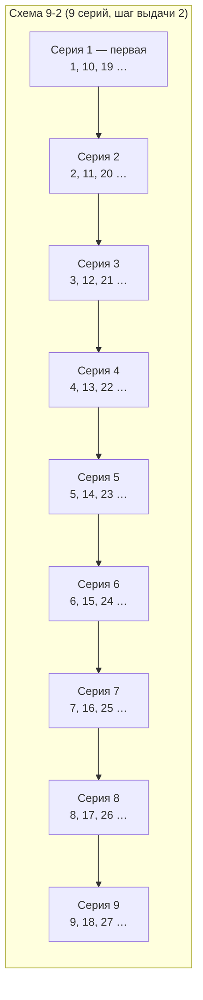
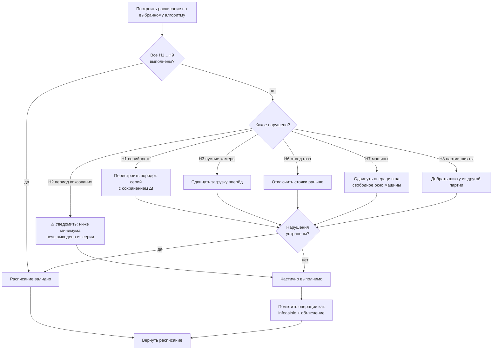
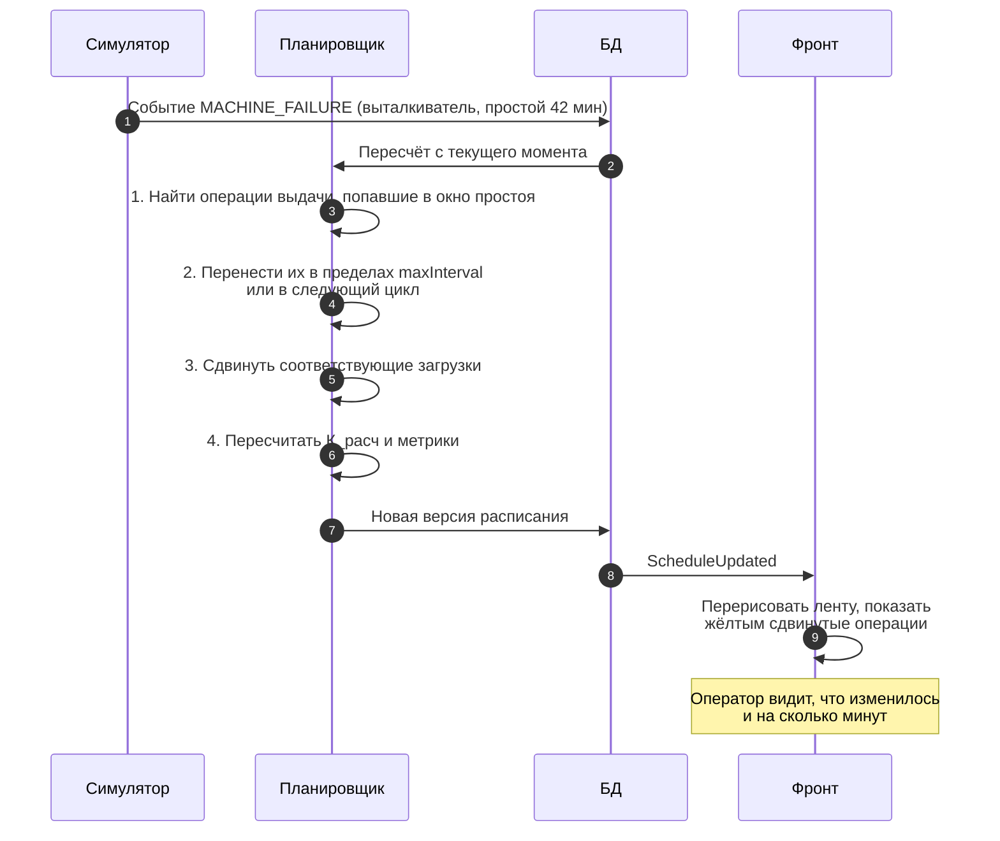

# 05. Алгоритмы планирования: математика

Документ отвечает на вопрос «что именно считает планировщик». Методичка требует
**несколько вариантов алгоритма формирования расписания и их сравнение** по четырём
критериям — значит, это не одна функция, а пространство решений.

---

## 1. Базовые величины

### 1.1 Времена цикла

```
T_кокс   — период коксования (загрузка → выдача), задаётся помесячно
T_обр    — время обработки печи (двери + выталкивание + уборка)
T_рем    — ремонтная часть цикла, 60…90 мин
T_об     — T_кокс + T_обработки   ← это ОБОРОТ печи
T_ц      — T_ц_раб + T_рем        ← это ЦИКЛ графика выдачи
```

**`T_обр` ≈ 15–20 мин**, собирается из нормативов:

| Этап | Норматив |
|---|---|
| Снятие дверей (коксовая + машинная стороны) | от снятия до установки ≤ **10 мин** |
| Печь с открытой дверью | ≤ **5 мин** |
| Выталкивание пирога, ампераж контроль | норма 210 А, предел 260 А |
| Уборка пода, рамы, дверей | входит в ремонтную часть либо в `T_обр` |
| От выдачи до загрузки шихты | ≤ **8 мин** |

**`T_рем` = 1,0–1,5 ч** при обороте 14–15 ч. Цикличная остановка — не менее 2 ч.

### 1.2 Интервал выдачи — центральная величина

За рабочую часть цикла каждая печь батареи выдаётся ровно один раз:

```
Δt_выдачи = T_ц_раб / N_печей
```

**Пример для батареи в 69 печей:**

| Параметр | Значение |
|---|---|
| `T_кокс` | 825 мин |
| `T_обр` | 15 мин |
| `T_об` (оборот печи) | 840 мин = 14,0 ч |
| `T_рем` | 75 мин (1,25 ч) |
| `T_ц` (цикл) | 915 мин = 15,25 ч |
| `T_ц_раб` | 840 мин |
| **`Δt_выдачи`** | **840 / 69 = 12,2 мин** |

Отсюда становится понятна нормативная практика «**поминутного графика с точностью
до одной минуты**»: при 69 печах точность в минуту — это уже 8 % межвыдавочного
интервала, грубее нельзя.

И обратно: **допустимый шаг между операциями** — ручка из блока «Управление графиком»
на макете — это `Δt_выдачи ± допуск`. Максимальное время между выдачами
(`maxIntervalBetweenDischargesMin`, 30 мин в примере контракта) — это примерно
2,5 × `Δt`: если интервал превысил 30 минут, печь остывает, и планировщик обязан
выдать её вне очереди.

### 1.3 Норма выдачи за смену

```
норма_выдачи = N_печей × (T_смены / T_об)
```

Для смены 8 ч при обороте 840 мин: `69 × 480/840 ≈ 39 печей за смену`.
В конце смены выдачу уменьшают — на уборку машин и передачу смены уходит **≈20 мин**.

---

## 2. Серийность: математика порядка выдачи

Серийность — не косметика. Она обеспечивает **одинаковый тепловой режим простенков
по длине батареи** и сохранность кладки.

### 2.1 Формат записи

Серийность записывается двумя цифрами: `S–K`.

| Цифра | Что означает |
|---|---|
| **Первая (`S`)** | На сколько серий разделены печи батареи. Одновременно — шаг нумерации печей внутри серии |
| **Вторая (`K`)** | Интервал между выдачами печей внутри серии. В первой серии выдача идёт подряд; в последующих — через указанное число позиций |

Печи, оканчивающиеся на ноль, из нумерации исключаются — на них нет стояков
с предусмотренным отводом.

### 2.2 Построение серий

Печь с номером `n` принадлежит серии `((n − 1) mod S) + 1`:



### 2.3 Пример для 69 печей

| Схема | Серий | Раскладка по сериям | Выдач на серию |
|---|---|---|---|
| **9-2** | 9 | 1,10,19,…,64 | 8 |
| | | 2,11,20,…,65 | 8 |
| | | … | … |
| | | 7,16,25,…,61 | 7 |
| **5-2** | 5 | 1,6,11,…,66 | 14 |
| | | 2,7,12,…,67 | 14 |
| | | 5,10,15,…,65 | 13 |
| **2-1** | 2 | нечётные 1,3,…,69 | 35 |
| | | чётные 2,4,…,68 | 34 |

Проверка для 5-2: `14 × 4 + 13 = 69` ✓. Для 2-1: `35 + 34 = 69` ✓.

> **Открытый вопрос куратору.** Трактовка второй цифры в литературе расходится:
> как шаг нумерации внутри серии или как интервал выдачи. В модели данных это
> параметр `serialityScheme`, поэтому переключить трактовку — изменение одной
> функции, а не миграция. Нужно подтвердить на реальном примере.

### 2.4 Ограничение серийности

```
∀ i:  t_выдачи(S_i) < t_выдачи(S_{i+1})
и
∀ печей p, q одной серии, |t(p) − t(q)| ≥ K × Δt_выдачи
```

Нарушение этого ограничения — не «сбой оптимальности», а нарушение теплового
режима батареи. В контракте API ему соответствует код `SERIALITY_VIOLATION`.

---

## 3. Формальная модель ограничений

### Жёсткие — нарушение делает расписание недопустимым

| # | Ограничение | Формализация |
|---|---|---|
| H1 | Серийность | порядок выдачи соответствует `S–K` |
| H2 | Период коксования не ниже минимума | `T_кокс ≥ T_кокс_min` |
| H3 | Не более одной пустой камеры | `|{печи с op_выдача < op_загрузка}| ≤ 1` |
| H4 | Время выдача → загрузка | `t_загрузка − t_выдача ≤ 8 мин` (≤ 18 при пустой камере) |
| H5 | Печь с открытой дверью | `≤ 5 мин` |
| H6 | Отвод от газосборника | `t_выдача − t_отключения ≥ 20 мин` |
| H7 | Одна машина — одна операция | `∀ m: интервалы заданий m не пересекаются` |
| H8 | Память партии шихты | суммарный расход ≤ остаток по каждой партии |
| H9 | План выпуска | суммарный выход ≥ `target_output_t` |

### Мягкие — планировщик штрафует, но не запрещает

| # | Ограничение | Штраф |
|---|---|---|
| S1 | Отклонение периода коксования | `w₁ × max(0, |ΔT| − 5 мин)` |
| S2 | Интервал между выдачами одной печи | `w₂ × max(0, интервал − maxInterval)` |
| S3 | Разброс загрузки между печами | `w₃ × (ОЕЭ_max − ОЕЭ_min)` |
| S4 | Простой оборудования | `w₄ × Σ простоев` |
| S5 | Отклонение от плана выпуска | `w₅ × |факт − план|` |

---

## 4. Целевая функция

Минимизируем взвешенную сумму штрафов, **жёсткие ограничения проверяем отдельно**:

```
minimize   F = w₁·Σ S₁  +  w₂·Σ S₂  +  w₃·S₃  +  w₄·S₄  +  w₅·S₅

subject to H1 … H9
```

Веса задаются в `params` расписания и входят в сравнение алгоритмов —
иначе сравнение нечестное.

---

## 5. Варианты алгоритмов

Методичка требует «несколько вариантов алгоритма формирования расписания».
Предлагается четыре — от наивного к умному, чтобы разброс метрик был показателен.

### B1 `fifo` — равномерный FIFO (базовый)

```
1. Разбить печи на серии по S–K
2. Построить очередь: серия за серией, внутри серии — по номеру
3. t[i] = t[0] + i × Δt_выдачи
4. t_загрузка[i] = t_выдача[i] + T_обработки
```

Не учитывает простои и приоритеты. Все срывы «съезжают» на последние печи цикла —
это и делает его плохим эталоном.

### B2 `idle` — минимизация простоя

```
1. Построить базовый FIFO
2. Для каждой операции, задержанной из-за простоя машины:
     найти ближайшую печь в том же цикле, которую можно сдвинуть
     в пределах (t − maxInterval, t + жёсткий сдвиг)
3. Каскадно пересчитать t_загрузка
4. Проверить H1…H9; при нарушении — откатить сдвиг
```

Целевой показатель — минимальный `totalIdleMin`. Именно он на макете показан
как «Простой, мин» с лучшим значением 75.

### B3 `priority` — приоритетный

```
1. Построить базовый FIFO
2. Вставить в очередь печи с аварийным приоритетом:
     сдвинуть вперёд до ближайшей допустимой позиции по серийности
3. Ограничить: t ≥ текущее время + T_минимальной_подготовки
4. Пересчитать циклы затронутых печей
```

Учитывает ручку «приоритетность срочных заказов» с макета
и параметр `leadTimeToFailureMin` («время до срыва»).

### B4 `shortest` — по возрастанию остатка кокса

```
1. Для каждой печи вычислить остаток:
     r_i = T_кокс_факт − (now − t_загрузка)
2. Сортировать печи по r_i ↑ (кто ближе к готовности — тот первый)
3. Распределить по серийности, сохраняя порядок серий
```

Минимизирует «перестой кокса» — самый дорогой с точки зрения качества исход.

---

## 6. Метрики сравнения

Четыре критерия из методички + служебные.

| # | Метрика | Формула | Лучше |
|---|---|---|---|
| M1 | Просроченные операции | `count(op.факт > op.план + 5 мин)` | меньше |
| M2 | Суммарная просрочка | `Σ max(0, факт − план)` мин | меньше |
| M3 | **Равномерность загрузки** | `100 × min(ОЕЭ) / max(ОЕЭ)` | больше |
| M4 | Разброс ОЕЭ | `max(ОЕЭ) − min(ОЕЭ)`, п.п. | меньше |
| M5 | **Простой** | `Σ` простоев машин и печей, мин | меньше |
| M6 | **Нарушения ограничений** | `count(H1…H9 нарушено)` | меньше |
| M7 | **К_расч** | `(м − а) / м` — см. [00](00-предметная-область.md) | больше |

### Равномерность и ОЕЭ печи

```
ОЕЭ_печи = (время_работы) / (время_цикла − простои)
время_работы = T_кокс_факт
```

Это ровно та метрика, по которой куратор оценивает карточку печи
(«ОЕЕ 91,2 %» на макете). Диапазон нормы — 85–93 %, при выходе за 90 %
интерпретация упрощается.

### Пример с макета

| Критерий | B1 FIFO | B2 Простой | B3 Срочные |
|---|---|---|---|
| Просрочено операций | 3 | **1** ✓ | 1 |
| Равномерность, % | 18 | **75** ✓ | 68 |
| Простой, мин | 140 | **95** ✓ | 112 |
| Нарушений (тех.) | 2 | **0** ✓ | 0 |

Видно, что B2 доминирует — но так будет **не всегда**. B3 выигрывает, когда
есть срочные заказы: он жертвует равномерностью ради исполнения приоритета.
Именно поэтому сравнение нужно в интерфейсе, а не в голове.

---

## 7. Где это реализуется в коде

Пакет `ru.evraz.koks.service.planner` — **чистый Java без Spring**.

Это осознанное требование, а не стилистический выбор. Куратор поставил условие:

> «Нарисовать можно ещё много всего, но если бэка под этими ручками не будет —
> получится не круто».

Планировщик — самая рискованная часть проекта: именно её отладка занимает
больше всего времени. Если она зависит от контекста Spring, то каждый юнит-тест
поднимает контекст, и итерация замедляется в разы.

```java
public final class SerialityPlanner {

    /** Собирает печи в серии по схеме S-K.
     *  Трактовка второй цифры вынесена в отдельный параметр:
     *  в литературе встречаются две, см. примечание в §2.3. */
    public static List<Integer> buildSeries(int ovenCount, SerialityScheme scheme) { … }

    /** Δt выдачи = T_ц_раб / N_печей */
    public static int dischargeIntervalMin(int cycleWorkMin, int ovenCount) { … }

    /** Строит порядок выдачи с учётом простоев и приоритетов. */
    public static ScheduleResult build(ScheduleInput input, AlgorithmCode algo) { … }
}
```

Структура:

```
service/planner/
├── SerialityPlanner.java      # серийность → порядок выдачи
├── CycleCalculator.java       # T_кокс, T_об, T_ц, Δt
├── constraint/                # проверки H1…H9, каждая — отдельный класс
├── algorithm/                 # FifoPlanner, IdlePlanner, PriorityPlanner
├── metrics/                   # K_расч, ОЕЭ, простой, просрочки
└── model/                     # ScheduleInput, ScheduleResult, records
```

Алгоритмы реализуются как один интерфейс — так их можно прогнать в цикле
и сравнить на одинаковых входных данных, что и требует методичка:

```java
public interface ScheduleAlgorithm {
    AlgorithmCode code();
    ScheduleResult build(ScheduleInput input);
}
```

Тесты — обычные JUnit, без Spring:

```java
@Test
void fifo_lateOperations_appearInLastOvensOfCycle() { … }
```

---

## 8. Что делает планировщик при неразрешимых ограничениях

Реальность чаще нарушает ограничения, чем не нарушает. Порядок деградации:



Ключевое: **расписание всегда возвращается**, даже если часть операций
невыполнима. Оператор должен видеть не пустоту, а объяснение: какая печь,
почему не выдаётся и что делать. Соответствует статусу `infeasible` в модели
статусов из [02-модель-данных.md](02-модель-данных.md).

---

## 9. Реакция на простои в работающем графике

Отдельный сценарий: график уже утверждён, в середине цикла выходит из строя
коксовыталкиватель или печь выводится из серии.



**Важно:** форсирование выдачи после простоя ограничено — не более
**1–2 печи/час** сверх нормы, иначе ухудшается качество обработки печей.
Значит, при Δt = 12,2 мин (≈ 4,9 печи/час) форсированный интервал
не может быть меньше `60 / (4,9 + 2) ≈ 8,7` мин. Это ограничение
форсирования живёт в планировщике как **жёсткое**, иначе он предложит
нереализуемый график.

Каждая пересчитанная версия расписания сохраняется как новый `SCHEDULE_RUN`
с пометкой `reason` в журнале действий. История графика — часть требования
кейса «журнал изменений и действий пользователя».