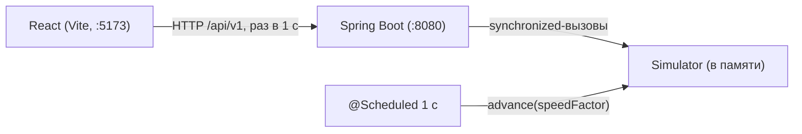

# 08. Интеграция симулятора и фронта (MVP)

Коротко: **один симулятор, одна батарея, без БД, пользователей и авторизации.**
Spring-бэкенд держит единственный экземпляр `Simulator` в памяти, раз в секунду
двигает его и отдаёт фронту JSON. Фронт опрашивает API раз в секунду. Этого
достаточно, чтобы уже сейчас показать живую батарею вместо хардкода.

Этот документ — рабочий контракт на время склейки. Полный целевой контракт
лежит в [03-контракт-api.md](03-контракт-api.md); здесь только то, что нужно
сделать сейчас.

## TL;DR

1. Бэкенд: `backend/` + composite build, один `Simulator` в сервисе,
   `@Scheduled` раз в секунду.
2. Отдать read-эндпоинты: `/battery`, `/state`, `/ovens`, `/machines`,
   `/feed`, `/events`.
3. Фронт: `client.js` + опрос раз в секунду, убрать `getOvenData`, число
   печей брать из ответа (69, не 60).
4. Управление: `start/pause/step/reset`, конфиг, «Сгенерировать отказ».
5. Пока нет: БД, авторизации, STOMP, планировщика B2–B4, телеметрии.
6. Приёмка: 69 печей, машины двигаются, отказ виден, пауза работает.

---

## 1. Что готово и чего нет

| Блок | Состояние |
|---|---|
| `simulator/` | готов: движок, машины, отказы, прогноз, 31 тест |
| Бэкенд `backend/` | **нет**, создаём с нуля |
| Фронт | статический React, данные захардкожены, слоя API нет |
| БД / пользователи / роли | не нужны для MVP |
| Планировщик B1–B4 | не реализован, кроме порядка серийности |
| Телеметрия (температуры, ампераж) | в симуляторе отсутствует |
| WebSocket / STOMP | позже; сейчас polling раз в секунду |

Допущения MVP:

- один экземпляр бэкенда, один `Simulator`, одна батарея Б-1 на 69 печей;
- все данные живут в памяти, после рестарта бэкенда симуляция начинается заново;
- идентификаторы батареи/печей — это номера, UUID не нужны;
- авторизации нет, CORS закрываем через прокси Vite;
- фронт не обращается к симулятору напрямую, только к REST.

---

## 2. Архитектура



- Бэкенд — единственный владелец `Simulator`.
- `advance()` и чтение снимков сериализуются (`synchronized` в сервисе): движок
  не потокобезопасен.
- Модельное время — минуты от 0. Наружу отдаём ISO UTC от фиксированного якоря
  `t0 = 2026-10-05T01:00:00Z` (08:00 по Новосибирску).
- Один реальный тик = `speedFactor` модельных минут. По умолчанию 60:
  1 секунда реального времени = 1 минута симуляции.

---

## 3. Быстрый старт

```bash
# 1. Симулятор: тесты и демо
cd simulator
./gradlew test
./gradlew run

# 2. Бэкенд (после создания модуля; wrapper — если ещё нет)
cd ../backend
gradle wrapper --gradle-version 8.14.2
./gradlew bootRun

# 3. Фронт
cd ../Production-schedule-generation-and-control-system
npm install
npm run dev
```

Проверка API:

```bash
curl -s localhost:8080/api/v1/state
curl -s 'localhost:8080/api/v1/ovens?zoom=battery' | jq '.data | length'   # 69
curl -s -X POST localhost:8080/api/v1/simulator/control \
  -H 'Content-Type: application/json' -d '{"action":"pause"}'
```

Фронт ходит на относительный `/api/v1`; в `vite.config.js` добавьте прокси,
тогда CORS не нужен:

```js
export default defineConfig({
  plugins: [react()],
  server: { proxy: { '/api': 'http://localhost:8080' } },
});
```

Если фронт запускают не через Vite-прокси, на контроллер достаточно повесить
`@CrossOrigin(origins = "http://localhost:5173")`.

---

## 4. Контракт API (MVP)

### 4.1. Соглашения

- База: `/api/v1`.
- Конверт: `{ "success": bool, "data": ..., "error": null | {code, message} }`.
- Время: ISO 8601 UTC с `Z`. Внутри симулятора — минуты, наружу — строки.
- Списки без пагинации: одна батарея, 69 печей, 4 машины. Для событий — `limit`.
- Ошибки: `400 VALIDATION_FAILED`, `409 SIMULATOR_NOT_READY` (не используется
  сейчас), `500 INTERNAL_ERROR`.
- `meta`, `requestId`, курсоры и UUID не нужны.

Ошибка:

```json
{
  "success": false,
  "data": null,
  "error": { "code": "VALIDATION_FAILED", "message": "action: start|pause|step|reset" }
}
```

### 4.2. Эндпоинты

| Метод | Путь | Назначение |
|---|---|---|
| GET | `/battery` | Паспорт единственной батареи (один раз при загрузке) |
| GET | `/state` | Время, скорость, счётчики, следующая печь |
| GET | `/ovens?zoom=battery` | Все 69 печей |
| GET | `/machines` | 4 машины комплекта |
| GET | `/feed?limit=20` | Ближайшие выдачи (прогноз) |
| GET | `/events?limit=50` | Последние события, новые сверху |
| POST | `/simulator/control` | `start` / `pause` / `step` / `reset` |
| PUT | `/simulator/config` | Скорость, seed, вероятности |
| POST | `/simulator/failure` | «Сгенерировать отказ» |
| POST | `/schedule/generate?limit=20` | Заглушка «Сформировать график» |

`zoom` пока принимает только `battery`; другие значения — `400`.

### 4.3. `GET /battery`

```json
{
  "success": true,
  "data": {
    "code": "Б-1",
    "name": "Коксовая батарея №1",
    "ovenCount": 69,
    "serialityScheme": "9-2",
    "cycleMin": 840,
    "cokingMin": 830,
    "deltaMin": 12.17,
    "toleranceMin": 5,
    "shiftStartLocal": "08:00"
  },
  "error": null
}
```

`cycleMin` — оборот печи, `cokingMin` — период коксования (на 10 мин меньше,
это запас), `deltaMin = cycleMin / ovenCount` — нормативный шаг выдачи.

### 4.4. `GET /state`

```json
{
  "success": true,
  "data": {
    "simMinutes": 123,
    "simTime": "2026-10-05T03:03:00Z",
    "running": true,
    "speedFactor": 60,
    "nextOvenNumber": 11,
    "avgIntervalMin": 12.3,
    "counters": {
      "discharges": 10,
      "late": 0,
      "overhold": 1,
      "pushJams": 0,
      "ovenFaults": 0
    }
  },
  "error": null
}
```

`avgIntervalMin` — `null`, пока не было ни одной выдачи.

### 4.5. `GET /ovens?zoom=battery`

```json
{
  "success": true,
  "data": [
    {
      "number": 1,
      "state": "coking",
      "label": "коксование",
      "progressPct": 54.2,
      "deviationMin": 0,
      "readyAt": "2026-10-05T03:12:00Z",
      "severity": "info"
    },
    {
      "number": 3,
      "state": "overhold",
      "label": "передержка",
      "progressPct": 100,
      "deviationMin": 25,
      "readyAt": "2026-10-05T02:38:00Z",
      "severity": "warning"
    }
  ],
  "error": null
}
```

Состояния (`state`):

| `OvenState` | API `state` | Подпись | Цвет на фронте |
|---|---|---|---|
| `EMPTY` | `discharging` | пуста / выдача-загрузка | синий |
| `COKING` | `coking` | коксование | жёлтый |
| `READY` | `ready` | готова к выдаче | зелёный |
| `OVERHOLD` | `overhold` | передержка | оранжевый |
| `FAULT` | `fault` | авария | красный |

`progressPct`:

- `COKING`: `(now − loadDoneAt) / (readyAt − loadDoneAt) × 100`, clamped 0…100;
- `READY` и `OVERHOLD`: 100;
- `EMPTY` и `FAULT`: 0 (для `EMPTY` можно позже считать прогресс загрузки).

`deviationMin`: `now − readyAt` для `OVERHOLD`, иначе 0.
`severity`: `info` для штатных, `warning` для `OVERHOLD`, `emergency` для `FAULT`.

### 4.6. `GET /machines`

```json
{
  "success": true,
  "data": [
    {
      "code": "КВ",
      "type": "pusher",
      "name": "Коксовыталкиватель",
      "status": "running",
      "pos": 12.4,
      "currentOvenNumber": 12,
      "currentXIndex": 11,
      "location": "battery",
      "busyUntil": "2026-10-05T03:15:00Z",
      "utilizationPct": 27
    }
  ],
  "error": null
}
```

- `pos` — позиция в номерах печей, может быть дробной; у башен больше `ovenCount`
  (≈ 100.7).
- `status`: `running`, если `freeAt > now`, иначе `idle`.
- `currentOvenNumber` и `currentXIndex` — `null`, если машина за батареей.
- `location`: `battery` | `quenchTower` | `coalTower`.
- `type`: `pusher` (КВ), `doorMachine` (ДСМ), `quenchCar` (ТВ), `loadingCar` (УВ).

### 4.7. `GET /feed?limit=20`

Прогноз по текущему порядку серийности. Первая выдача учитывает занятость
машин, остальные — оценка по слоту и готовности печи.

```json
{
  "success": true,
  "data": {
    "generatedAt": "2026-10-05T03:03:00Z",
    "items": [
      {
        "ovenNumber": 11,
        "eventType": "discharge_start",
        "title": "П-11 · выдача кокса",
        "plannedAt": "2026-10-05T03:15:00Z",
        "predictedAt": "2026-10-05T03:15:00Z",
        "deviationMin": 0,
        "severity": "info",
        "relativeLabel": "через 12 мин"
      },
      {
        "ovenNumber": 20,
        "eventType": "discharge_start",
        "title": "П-20 · выдача кокса",
        "plannedAt": "2026-10-05T03:27:00Z",
        "predictedAt": "2026-10-05T03:42:00Z",
        "deviationMin": 15,
        "severity": "warning",
        "relativeLabel": "через 39 мин"
      }
    ]
  },
  "error": null
}
```

`deviationMin = predictedAt − plannedAt`; `warning`, если больше `toleranceMin`.
`limit` ограничиваем 69 (один оборот).

### 4.8. `GET /events?limit=50`

Новые события сверху. `id` нет — на фронте ключ можно собрать из
`simMinutes + type + ovenNumber + index`.

```json
{
  "success": true,
  "data": [
    {
      "simTime": "2026-10-05T03:03:00Z",
      "simMinutes": 123,
      "type": "OVERHOLD",
      "ovenNumber": 3,
      "title": "передержка кокса 25 мин (допуск 5)",
      "severity": "warning"
    }
  ],
  "error": null
}
```

`severity` событий: `DISCHARGE`, `LOADED`, `RECOVERED` → `info`; `LATE`,
`OVERHOLD` → `warning`; `FAULT` → `critical`, а отказ обогрева — `emergency`.

### 4.9. Управление симулятором

`POST /simulator/control`:

```json
{ "action": "start" }
{ "action": "pause" }
{ "action": "step", "minutes": 5 }
{ "action": "reset" }
```

- `step` ставит паузу и прогоняет указанное число минут (по умолчанию 1).
- `reset` пересоздаёт `Simulator` с текущим конфигом, время и счётчики — с нуля,
  симуляция остаётся на паузе.
- Все действия возвращают `StateDto`, как `GET /state`.

`PUT /simulator/config`:

```json
{
  "speedFactor": 120,
  "seed": 1042,
  "pushJamProb": 0.004,
  "ovenFaultPerHour": 0.0008
}
```

Все поля необязательные. `speedFactor` меняется на лету. Изменение `seed`,
`pushJamProb` или `ovenFaultPerHour` **пересоздаёт симулятор** (время сбрасывается),
потому что `SimConfig` неизменяемый. Это нужно показать в модалке.

`POST /simulator/failure`:

```json
{ "type": "pushJam" }
{ "type": "ovenHeating", "ovenNumber": 5 }
```

`pushJam` сработает на ближайшей выдаче; `ovenHeating` без номера — на ближайшей
по потоку печи. Других типов отказов в движке пока нет.

`POST /schedule/generate?limit=20`:

```json
{
  "success": true,
  "data": {
    "generatedAt": "2026-10-05T03:03:00Z",
    "algorithmCode": "b1_fifo",
    "totalOperations": 69,
    "items": [ "..." ]
  },
  "error": null
}
```

Это **заглушка**: не B1/B2, а снимок текущего порядка серийности и прогноза.
Кнопка «Сформировать график» пока просто перечитывает ленту; не показывайте
на ней несуществующие метрики алгоритмов.

---

## 5. Что вызывать в симуляторе

Пакет `ru.evraz.koks.sim`, все времена — минуты, позиции — номера печей.

| Метод | Что делает |
|---|---|
| `new Simulator(SimConfig.defaults())` | Создать движок (69 печей, 9-2) |
| `advance(long minutes)` | Прогнать время вперёд; назад нельзя |
| `simMinutes()` | Текущее модельное время |
| `state(int n)` | `OvenState` печи на сейчас |
| `readyAt(n)` | Когда печь готова к выдаче |
| `loadDoneAt(n)` | Когда закончилась загрузка (начало коксования) |
| `dischargeAt(n)` | Когда началась последняя выдача |
| `forecast(int limit)` | `PlannedDischarge(ovenNo, plannedMin, readyAtMin, predictedStartMin)` |
| `events()` | Все события в хронологическом порядке |
| `machineStatus()` | 4 среза: код, позиция, `freeAt`, задачи, утилизация |
| `machines()` | Живые объекты машин; **не мутировать из API** |
| `injectFailure(PUSH_JAM / OVEN_HEATING)` | Принудительный отказ |
| `injectOvenHeatingFault(n)` | Отказ обогрева конкретной печи |
| `ovenCount()`, `deltaMin()`, `order()`, `nextIssue()` | Метаданные и порядок |
| `discharges()`, `lateCount()`, `overholdCount()`, `pushJams()`, `ovenFaults()` | Счётчики |
| `avgIntervalMin()` | Средний фактический интервал |

Важное:

- `forecast(limit)` возвращает не больше 69 записей; для вторых оборотов нужен
  отдельный расчёт, для ленты на 20 хватает.
- `events()` копирует и сортирует весь журнал. Для длинного прогона отдавайте
  последние N, а не всё.
- `MachineStatus.runningAt(now)` — готовый `running/idle`.
- `SimConfig` — record из 18 полей; меняется только пересозданием `Simulator`.
- Один и тот же seed даёт одинаковую ленту — удобно для демо и тестов.

---

## 6. Минимальный бэкенд

Структура:

```
backend/
├── settings.gradle.kts
├── build.gradle.kts
└── src/main/java/ru/evraz/koks/backend/
    ├── KoksApplication.java
    ├── api/ApiController.java
    ├── api/ApiResponse.java
    ├── api/ErrorHandler.java
    └── sim/SimulatorService.java
```

### 6.1. Gradle

`backend/settings.gradle.kts`:

```kotlin
rootProject.name = "koks-backend"
includeBuild("../simulator")
```

`backend/build.gradle.kts`:

```kotlin
plugins {
    java
    id("org.springframework.boot") version "3.4.4"
    id("io.spring.dependency-management") version "1.1.7"
}

group = "ru.evraz.koks"
version = "0.1.0"

java { toolchain { languageVersion = JavaLanguageVersion.of(21) } }
repositories { mavenCentral() }

dependencies {
    implementation("org.springframework.boot:spring-boot-starter-web")
    implementation("ru.evraz.koks:koks-simulator")
}
```

`application.yml`:

```yaml
server:
  port: 8080
```

`KoksApplication.java`:

```java
@SpringBootApplication
@EnableScheduling
public class KoksApplication {
    public static void main(String[] args) {
        SpringApplication.run(KoksApplication.class, args);
    }
}
```

### 6.2. Сервис

Ключевое: один `Simulator`, все публичные методы `synchronized`, тик раз в секунду.
DTO — вложенные record'ы, чтобы не плодить файлы.

```java
@Service
public class SimulatorService {

    private static final Instant T0 = Instant.parse("2026-10-05T01:00:00Z");

    private SimConfig config = SimConfig.defaults();
    private Simulator sim = new Simulator(config);
    private boolean running = true;
    private int speedFactor = 60;

    @Scheduled(fixedRate = 1000)
    public synchronized void tick() {
        if (running) sim.advance(speedFactor);
    }

    public synchronized BatteryDto battery() {
        return new BatteryDto("Б-1", "Коксовая батарея №1",
                sim.ovenCount(), config.seriality(), config.cycleMin(),
                config.cokingMin(), round2(sim.deltaMin()),
                config.toleranceMin(), "08:00");
    }

    public synchronized StateDto state() {
        return new StateDto(
                sim.simMinutes(), iso(sim.simMinutes()), running, speedFactor,
                new Counters(sim.discharges(), sim.lateCount(), sim.overholdCount(),
                        sim.pushJams(), sim.ovenFaults()),
                sim.order()[sim.nextIssue() % sim.ovenCount()],
                sim.discharges() == 0 ? null : round1(sim.avgIntervalMin()));
    }

    public synchronized List<OvenDto> ovens() {
        List<OvenDto> out = new ArrayList<>();
        for (int n = 1; n <= sim.ovenCount(); n++) {
            OvenState st = sim.state(n);
            double progress = switch (st) {
                case COKING -> {
                    double a = sim.loadDoneAt(n), b = sim.readyAt(n);
                    yield b > a ? clamp((sim.simMinutes() - a) / (b - a) * 100) : 100;
                }
                case READY, OVERHOLD -> 100;
                case EMPTY, FAULT -> 0;
            };
            double deviation = st == OvenState.OVERHOLD
                    ? Math.max(0, sim.simMinutes() - sim.readyAt(n)) : 0;
            out.add(new OvenDto(n, apiState(st), st.label, round1(progress),
                    round1(deviation), iso(sim.readyAt(n)), ovenSeverity(st)));
        }
        return out;
    }

    public synchronized List<MachineDto> machines() {
        long now = sim.simMinutes();
        return sim.machineStatus().stream().map(m -> {
            boolean atBattery = m.pos() <= sim.ovenCount() + 1e-9;
            Integer oven = atBattery ? (int) Math.round(m.pos()) : null;
            Integer x = oven == null ? null
                    : Math.max(0, Math.min(sim.ovenCount() - 1, oven - 1));
            return new MachineDto(m.code(), machineType(m.code()), m.name(),
                    m.runningAt(now) ? "running" : "idle", round2(m.pos()),
                    oven, x, location(m.code(), atBattery), iso(m.freeAt()),
                    (int) Math.round(m.utilization() * 100));
        }).toList();
    }

    public synchronized FeedDto feed(int limit) {
        return feedDto(limit);
    }

    public synchronized ScheduleDto generate(int limit) {
        FeedDto f = feedDto(limit);
        return new ScheduleDto(f.generatedAt(), "b1_fifo", sim.ovenCount(), f.items());
    }

    public synchronized List<EventDto> events(int limit) {
        List<Event> all = sim.events();
        int n = Math.max(0, Math.min(limit, all.size()));
        List<EventDto> out = new ArrayList<>(n);
        for (int i = all.size() - 1; i >= all.size() - n; i--) {
            Event e = all.get(i);
            out.add(new EventDto(iso(e.simMin()), e.simMin(), e.type().name(),
                    e.ovenNo(), e.detail(), eventSeverity(e)));
        }
        return out;
    }

    public synchronized StateDto control(ControlRequest r) {
        switch (r.action() == null ? "" : r.action()) {
            case "start" -> running = true;
            case "pause" -> running = false;
            case "step" -> {
                running = false;
                sim.advance(r.minutes() == null ? 1 : Math.max(1, r.minutes()));
            }
            case "reset" -> {
                sim = new Simulator(config);
                running = false;
            }
            default -> throw new IllegalArgumentException("action: start|pause|step|reset");
        }
        return state();
    }

    public synchronized StateDto configure(ConfigRequest r) {
        if (r.speedFactor() != null)
            speedFactor = Math.max(1, Math.min(600, r.speedFactor()));

        boolean rebuild = r.seed() != null || r.pushJamProb() != null
                || r.ovenFaultPerHour() != null;
        if (rebuild) {
            double jam = r.pushJamProb() != null
                    ? Math.max(0, Math.min(1, r.pushJamProb())) : config.pushJamProb();
            double heat = r.ovenFaultPerHour() != null
                    ? Math.max(0, r.ovenFaultPerHour()) : config.ovenFaultPerHour();
            config = new SimConfig(
                    config.ovenCount(), config.seriality(), config.cycleMin(),
                    config.cokingMin(), config.toleranceMin(), config.pitchM(),
                    config.pushMin(), config.doorRemoveMin(), config.doorInstallMin(),
                    jam, config.pushJamRepairMin(), config.takeMin(), config.unloadMin(),
                    config.loadMin(), config.towerDistanceM(), heat,
                    config.ovenFaultRepairMin(),
                    r.seed() != null ? r.seed() : config.seed());
            sim = new Simulator(config);
            running = false;
        }
        return state();
    }

    public synchronized StateDto inject(FailureRequest r) {
        switch (r.type() == null ? "" : r.type()) {
            case "pushJam" -> sim.injectFailure(Simulator.FailureType.PUSH_JAM);
            case "ovenHeating" -> {
                if (r.ovenNumber() != null) sim.injectOvenHeatingFault(r.ovenNumber());
                else sim.injectFailure(Simulator.FailureType.OVEN_HEATING);
            }
            default -> throw new IllegalArgumentException("type: pushJam|ovenHeating");
        }
        return state();
    }

    // --- DTO ---

    public record BatteryDto(String code, String name, int ovenCount,
                             String serialityScheme, double cycleMin, double cokingMin,
                             double deltaMin, double toleranceMin, String shiftStartLocal) {}
    public record Counters(int discharges, int late, int overhold,
                           int pushJams, int ovenFaults) {}
    public record StateDto(long simMinutes, String simTime, boolean running,
                           int speedFactor, Counters counters, int nextOvenNumber,
                           Double avgIntervalMin) {}
    public record OvenDto(int number, String state, String label, double progressPct,
                          double deviationMin, String readyAt, String severity) {}
    public record MachineDto(String code, String type, String name, String status,
                             double pos, Integer currentOvenNumber, Integer currentXIndex,
                             String location, String busyUntil, int utilizationPct) {}
    public record FeedItemDto(int ovenNumber, String eventType, String title,
                              String plannedAt, String predictedAt, double deviationMin,
                              String severity, String relativeLabel) {}
    public record FeedDto(String generatedAt, List<FeedItemDto> items) {}
    public record ScheduleDto(String generatedAt, String algorithmCode,
                              int totalOperations, List<FeedItemDto> items) {}
    public record EventDto(String simTime, long simMinutes, String type, int ovenNumber,
                           String title, String severity) {}
    public record ControlRequest(String action, Long minutes) {}
    public record ConfigRequest(Integer speedFactor, Long seed,
                                Double pushJamProb, Double ovenFaultPerHour) {}
    public record FailureRequest(String type, Integer ovenNumber) {}

    // --- маппинг и утилиты ---

    private FeedDto feedDto(int limit) {
        int n = Math.max(1, Math.min(limit, sim.ovenCount()));
        long now = sim.simMinutes();
        List<FeedItemDto> items = sim.forecast(n).stream().map(p -> {
            double dev = p.predictedStartMin() - p.plannedMin();
            return new FeedItemDto(p.ovenNo(), "discharge_start",
                    "П-%d · выдача кокса".formatted(p.ovenNo()),
                    iso(p.plannedMin()), iso(p.predictedStartMin()), round1(dev),
                    dev > config.toleranceMin() ? "warning" : "info",
                    relative(p.predictedStartMin() - now));
        }).toList();
        return new FeedDto(iso(now), items);
    }

    private static String apiState(OvenState s) {
        return switch (s) {
            case EMPTY -> "discharging";
            case COKING -> "coking";
            case READY -> "ready";
            case OVERHOLD -> "overhold";
            case FAULT -> "fault";
        };
    }

    private static String ovenSeverity(OvenState s) {
        return switch (s) {
            case OVERHOLD -> "warning";
            case FAULT -> "emergency";
            default -> "info";
        };
    }

    private static String eventSeverity(Event e) {
        return switch (e.type()) {
            case LATE, OVERHOLD -> "warning";
            case FAULT -> e.detail().contains("обогрев") ? "emergency" : "critical";
            default -> "info";
        };
    }

    private static String machineType(String code) {
        return switch (code) {
            case "КВ" -> "pusher";
            case "ДСМ" -> "doorMachine";
            case "ТВ" -> "quenchCar";
            case "УВ" -> "loadingCar";
            default -> "unknown";
        };
    }

    private static String location(String code, boolean atBattery) {
        if (atBattery) return "battery";
        return switch (code) {
            case "ТВ" -> "quenchTower";
            case "УВ" -> "coalTower";
            default -> "battery";
        };
    }

    static String iso(double min) {
        return T0.plusSeconds(Math.round(min * 60)).toString();
    }

    static String iso(long min) { return iso((double) min); }

    private static String relative(double d) {
        if (d <= 0.5) return "сейчас";
        long m = Math.round(d);
        return m < 60 ? "через %d мин".formatted(m)
                : "через %d ч %d мин".formatted(m / 60, m % 60);
    }

    private static double clamp(double v) { return Math.max(0, Math.min(100, v)); }
    private static double round1(double v) { return Math.round(v * 10) / 10.0; }
    private static double round2(double v) { return Math.round(v * 100) / 100.0; }
}
```

### 6.3. Контроллер и конверт

```java
public record ApiResponse<T>(boolean success, T data, ApiError error) {
    public static <T> ApiResponse<T> ok(T data) {
        return new ApiResponse<>(true, data, null);
    }
    public static <T> ApiResponse<T> fail(String code, String message) {
        return new ApiResponse<>(false, null, new ApiError(code, message));
    }
    public record ApiError(String code, String message) {}
}
```

```java
@RestController
@RequestMapping("/api/v1")
public class ApiController {
    private final SimulatorService sim;

    public ApiController(SimulatorService sim) { this.sim = sim; }

    @GetMapping("/battery")
    public ApiResponse<SimulatorService.BatteryDto> battery() {
        return ApiResponse.ok(sim.battery());
    }

    @GetMapping("/state")
    public ApiResponse<SimulatorService.StateDto> state() {
        return ApiResponse.ok(sim.state());
    }

    @GetMapping("/ovens")
    public ApiResponse<List<SimulatorService.OvenDto>> ovens(
            @RequestParam(defaultValue = "battery") String zoom) {
        if (!"battery".equals(zoom))
            throw new IllegalArgumentException("пока поддерживается zoom=battery");
        return ApiResponse.ok(sim.ovens());
    }

    @GetMapping("/machines")
    public ApiResponse<List<SimulatorService.MachineDto>> machines() {
        return ApiResponse.ok(sim.machines());
    }

    @GetMapping("/feed")
    public ApiResponse<SimulatorService.FeedDto> feed(
            @RequestParam(defaultValue = "20") int limit) {
        return ApiResponse.ok(sim.feed(limit));
    }

    @GetMapping("/events")
    public ApiResponse<List<SimulatorService.EventDto>> events(
            @RequestParam(defaultValue = "50") int limit) {
        return ApiResponse.ok(sim.events(limit));
    }

    @PostMapping("/simulator/control")
    public ApiResponse<SimulatorService.StateDto> control(
            @RequestBody SimulatorService.ControlRequest request) {
        return ApiResponse.ok(sim.control(request));
    }

    @PutMapping("/simulator/config")
    public ApiResponse<SimulatorService.StateDto> configure(
            @RequestBody SimulatorService.ConfigRequest request) {
        return ApiResponse.ok(sim.configure(request));
    }

    @PostMapping("/simulator/failure")
    public ApiResponse<SimulatorService.StateDto> failure(
            @RequestBody SimulatorService.FailureRequest request) {
        return ApiResponse.ok(sim.inject(request));
    }

    @PostMapping("/schedule/generate")
    public ApiResponse<SimulatorService.ScheduleDto> generate(
            @RequestParam(defaultValue = "20") int limit) {
        return ApiResponse.ok(sim.generate(limit));
    }
}
```

```java
@RestControllerAdvice
public class ErrorHandler {
    @ExceptionHandler(IllegalArgumentException.class)
    @ResponseStatus(HttpStatus.BAD_REQUEST)
    public ApiResponse<Void> badRequest(IllegalArgumentException e) {
        return ApiResponse.fail("VALIDATION_FAILED", e.getMessage());
    }
}
```

---

## 7. Фронт: что менять

### 7.1. Слой API

Новый файл `src/api/client.js`:

```js
const BASE = import.meta.env.VITE_API_URL ?? '/api/v1';

async function api(path, options = {}) {
  const res = await fetch(BASE + path, {
    headers: { 'Content-Type': 'application/json' },
    ...options,
  });
  const body = await res.json().catch(() => null);
  if (!res.ok || !body?.success) {
    throw new Error(body?.error?.message ?? `HTTP ${res.status}`);
  }
  return body.data;
}

const post = (path, data) =>
  api(path, { method: 'POST', body: data ? JSON.stringify(data) : undefined });

export const getBattery = () => api('/battery');
export const getState = () => api('/state');
export const getOvens = () => api('/ovens?zoom=battery');
export const getMachines = () => api('/machines');
export const getFeed = (limit = 20) => api(`/feed?limit=${limit}`);
export const getEvents = (limit = 50) => api(`/events?limit=${limit}`);
export const control = (action, minutes) => post('/simulator/control', { action, minutes });
export const configure = (body) =>
  api('/simulator/config', { method: 'PUT', body: JSON.stringify(body) });
export const forceFailure = (body) => post('/simulator/failure', body);
export const generateSchedule = () => post('/schedule/generate?limit=20');
```

Пока бэкенда нет, эти же ответы можно держать в `src/api/fixtures.js` и
подставлять в `client.js`; главное — не менять форму, чтобы потом переключить
один `BASE`.

Опрос без наложения запросов — через `setTimeout`, а не `setInterval`:

```js
useEffect(() => {
  let alive = true;
  let timer;

  const tick = async () => {
    try {
      const [state, ovens, machines, feed, events] = await Promise.all([
        getState(), getOvens(), getMachines(), getFeed(20), getEvents(50),
      ]);
      if (!alive) return;
      setSnapshot({ state, ovens, machines, feed, events });
      setError(null);
    } catch (e) {
      if (alive) setError(e);
    } finally {
      if (alive) timer = setTimeout(tick, 1000);
    }
  };

  tick();
  return () => { alive = false; clearTimeout(timer); };
}, []);
```

### 7.2. По компонентам

| Файл | Что сделать |
|---|---|
| `App.jsx` | Загрузить `/battery` один раз; опрашивать state/ovens/machines/feed/events; прокинуть пропсами; подключить кнопки ПУСК/ПАУЗА/СТОП к `control`; в шапке показывать `state.simTime` и `x${state.speedFactor}` |
| `LeftPanel.jsx` | `ovenCount`/`seriality` из `/battery`; «Сформировать график» → `generateSchedule()`; шаг, приоритет, окно смены и доступность пока **не отправлять** — это параметры планировщика, которого ещё нет |
| `MainWorkspace.jsx` | Удалить `getOvenData` и статические массивы; рисовать `ovens`; количество печей — `ovens.length` (69), а не 60; позиции машин — из `machines` (`type === 'pusher'`, `'quenchCar'`); в `TrackWithMachines` делитель — `(end - start)`, а не 29; лента — из `feed.items` |
| `RightSidebar.jsx` | Журнал — из `events`; карточки отклонений — из последних `warning`/`critical`/`emergency`; фильтры пока локальные |
| `Modals.jsx` | Слайдер скорости → `configure({speedFactor})`; seed/вероятности → `configure` с предупреждением о сбросе; «Сгенерировать отказ» → `forceFailure`; «Сбросить» → `control('reset')` |

Раскладка на 69 печей: две строки по `Math.ceil(ovens.length / 2)` и
`Math.floor(ovens.length / 2)`; в заголовке «Вся батарея · 69 печей» и
«включено X из 69» берутся из данных. Цвет — по `state`, а не по номеру:

| `state` | Цвет |
|---|---|
| `ready` | зелёный |
| `coking` | жёлтый |
| `overhold` | оранжевый |
| `fault` | красный |
| `discharging` | синий |

Заполнение колонки — `progressPct`, подпись — `label`.

Аналитика печи: телеметрии в симуляторе нет. Пока оставьте синтетический ряд
или спрячьте график; это не блокирует склейку. Не выдавайте синтетику за факт.

---

## 8. Порядок работ

**Бэкенд (1 день)**

1. Создать `backend/`, composite build, `bootRun`.
2. `SimulatorService` + `GET /state`, `/ovens`, `/machines`.
3. `@Scheduled`-тик, `start/pause/step/reset`.
4. `/feed`, `/events`.
5. `/simulator/config`, `/simulator/failure`, `/schedule/generate`-заглушка.
6. Проверить `curl`-ами и отдать фронту.

**Фронт (1 день, параллельно)**

1. `client.js`, опрос, обработка ошибок.
2. Заменить хардкод печей и машин.
3. Лента и журнал.
4. Кнопки управления и модалка симулятора.
5. Раскладка на 69 печей, удалить статические массивы.

**Приёмка**

- `/ovens` отдаёт 69, цвета и прогресс меняются при `advance`;
- машины двигаются, КВ и ТВ видны на полоске;
- `pushJam` даёт `FAULT`, затем `OVERHOLD` у следующих печей;
- пауза останавливает время, `step` двигает на N минут, `reset` обнуляет;
- при падении бэкенда фронт показывает ошибку, а не пустой экран;
- `npm run build` и `./gradlew test` зелёные.

---

## 9. Ограничения и открытые вопросы

1. **60 или 69 печей.** Бэкенд отдаёт 69. Фронт должен брать число из
   `ovens.length`; старые «60» — это макет.
2. **Телеметрия.** Температур и ампеража нет; график аналитики — заглушка.
3. **Планировщик.** B2–B4 не реализованы. «Сформировать график» — снимок
   текущей серийности, а не оптимизация. Метрики сравнения алгоритмов пока
   статические и не должны выглядеть как реальные.
4. **Доступность оборудования, срочные заказы, окно смены.** В симуляторе не
   моделируются; в UI оставить локально/disabled.
5. **Отказы.** Есть только тугой ход и отказ обогрева. Отказы ДСМ/ТВ из
   `docs/03` не реализованы.
6. **Конфиг.** `SimConfig` неизменяемый: seed/вероятности пересоздают движок и
   сбрасывают время. Скорость меняется на лету.
7. **Память.** События и счётчики живут до рестарта; БД нет. Для длинного демо
   периодически делайте `reset` или ограничивайте `limit`.
8. **Потокобезопасность.** Все методы сервиса `synchronized`; не отдавайте
   `Simulator` наружу и не вызывайте `Machine.commit/addBusy` из контроллера.
9. **Время.** Внутри — минуты, наружу — ISO UTC от `t0`. Фронт показывает
   локальное время.
10. **Серийность.** Для `S–K` принята трактовка: `S` — число серий и шаг
    внутри серии, `K` — шаг перехода к следующей серии. Порядок задаёт
    `Seriality.dischargeOrder`; для 9-2 серии идут
    `1 → 3 → 5 → 7 → 9 → 2 → 4 → 6 → 8`.

---

## 10. Куда смотреть дальше

- [03-контракт-api.md](03-контракт-api.md) — полный API, когда появятся БД,
  несколько батарей и STOMP.
- [05-алгоритмы-планирования.md](05-алгоритмы-планирования.md) — B1–B4 и метрики.
- [01-мнемосхема.md](01-мнемосхема.md) — координаты и уровни `zoom`.
- [02-модель-данных.md](02-модель-данных.md) — статусы и `severity`.
- `simulator/README.md` — запуск, модель, API движка.
