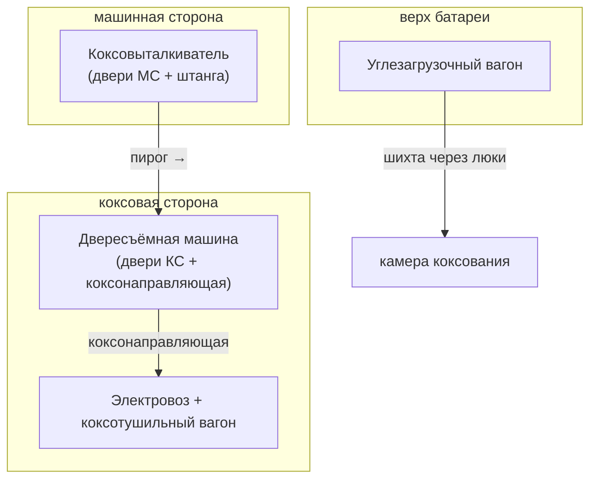
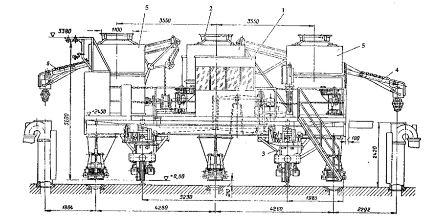
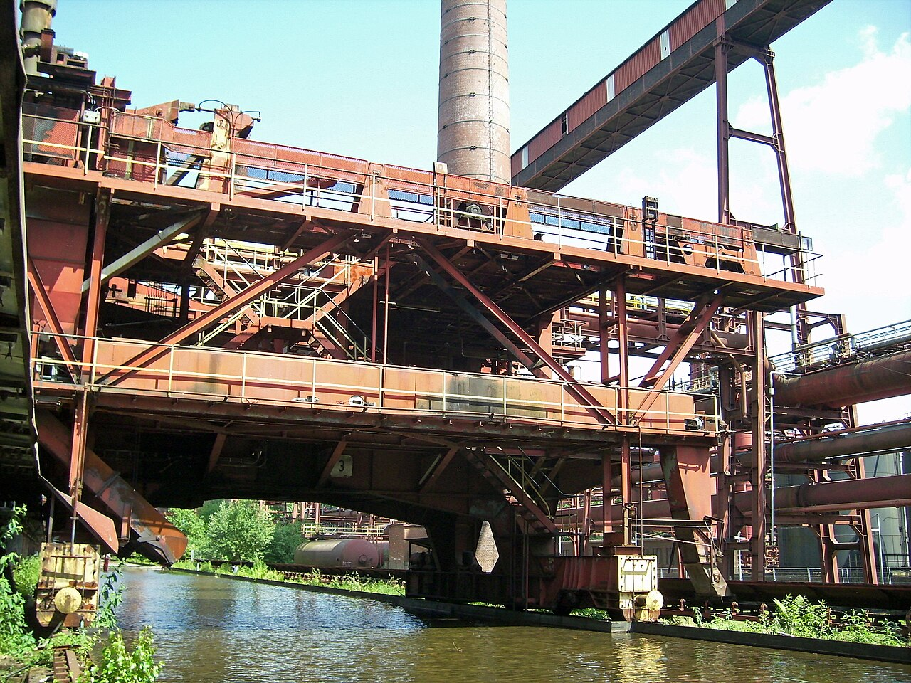
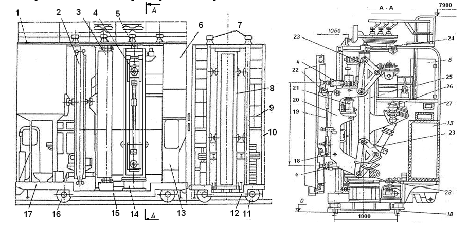
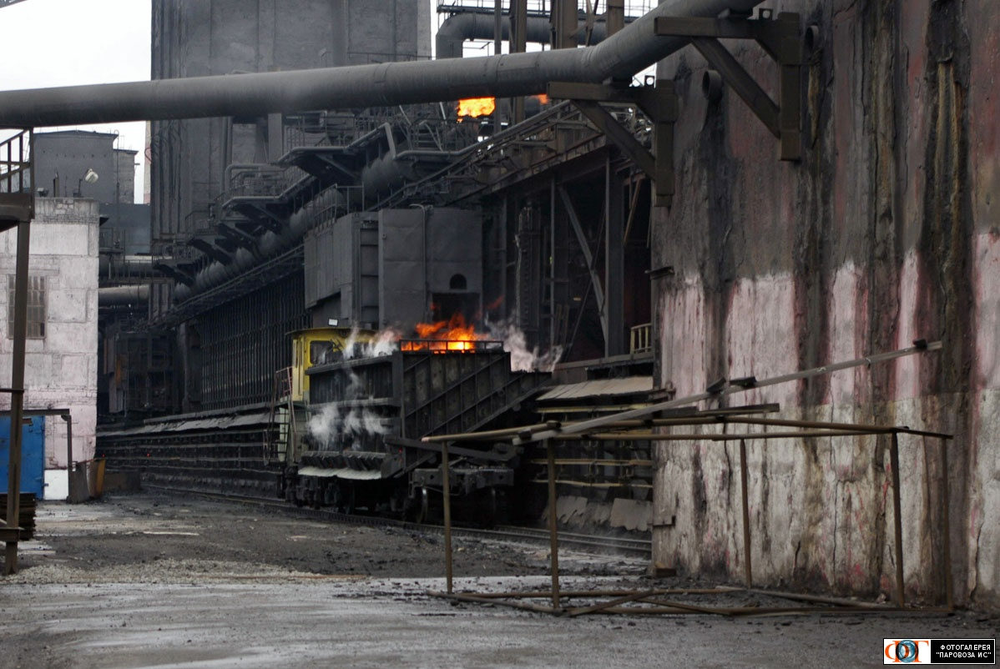
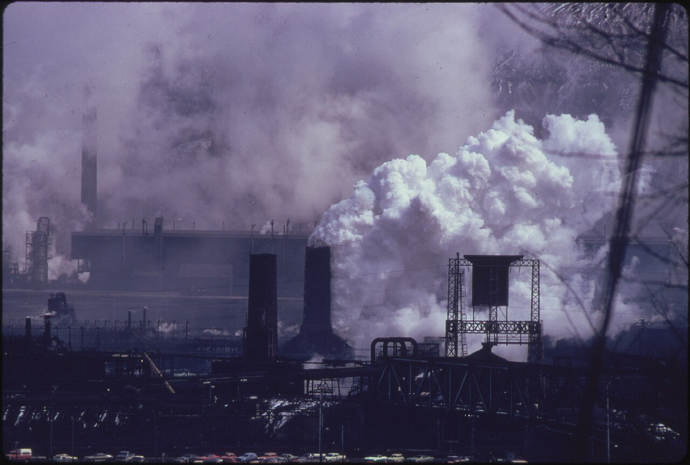
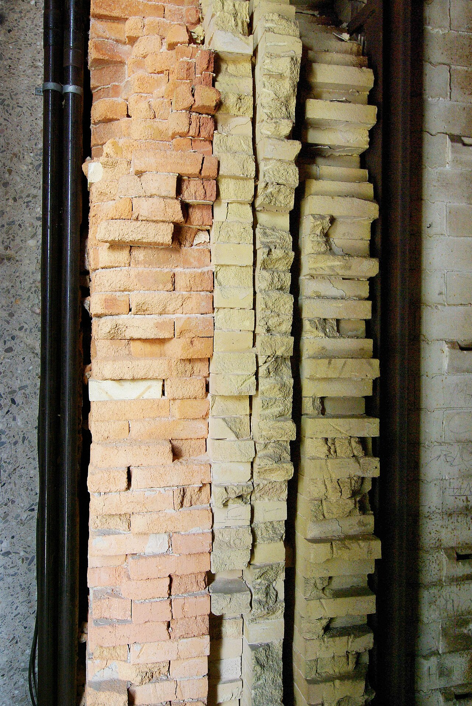
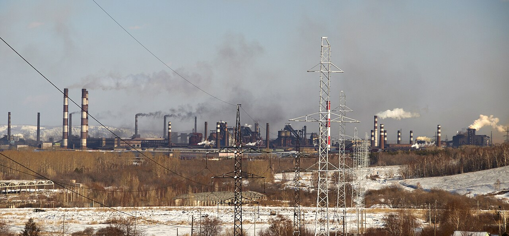

# 11. Машины и механизмы коксовой батареи

Справочник машин батареи: названия, выполняемые операции, технические
характеристики, производители, фотографии. Зачем он нужен:

- **мнемосхема и UI** ([01](01-мнемосхема.md)) — пропорции и реальные скорости
  машин, их зоны обслуживания и взаимные блокировки;
- **симулятор** — времена и скорости операций: цикл углезагрузочного вагона,
  выталкивание, тушение, выдача на рампу;
- **демо и презентация** — фотографии и названия, на которые можно ссылаться
  перед заказчиком.

Численные нормативы процесса (периоды, температуры, ограничения H1–H9) —
в [06](06-справочник-нормативов.md). Физика процесса — в [00](00-предметная-область.md).

> Документ собран из открытых источников (перечень — в конце). Данные 2011 г.
> по ЕКС — из [ОТЧ-2011]. Конкретные модели машин, стоящих на батареях ЕКС,
> в открытых источниках не найдены — это вопрос к заказчику (см. [06] §8).

---

## 1. Комплект машин батареи

Один комплекс машин обслуживает батарею. Стороны жёстко закреплены:

| Машина | Где ходит | Что делает |
|---|---|---|
| **Углезагрузочный вагон (УВ, МУЗ)** | верх батареи (по её своду) | принимает шихту из угольной башни, загружает камеры через люки |
| **Коксовыталкиватель (КВ)** | машинная сторона | снимает/ставит двери машинной стороны, **выталкивает коксовый пирог**, планирует шихту, чистит рамы и двери |
| **Двересъёмная машина (ДСМ, МДС)** | коксовая сторона | снимает/ставит двери коксовой стороны, чистит арматуру, её **коксонаправляющая** направляет пирог в тушильный вагон |
| **Электровоз + коксотушильный вагон (ЭВ + КТВ)** | путевой уровень, коксовая сторона | электровоз позиционирует вагон под печью; вагон принимает пирог, везёт под тушильную башню / УСТК, выдаёт кокс на рампу |

**Взаимные блокировки.** Выдача возможна только при точном взаимном
позиционировании: штанга КВ — по оси камеры, коксонаправляющая ДСМ — у той же
камеры, КТВ — под коксонаправляющей. Это основа серийной выдачи и причина, по
которой отказ любой из машин останавливает всю выдачу (в симуляторе — событие
`MACHINE_DOWN`).

Типовое закрепление (см. [00] §1): один комплект УВ + КВ + ДСМ на батарею;
тушильный вагон с электровозом, тушильная башня, угольная башня и рампа —
на две батареи.

---

## 2. Углезагрузочный вагон

### Операции цикла (10–12 мин на печь)

1. встать по оси затворов угольной башни, открыть их; заполнить бункера
   с взвешиванием (пневмообрушение шихты), закрыть затворы;
2. переехать к печи; открыть крышки стояков, закрыть клапаны гидрозатворов,
   прочистить колодцы стояков;
3. люкосъёмным механизмом снять две крайние крышки загрузочных люков,
   опустить телескопические течки, загрузить из крайних бункеров;
4. то же — средний люк и средний бункер;
5. убрать просыпавшуюся шихту, поставить крышки, вернуть крышки стояков;
6. дозагрузка бункеров из башни — вагон едет к следующей печи.

Планёр (штанга разравнивания шихты) на современных машинах совмещён с
коксовыталкивателем (планёрная штанга КВ) либо работает с УВ; высота
подсводового пространства после планёра — 250–350 мм ([06] §2).

### Характеристики

| Параметр | Значение | Примечание |
|---|---|---|
| Число бункеров | 3 (бывают 4–5) | трёхбункерные с нижней кабиной — самые распространённые |
| Суммарный объём бункеров | равен полезному объёму камеры, до 41 м³ | один вагон = одна загрузка камеры |
| Скорость передвижения | до 2 м/с | АМКР, КБ №3–4 |
| Масса | ~60 т (старые, 4 колеса) … ~105 т (современные, 8 приводных колёс) | давление на колесо до 138–150 кН |
| Габариты (Д×Ш×В) | ≈ 9,9 × 7,0 × 10,5 м | по выпущкам над сводом |
| Тормозной путь | 5 / 6,5 м (2 / 1 м/с) | — |
| Время обслуживания печи | 10–12 мин | цикл: угольная башня → печь → башня |

### Модификации

- **типовые** — для печей 20–21,6 / 30,3–35,5 / 41,6+ м³;
- **специальные** — для бездымной загрузки (пароинжекция, аспирация) и для
  термически подготовленной шихты.

---

## 3. Коксовыталкиватель

### Функции

- отворачивание ригельных винтов, съём и установка **дверей машинной стороны**;
- **выталкивание коксового пирога** штангой с башмаком;
- планёрная штанга — разравнивание шихты после загрузки;
- очистка и обезграфичивание рам, дверных планок, зеркала кладки;
- (на части машин) управление стояками и кранами пароинжекции при загрузке.

Ампераж двигателя штанги — ключевая телеметрия проекта: норма 210 А,
предел 260 А, выше — «тугой ход» ([06] §5).

### Характеристики

| Параметр | Значение | Источник/примечание |
|---|---|---|
| Скорость передвижения по фронту | 1,3–1,7 м/с | Платов; АМКР 1,68–1,7 |
| Скорость штанги | 0,43–0,5 м/с | Платов; АМКР |
| Ход штанги | ≈ 17,7–18,3 м | перекрывает длину камеры 14–17 м |
| Усилие выталкивания | до 300 кН | Платов |
| Скорость планёрной штанги | 0,83–1,5 м/с | АМКР |
| Скорость двересъёмной каретки | 0,18 м/с | АМКР |
| Масса | 148 т (печи 17–21 м³) … 250–500 т (большие печи) | Платов |
| Мощность / питание | 190–250 кВт; 220 В пост. тока от троллеев | Платов |
| Тормозной путь | 7 м | АМКР |
| Габариты (Д×Ш×В) | ≈ 25,6 × 8,5 × 9,1 м | АМКР КБ №1–2 |

> **Для симулятора.** Полное выталкивание пирога длиной ~15 м при скорости
> штанги 0,5 м/с — ~60–90 с с учётом разгона и реверса; снятие/установка
> двери — единицы минут (норматив «от снятия дверей до установки ≤ 10 мин»,
> [06] §3).

### Разработчики и производители

| Период | Кто |
|---|---|
| СССР | разработка Гипрококс (Киев) и СКБ/КБ «Коксохиммаш» (Краматорск); изготовление — завод «Коксохиммаш» (Бердянск) |
| Россия сейчас | ЗАО «Платов» (Ростовская обл.) — основной поставщик; ЮУМЗ (ГК «РэйлТрансХолдинг») — программа импортозамещения |
| Другие | КБ «Коксохиммаш», НКМЗ (Украина); Goša FOM (Сербия); автоматизация машин — ELAKS и др. |

---

## 4. Двересъёмная машина (коксовая сторона)

### Функции

- съём и установка **дверей коксовой стороны**, отвинчивание ригельных винтов;
- подъём/отвод двери, отвод рамы (отсечение от кладки) на ~1000 мм;
- чистка двери (планиры, скребки), рамы, дверной арматуры;
- **коксонаправляющая ванна** — бортовое устройство, направляющее пирог из
  камеры в коксотушильный вагон; поворот на угол до 90°, выдвижение к печи;
- стальной наклонный лист над коксонаправляющей — обрушение «верхней шапки»
  пирога, чтобы он не нависал над вагоном.

### Характеристики

| Параметр | Значение |
|---|---|
| Скорость передвижения | ~1,4 м/с |
| Угол поворота коксонаправляющей | до 90° |
| Ход отвода двери / прижим | ~990–1000 мм |
| Конструкция | портал на 2 ходовых тележках, консольная каретка двери |

> ДСМ — «вторая половина» выталкивателя: дверь КС открыта ровно столько,
> сколько идёт выдача (норматив «печь с открытой дверью ≤ 5 мин», [06] §3).
> Отказ ДСМ = невозможность выдачи, даже если штанга КВ исправна.

---

## 5. Коксотушильный вагон и электровоз

### Коксотушильный вагон

Открытый самоходный/прицепной вагон с наклонным дном и плужковыми затворами
по бортам; изнутри футерован нержавеющей сталью.

| Параметр | Значение | Примечание |
|---|---|---|
| Вместимость по коксу | 13 т (печи ~20 м³); для камер 30–41 м³ — пропорционально больше | точные значения для больших печей не найдены — вопрос заказчику |
| Температура принимаемого кокса | 1000–1050 °C | — |
| Угол наклона дна | 28° | кокс сползает при открытии затворов |
| Затворы | рычажно-пневматические (плужковые), 2 привода, 6 атм | открытие 8–12 с |
| Колея | 1520 мм | — |
| Масса | ~54,5 т | — |
| Управление | из кабины электровоза | машинист ЭВ открывает затворы на рампе |
| Датчики | сигнализаторы точной установки под коксонаправляющей | позиционирование относительно печи |

Выдача на рампу: вагон ставят над наклонной решёткой рампы, открывают
затворы — кокс ссыпается по дну, вагон продвигается вдоль рампы.

### Электровоз ЭК14 (ЭК-14М)

Тбилисский электровозостроительный завод им. Ленина; опытные — 1973 г.,
серийно с 1974 г. Разработан СКБ «Электровозостроитель» по заданию
Минчермета СССР. Предшественник — ЭК13, развитие — ЭК14М (современные
модификации, работает, например, на ЧМК).

| Параметр | Значение |
|---|---|
| Назначение | передвижение коксотушильных вагонов общей массой до 100 т |
| Осевая формула | 2 двухосные тележки (колёсная база 3380 мм) |
| Масса | 38 т |
| Тяговая сила при трогании | 74,6 кН (7600 кгс) |
| Скорости | минимум 0,5 км/ч (сухое тушение) / 1,5 км/ч (мокрое); максимум 25 км/ч |
| Тяговые двигатели | 2 × ЭД-118ТЛ по 95 кВт (450 В пост. тока), герметизированы от коксовой пыли |
| Питание | 380 В, 3ф, 50 Гц через тиристорные преобразователи |
| Тормоза | пневматические + ручные + магниторельсовые ТРМ-5 |
| **Точность остановки** | **±20 мм при 0,5 км/ч** |
| Управление | ручное / автоматическое / **дистанционное со стационарного пункта** |

> **Для проекта.** Машинист электровоза — оператор выдачи: он позиционирует
> вагон под печью (по команде графика) и открывает затворы на рампе.
> Точность позиционирования ±20 мм и дистанционное управление — готовый
> аргумент в пользу того, что в симуляторе позиция ЭВ/КТВ вдоль фронта —
> дискретная координата «под печью N», а не свободная ([01] §2).

---

## 6. Мокрое тушение: тушильная башня

| Параметр | Значение | Источник |
|---|---|---|
| Температура кокса до тушения | 1000–1050 °C | [ЦХУ] |
| Расход воды | 0,45–0,55 м³/т кокса | [ОТЧ-2011]; УрФУ ~0,5 |
| Время тушения под душевой установкой | 100–130 с | УрФУ |
| Отстой вагона после тушения | 30–65 с | УрФУ |
| Вода | оборотная фенольная/техническая: башня → отстойник → градирня → насосная → напорные баки | [ОТЧ-2011], КузГТУ |
| Пары | удаляются вытяжной трубой башни; брызгоулавливание над душевой | — |

Цикл: электровоз подводит вагон под башню со скоростью 1,5 км/ч →
душевая установка за ~2 мин заливает/орошает кокс → отстой 30–65 с (стекание)
→ выдача на рампу. На ЕКС — тушильные башни № 1 и 2 ([ОТЧ-2011]).

---

## 7. Сухое тушение: УСТК

Кокс (~1000 °C) из вагона ссыпается в приёмный бункер камеры тушения, где
снизу вверх навстречу ему идёт циркуляционный инертный газ (продукты
неполного сгорания + азот). Газ отбирает тепло, проходит циклон (пыль),
поступает в **котёл-утилизатор** (выработка пара), затем после скруббера
возвращается вентилятором в камеру.

| Параметр | Значение | Источник |
|---|---|---|
| Производительность (система Гипрококса) | 70–90 т/ч кокса | [СПР-КХ] |
| Выработка пара | до 40 т/ч, 450 °C | [СПР-КХ] |
| Температура кокса на входе | ~1000 °C | — |
| Температура кокса на выходе | ~200 °C | УрФУ |
| Расход циркуляционного газа | ~1500–1700 м³/т | патент RU2632016 (ориентир) |

Преимущества перед мокрым тушением:

- **качество**: меньше микротрещин от термического удара водой — прочность и
  CSR/CRI выше (главная причина ставить УСТК);
- **энергия**: тепло кокса не выбрасывается с паром в атмосферу, а даёт пар
  (и далее электроэнергию) — типовая рекуперация ~0,4–0,5 т пара на тонну кокса;
- **экология**: нет выброса парогазового облака с фенолами и пылью; пыль
  улавливается циклоном и рукавными фильтрами.

На ЕКС — УСТК № 2, 3, 4 ([ОТЧ-2011]).

---

## 8. Рампа и коксосортировка

**Рампа** — наклонный лоток/решётка вдоль коксовой стороны, куда КТВ выдаёт
тушёный кокс. Выдержка 15–20 мин: догорание не догоревших фракций исключается
водой в вагоне, кокс подсушивается и «дозревает» (отдаёт влагу и тепло), затем
дозируется на конвейеры ([06] §3).

**Коксосортировка** — грохочение на классы **>40 / 25–40 / 10–25 / 0–10 мм**
([06] §4): валковые/инерционные грохоты, бункера по классам, отгрузка в
железнодорожные вагоны или подача конвейерами на доменный цех. На ЕКС —
коксосортировки № 1 и 2, бункера кокса № 1–8 ([ОТЧ-2011]).

---

## 9. Конкретика ЕКС (ЗСМК, Новокузнецк)

| Факт | Значение | Источник |
|---|---|---|
| Коксохимпроизводство | основано 1963, 7 большегрузных батарей (строились 13 лет), максимум 5235,8 тыс. т кокса/год (1976) | [ОТЧ-2011] |
| Структура | площадка ЗСМК: ЦУП + КЦ + ЦХУиПКХП; площадка НКМК: КХЦ | [ОТЧ-2011] |
| Подача шихты | 920 т/ч (печи № 1–6), 500 т/ч (№ 7) | [ОТЧ-2011] |
| КБ-1 | коренная реконструкция 22.12.2005: современная батарея, высокая автоматизация, ~50 сопутствующих объектов модернизировано, технология выдачи с улавливанием пыли | [ОТЧ-2011] |
| **КБ-2** | реконструкция 2022–2025, 21 млрд руб.: первый кокс 21.02.2025, до 750 тыс. т/год, 66 новых рабочих мест; перевооружены коксосортировка, системы тушения, биохимочистка; промышленная эксплуатация — ноябрь 2025 | пресса ЕВРАЗ (ссылки ниже) |
| Машины батарей | точные модели/производители машин ЕКС в открытых источниках **не найдены**; типовой советский парк — разработки Гипрококс/КБ «Коксохиммаш» | — |

Модели машин, стоящие на КБ-2 после реконструкции 2025 г., в открытых
источниках не раскрываются. Для демо-данных симулятора используем типовые ТТХ
из §2–5, а марки машин включаем в вопросы заказчику ([06] §8).

---

## 10. Что взять в проект из этого справочника

| Данные | Куда в проекте |
|---|---|
| Скорости машин (КВ 1,7 м/с; УВ 2 м/с; ЭВ 1,5 км/ч под башней) | телеметрия `machine.position`, анимация мнемосхемы ([01] §2) |
| Время цикла УВ 10–12 мин; выталкивание ~60–90 с; двери ≤ 10 мин | длительности операций в симуляторе и планировщике |
| Вместимость КТВ ~13–25 т; выдача на рампу затворами 8–12 с | `planned_quantity_t` операции выдачи ([02] §2) |
| Тушение 100–130 с + отстой 30–65 с; рампа 15–20 мин | последовательность событий после `PUSH_DONE` |
| Точность позиционирования ±20 мм, блокировки КВ↔ДСМ↔ЭВ | обоснование дискретной позиции «под печью N» |
| УСТК: 70–90 т/ч, до 40 т/ч пара | сценарий «сухое тушение» как альтернатива мокрому |
| Фото и чертежи | `img/machines/` — презентация, карточки машин, иконки UI |

---

## 11. Фотоматериалы

Все файлы лежат в `docs/img/machines/`. Рядом — источник и лицензия
(для презентации атрибуция обязательна для CC BY / CC BY-SA).

| Файл | Что изображено | Источник, лицензия |
|---|---|---|
| `battery-krivoy-rog.jpg` | коксовая батарея № 6, АрселорМиттал Кривой Рог (батарея советского типа ПВР) | [Commons: Коксовая батарея №6](https://commons.wikimedia.org/wiki/File:Коксовая_батарея_№6.jpg), CC BY-SA 4.0 |
| `battery-zollverein.jpg` | коксовая батарея с УСТК, коксохимзавод Цольферайн (Эссен, Германия) | [Commons: Kokerei Zollverein](https://commons.wikimedia.org/wiki/File:Kokerei_Zollverein_IMGP5095_wp.jpg), Free Art License |
| `pusher-zollverein.jpg` | коксовыталкиватель (Drückmaschine) со стороны камеры | [Commons: Drückmaschine](https://commons.wikimedia.org/wiki/File:Kokerei_Zollverein_-_Dr%C3%BCckmaschine.jpg), CC BY-SA 2.5 |
| `pusher-historic.jpg` | исторический коксовыталкиватель, общий вид | [Commons: Koksausdrückmaschine](https://commons.wikimedia.org/wiki/File:Koksausdr%C3%BCckmaschine.jpg), public domain |
| `pushing-into-quenching-car.jpg` | **выдача: раскалённый пирог идёт из камеры в коксотушильный вагон** | [Commons: Coke being pushed...](https://commons.wikimedia.org/wiki/File:Coke_being_pushed_into_a_quenching_car1a35416v.jpg), public domain (Library of Congress) |
| `quenching-car-zollverein.jpg` | коксотушильный вагон | [Commons: Kokerei Löschwagen](https://commons.wikimedia.org/wiki/File:0_Kokerei_L%C3%B6schwagen.jpg), CC BY 4.0 |
| `quenching-car-at-tower.jpg` | коксотушильный вагон под тушильной башней | [Commons: Löschwagen Löschturm](https://commons.wikimedia.org/wiki/File:0_Kokerei_L%C3%B6schwagen_L%C3%B6schturm.jpg), CC BY 4.0 |
| `quenching-tower-zollverein.jpg` | тушильная башня | [Commons: Kokerei Löschturm West](https://commons.wikimedia.org/wiki/File:0_Kokerei_L%C3%B6schturm_West.jpg), CC BY 4.0 |
| `quenching-tower-steam-nara.jpg` | паровой факел над тушильной башней (классическое фото DOCUMERICA) | [Commons: White plume, NARA-557214](https://commons.wikimedia.org/wiki/File:WHITE_PLUME_CONTAINING_MANY_POLLUTANTS_IS_EMITTED_FROM_A_QUENCHING_TOWER_AT_A_COKE_PLANT_OWNED_BY_THE_UNITED_STATES..._-_NARA_-_557214.jpg), public domain (NARA) |
| `zsmk-plant-view.jpg` | общий вид ЕВРАЗ ЗСМК (Новокузнецк) | [Commons: West Siberian Metal Plant](https://commons.wikimedia.org/wiki/File:West_Siberian_Metal_Plant_(ZSMK)_-_panoramio.jpg), CC BY 3.0 |
| `elektrovoz-ek14m-s-tushilnym-vagonom.jpg` | электровоз ЭК14М-393 толкает коксотушильный вагон, ЧМК, 2019 | [parovoz.com, галерея](https://parovoz.com/newgallery/pg_view.php?ID=654842) (публикация с указанием источника) |
| `shema-uglezagruzochny-vagon.png` | углезагрузочный вагон, учебный чертёж общего вида | [metallolome.ru](https://metallolome.ru/mashiny-obsluzhivayushhie-koksovye-pechi) (учебные материалы) |
| `shema-koksovytalkivatel.png` | коксовыталкиватель, учебный чертёж общего вида | [metallolome.ru](https://metallolome.ru/mashiny-obsluzhivayushhie-koksovye-pechi) (учебные материалы) |
| `shema-dveresemnaya-mashina.png` | двересъёмная машина, учебный чертёж общего вида | [metallolome.ru](https://metallolome.ru/mashiny-obsluzhivayushhie-koksovye-pechi) (учебные материалы) |
| `shema-koksotushilny-vagon.png` | коксотушильный вагон, учебный чертёж общего вида | [metallolome.ru](https://metallolome.ru/mashiny-obsluzhivayushhie-koksovye-pechi) (учебные материалы) |

---

## Источники

Полный перечень всего, что нашлось при подготовке справочника (24.11.2026).
Сайты chem21.info, studfile.net и platovzavod.ru отклоняют автоматические
запросы (403 для ботов) — в браузере страницы открываются.

### Внутренние материалы (папка `документы/`)

- [ОТЧ-2011] — `документы/Отчёт_производственная_практика_2011_ЕКС.doc`:
  структура ЕКС, состав коксового цеха, реконструкция КБ-1 (2005), данные по
  газовому тракту и выбросам
- `документы/Список_проектов_кейсов_«ЕвразТехника_ИС».docx` — текст кейса №1
  (статусы операций, требования к сравнению алгоритмов, рекомендуемый стек)
- `документы/ChatExport_2026-11-24/` — переписка с куратором (решения по UI,
  масштабам батареи, параметрам блока управления)

### ТТХ и устройство машин

- [metallolome.ru — машины, обслуживающие коксовые печи](https://metallolome.ru/mashiny-obsluzhivayushhie-koksovye-pechi) — основной источник ТТХ §2–5: углезагрузочный вагон, коксовыталкиватель, двересъёмная машина, коксотушильный вагон (батареи АМКР, Кривой Рог); там же — чертежи `shema-*.png`
- [trastcomp.ru — технологический процесс работы углезагрузочного вагона](https://trastcomp.ru/opisanie-tenologicheskogo-processa-raboty-uglezagruzochnogo-vagona) — классификация УВ, последовательность операций цикла, конструкция
- [studfile — основное оборудование коксового цеха](https://studfile.net/preview/7846018/page:4) и [мокрое тушение кокса](https://studfile.net/preview/7846018/page:8) — назначение КВ/УВ/ДСМ, температура кокса 1000–1050 °C
- [studfile — операции углезагрузочного вагона](https://studfile.net/preview/578440/page:2) — заполнение бункеров из угольной башни, взвешивание, подача к печам
- [chem21.info — Коксовыталкиватель (химическая энциклопедия)](https://chem21.info/info/1115166) — состав комплекта машин
- [chem21.info — Угольная башня](https://chem21.info/info/1115996) — порядок загрузки УВ из башни
- [dropsa.com — обзор процесса коксовой печи](https://www.dropsa.com/flex/cm/pages/ServeBLOB.php/L/RU/IDPagina/1897) — цепочка «печь → тушильный вагон → бункер»
- [consultant.ru — классификатор ОКПД «оборудование для коксовых печей»](https://www.consultant.ru/document/cons_doc_LAW_10967/07a96b8caab7461313c208259e49b1917fc48503) — официальная номенклатура: коксовыталкиватели, машины двересъёмные, машины углезагрузочные

### Производители коксовых машин

- [Платов завод — коксовыталкиватель](https://www.platovzavod.ru/goods/228670402-koxovytalkivatel) и [ЗАО «Платов» — коксохимическое оборудование](http://www.zaoplatov.ru/equipment/koks-him?n=38) — ТТХ выталкивателей (масса, скорости, ход штанги, усилие)
- [КБ «Коксохиммаш» — коксовые машины](http://www.kbkxm-kbk.com/UKR/KM.html) — разработчик ГБРУ/СКБ (Краматорск), номенклатура машин
- [Goša FOM — коксовые машины](http://www.gosafom.com/?p=634&lang=ru) — сербский производитель: выталкиватель, УВ, ДСМ, электровоз; тяговые параметры электровоза
- [ELAKS — коксовые машины и автоматизация](https://elaks.ua/ru/solutions/koksovye-masiny-masiny-uglezagruzocnaa-i-dveresemnaa-koksovytalkivatel) — МУЗ/КВ/МДС/ЭВ, объём автоматизации
- [Википедия — Уралхиммаш](https://ru.wikipedia.org/wiki/Уралхиммаш) — оборудование для коксохимии (не основной поставщик машин)

### Электровоз

- [Википедия — ЭК14](https://ru.wikipedia.org/wiki/ЭК14) — основа §5: история, конструкция, ТЭД, скорости, масса, точность ±20 мм
- [СЦБИСТ — коксотушильный электровоз ЭК14](https://scbist.com/wiki/17155-koksotushilnyi-elektrovoz-ek14.html) — тяговые характеристики
- [drivetrend.ru — промышленные электровозы ЭК13/ЭК14](https://www.drivetrend.ru/auto/travel/neobychnye-electrovozy) — назначение: вагоны с коксом до 100 т
- [eurasmet.ru — электровоз под управлением АСУ ТП (ОАО «Кокс», 2006)](https://www.eurasmet.ru/news/9343) — пример автоматизации электровоза в связке с тушильным вагоном
- [parovoz.com — фото ЭК14М-393 с тушильным вагоном, ЧМК, 2019](https://parovoz.com/newgallery/pg_view.php?ID=654842)

### Мокрое тушение

- [УрФУ, «Выбор оптимального метода тушения кокса», 2014](https://elar.urfu.ru/bitstream/10995/33596/1/tim_2014_02_30.pdf) — расход воды ~0,5 м³/т, время 100–130 с, отстой 30–65 с, охлаждение до 200 °C
- [КузГТУ, 2017 — цикл мокрого тушения](https://science.kuzstu.ru/wp-content/Events/Conference/Ecoprom/2017/egpp/pages/Articles/324.pdf) — насосные агрегаты, напорные баки, последовательность цикла
- [АСУТМ — тушение кокса](https://www.asutm.com/modules/coking/quenching.html) — цели системы тушения
- [chem21.info — тушение кокса водой](https://chem21.info/info/1273069) — организация подачи воды
- [Патент RU2605975C2 — башня мокрого тушения кокса](https://patents.google.com/patent/RU2605975C2/ru) — конструкция орошения и брызгоулавливания

### УСТК (сухое тушение)

- [studfile — установки сухого тушения кокса](https://studfile.net/preview/9048496/page:10) — 70–90 т/ч, 40 т/ч пара 450 °C
- [chem21.info — бункерная УСТК](https://chem21.info/info/1273123) — схемы и характеристики систем Гипрококса
- [Патент RU2632016C2 — установка сухого тушения кокса](https://patents.google.com/patent/RU2632016C2/ru) — камера с теплообменниками, котёл-утилизатор
- [promvest.info — УСТК 52 т/ч с контролем давления](https://promvest.info/ru/innovatsii/razrabotka-ustanovki-i-sposoba-dlya-tusheniya-koksa-pozvolyayuschie-umenshit-vyibros-ugarnogo-gaza-v-okrujayuschuyu-sredu) — снижение выбросов CO
- [neftegaz.ru — новая технология сухого тушения, 2025](https://neftegaz.ru/news/standarts/881079-novaya-tekhnologiya-sukhogo-tusheniya-koksa-snizhenie-ugara-do-0-2-i-povyshenie-bezopasnosti) — угар до 0,2 %, замена газа азотом
- [МЭИ — диссертация по газовому тракту УСТК](https://mpei.ru/diss/Lists/FilesDissertations/185-Диссертация.pdf) — глубокая проработка газового контура

### Коксовые печи и процесс (общее)

- [УрФУ, Kaufman, «Отечественные и зарубежные коксовые печи», 2013](https://elar.urfu.ru/bitstream/10995/28834/1/978-5-7996-1129-3_2013.pdf) — типы печей, термодеструкция шихты 1000–1050 °C
- [Патент RU2501838C2 — подготовка угольной шихты к коксованию](https://patents.google.com/patent/RU2501838C2/ru) — температура шихты на входе в углезагрузочный вагон 90 °C, влажность 6 %

### ЕКС / ЕВРАЗ ЗСМК, Новокузнецк

- [city-n.ru — запуск новой КБ-2, ноябрь 2025](https://www.city-n.ru/view/481041.html) — до 750 тыс. т/год, перевооружение коксосортировки и тушения
- [kuzbass85.ru — 21 млрд руб. в модернизацию, февраль 2025](https://kuzbass85.ru/2025/02/24/evraz-zsmk-vlozhil-21-mlrd-rub-v-modernizacziyu-koksohimicheskogo-proizvodstva)
- [admnkz.info — первый кокс КБ-2, 21.02.2025](https://www.admnkz.info/news/12769) — 66 рабочих мест
- [old.admnkz.info — завершение огнеупорной кладки КБ-2, февраль 2024](https://old.admnkz.info/web/guest/viewnews/-/asset_publisher/FKllLE6BfbLB/content/na-evraz-zsmk-zaversili-ogneupornuu-kladku-novoj-koksovoj-batarei)
- [mashnews.ru — КБ-2 выдала первый кокс](https://mashnews.ru/koksovaya-batareya-2-evraz-zsmk-vyidala-pervyij-koks-posle-masshtabnoj-rekonstrukczii-za-21-mlrd-rublej.html)
- [stellarcons.com — генподрядчик реконструкции КБ-2, 2022–2025](https://stellarcons.com/projects/rekonstruktsiya-kompleksa-koksovoy-batarei-2-ao-evraz-zsmk) — период работ, состав проекта

### Фотоматериалы

- Wikimedia Commons — страницы файлов перечислены в §11; поиск —
  [категория Coke ovens](https://commons.wikimedia.org/wiki/Category:Coke_ovens),
  [категория Coke plants](https://commons.wikimedia.org/wiki/Category:Coke_plants),
  [категория Kokerei Zollverein](https://commons.wikimedia.org/wiki/Category:Kokerei_Zollverein)
- [parovoz.com — фото ЭК14М](https://parovoz.com/newgallery/pg_view.php?ID=654842)
- [metallolome.ru — учебные чертежи машин](https://metallolome.ru/mashiny-obsluzhivayushhie-koksovye-pechi)
