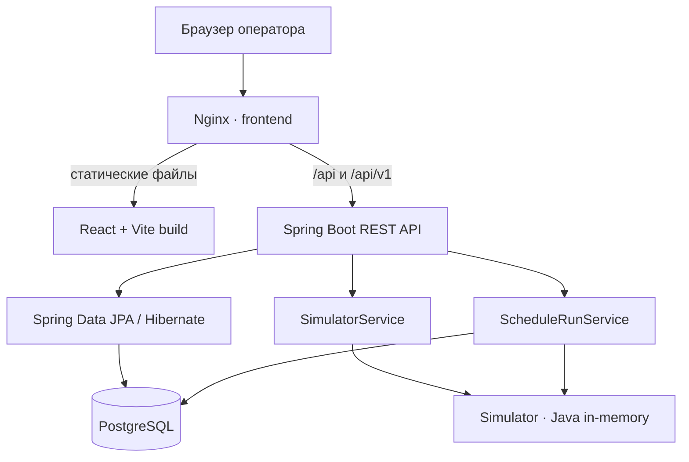
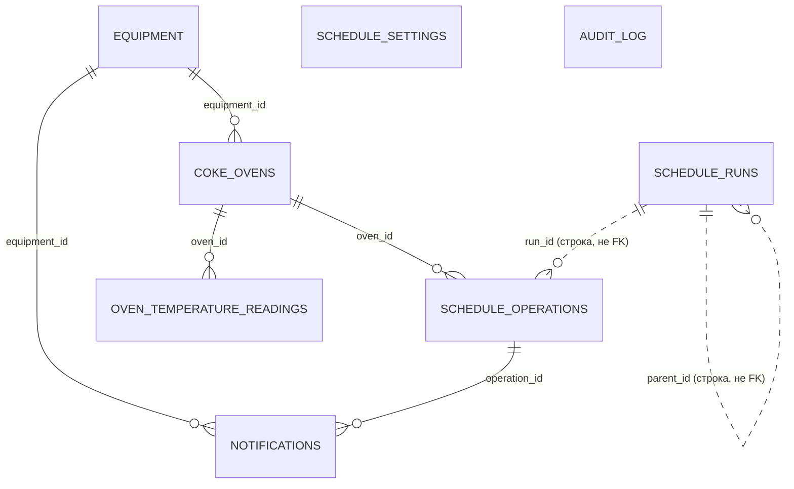

# 12. Техническая документация: API, база данных и Docker

**Основа:** фактический исходный код архива `all(3).zip` и изменения, внесённые при проверке соответствия ТЗ.  
**Назначение:** техническая документация для разработчика и подготовки к защите.  
**Дата актуализации:** 26.11.2026.

---

# 0. Проверка соответствия требованиям кейса

| Требование кейса | Состояние после доработки |
|---|---|
| Справочник технологического оборудования | Реализован в `equipment` и `coke_ovens`, CRUD и CSV-импорт |
| Загрузка состояния оборудования | CSV-импорт печей и четырёх типов машин; доступность применяется к симулятору |
| Формирование производственного графика | Реализовано: B1 FIFO, B2 idle, B3 smooth |
| Настройка интервала между операциями | Реализована через `stepMinutes` |
| Настройка доступности оборудования | Реализована для печей и всех четырёх типов машин |
| Настройка приоритетов | Реализован приоритет по умолчанию и приоритет конкретной операции; приоритет влияет на порог опоздания, не нарушая серийность |
| Временные ограничения | Физические ограничения симулятора и окно смены; 30-минутная операция должна помещаться в смену |
| Визуализация графика | Реализована на временной шкале frontend |
| Статусы план/факт | Реализованы `PLANNED`, `IN_PROGRESS`, `DONE`, `OVERDUE`, `IMPOSSIBLE` |
| Сравнение планового и фактического исполнения | Реализованы фактические времена и `deviationMinutes` |
| Уведомления об отклонениях | Реализованы сохранённые уведомления о просрочке/невозможной операции |
| Ручная корректировка графика | Реализована в UI/API; последующие операции сдвигаются с сохранением порядка |
| Журнал изменений | Реализован для основных действий, CRUD и автоматической синхронизации план/факт |
| Сравнение алгоритмов | Реализовано для B1/B2/B3 по просрочке, простоям, равномерности и проверяемым ограничениям |

**Ограничение относительно более подробной внутренней модели:** автоматические валидаторы есть только для H1 (серийность) и H4 (выдача → загрузка). H2, H3, H5–H9 не реализованы. В ТЗ кейса они не перечислены как обязательный исчерпывающий набор, но внутренние проектные документы их описывают, поэтому на защите нельзя заявлять полную проверку H1–H9.

Рекомендуемый в ТЗ стек C#/.NET не является единственно допустимым: фактический проект использует Java/Spring Boot, React и PostgreSQL.

---

# 1. Архитектура backend

## 1.1. Технологический стек

| Компонент | Фактическая реализация |
|---|---|
| Язык backend и симулятора | Java 21 |
| Backend framework | Spring Boot 3.4.4 |
| HTTP / REST | Spring Web MVC |
| ORM | Spring Data JPA + Hibernate |
| База данных | PostgreSQL 15 |
| Сборка | Gradle Kotlin DSL, Gradle Wrapper 8.14.2 |
| API-документация | springdoc-openapi 2.8.9, Swagger UI |
| Планировщик фоновых задач | Spring `@Scheduled` |
| DTO | Java records и отдельные JPA-сущности |
| Тестирование | JUnit 5, AssertJ, Mockito через `spring-boot-starter-test` |
| Frontend | React 19, Vite 8, Tailwind CSS 3.4, Recharts 3 |
| Раздача frontend | Nginx 1.27 |
| Контейнеризация | Dockerfile + Docker Compose |

В проекте **не подключены** Flyway, Quartz, MapStruct, WebSocket/STOMP и Spring Security. Testcontainers 1.20.4 добавлен для интеграционных тестов PostgreSQL. Это не следует смешивать с runtime-компонентами приложения.

## 1.2. Логическая схема



Система разделена на два вида данных:

1. **PostgreSQL** — справочники, настройки, прогоны графика, операции, уведомления, температурные измерения и аудит.
2. **Симулятор в памяти backend-процесса** — текущее модельное время, состояние печей, машин, события и фактические выдачи.

Текущее состояние симулятора само по себе не хранится в PostgreSQL. Для сохранения/восстановления состояния предусмотрены JSON export/import.

## 1.3. Структура backend

| Каталог | Назначение |
|---|---|
| `controller/` | REST-контроллеры, маршрутизация HTTP |
| `service/` | бизнес-логика, интеграция с симулятором, планирование, импорт, аудит |
| `entity/` | JPA-сущности и enum-типы |
| `repository/` | Spring Data JPA интерфейсы доступа к данным |
| `dto/` | общая оболочка ответа `/api/v1` |
| `exception/` | единый обработчик ошибок всех REST-контроллеров |
| `config/` | CORS-конфигурация |
| `src/main/resources/` | `application.yaml`, начальные данные `data.sql` |
| `simulator/` | отдельный Java-модуль событийного движка и планировщиков B1–B3 |

Ключевые классы:

- `CokeFactoryApplication` — точка входа Spring Boot, включает `@EnableScheduling`.
- `SimulatorService` — владеет одним экземпляром `Simulator`, обновляет его раз в секунду, предоставляет DTO и потокобезопасный фасад.
- `ScheduleRunService` — создаёт версии графика, запускает алгоритмы, сохраняет операции, выполняет replay для метрик, синхронизирует статусы и обрабатывает ручные переносы.
- `ScheduleService` — фасад операции «Сформировать график».
- `DirectoryCsvService` — импорт справочников печей и машин.
- `AuditService` — запись действий оператора в `audit_log`.

## 1.4. Фоновая работа

Используются два периодических процесса Spring:

- `SimulatorService.tick()` — раз в секунду. Если симуляция запущена, продвигает модельное время на число минут, соответствующее `speedFactor`.
- `ScheduleRunService.syncTick()` — раз в секунду. Проверяет ревизию состояния симулятора, при необходимости пересчитывает активный график и синхронизирует статусы операций.

`Simulator` не потокобезопасен. Поэтому публичные методы `SimulatorService` синхронизированы (`synchronized`), чтобы чтение снимка и продвижение модельного времени не выполнялись одновременно.

## 1.5. Время

- Внутри симулятора время хранится как количество модельных минут от нуля.
- Якорь времени: `2026-10-05T01:00:00Z`, что соответствует 08:00 в часовом поясе предприятия `Asia/Novosibirsk`.
- `SimulatorService.toPlantTime()` и `simMinutesOf()` переводят модельные минуты в локальное время предприятия и обратно.
- В API симулятора временные отметки передаются ISO 8601.
- В JPA-таблицах используется `LocalDateTime`; зона в самой колонке PostgreSQL не хранится.

---

# 2. REST API

## 2.1. Общие соглашения

В приложении есть два пространства API, и форматы ответов у них различаются.

| Пространство | Назначение | Формат ответа |
|---|---|---|
| `/api/v1/...` | симулятор, прогоны графика, импорт/экспорт состояния | `{ success, data, error }` |
| `/api/...` | CRUD-ресурсы PostgreSQL | обычный JSON / `ResponseEntity` |

Пример успешного ответа `/api/v1`:

```json
{
  "success": true,
  "data": {
    "simMinutes": 60,
    "running": false
  },
  "error": null
}
```

Пример ошибки `/api/v1`:

```json
{
  "success": false,
  "data": null,
  "error": {
    "code": "VALIDATION_FAILED",
    "message": "неизвестный алгоритм"
  }
}
```

После API-доработки `ApiExceptionHandler` применяется глобально ко всем REST-контроллерам. Для ошибок используется оболочка `ApiResponse` с `success: false`; успешные ответы legacy-маршрутов `/api/...` сохраняют прежнюю структуру.

Документация Swagger доступна по адресу:

- `http://localhost:8080/swagger-ui.html`
- OpenAPI JSON: `http://localhost:8080/v3/api-docs`

## 2.2. API симулятора — `/api/v1`

Контроллер: `SimulatorController`.

| Метод | Endpoint | Назначение |
|---|---|---|
| GET | `/api/v1/battery` | параметры батареи: число печей, схема, цикл, шаг, допуск |
| GET | `/api/v1/snapshot` | единый согласованный снимок: state, battery, ovens, machines, feed, events, analytics |
| GET | `/api/v1/state` | модельное время, скорость, счётчики, seed и состояние запуска |
| GET | `/api/v1/ovens?zoom=battery` | состояния всех печей |
| GET | `/api/v1/machines` | положения и загрузка четырёх машин |
| GET | `/api/v1/analytics?limit=20` | фактические показатели выдач и загрузки машин |
| GET | `/api/v1/feed?limit=20` | прогноз ближайших выдач |
| GET | `/api/v1/events?limit=50` | журнал событий симулятора |
| POST | `/api/v1/simulator/control` | запуск, пауза, шаг или сброс |
| PUT | `/api/v1/simulator/config` | скорость, seed, вероятности отказов, серийность |
| POST | `/api/v1/simulator/failure` | принудительно создать отказ |
| GET | `/api/v1/simulator/state/export` | скачать JSON-снимок батареи |
| POST | `/api/v1/simulator/state/import` | восстановить симулятор из JSON-снимка |
| POST | `/api/v1/schedule/generate?limit=20` | сформировать график через активный планировщик |
| POST | `/api/v1/operator-actions` | записать действие оператора, выполненное на frontend |

### Управление симулятором

`POST /api/v1/simulator/control`

Тело запроса:

```json
{
  "action": "step",
  "minutes": 15
}
```

Поддерживаемые `action`:

- `start` — запустить непрерывное продвижение времени;
- `pause` — поставить на паузу;
- `step` — остановить непрерывное движение и сделать шаг на `minutes` модельных минут (по умолчанию 1);
- `reset` — создать новый симулятор с текущей конфигурацией и обнулить его модельное состояние.

### Настройка симулятора

`PUT /api/v1/simulator/config`

Пример:

```json
{
  "speedFactor": 60,
  "seed": 12345,
  "pushJamProb": 0.004,
  "ovenFaultPerHour": 0.0008,
  "seriality": "9-2"
}
```

Поля необязательные. Изменение seed, вероятностей отказа или серийности пересоздаёт симулятор и ставит его на паузу. `speedFactor` ограничивается диапазоном 1–600.

### Принудительный отказ

`POST /api/v1/simulator/failure`

```json
{
  "type": "pushJam"
}
```

или

```json
{
  "type": "ovenHeating",
  "ovenNumber": 17
}
```

Допустимые типы: `pushJam`, `ovenHeating`.

## 2.3. API прогонов графика — `/api/v1`

Контроллер: `ScheduleRunController`.

| Метод | Endpoint | Назначение |
|---|---|---|
| POST | `/api/v1/schedule-runs` | создать новый прогон планировщика |
| GET | `/api/v1/schedule-runs` | список прогонов |
| GET | `/api/v1/schedule-runs/active` | текущий рассчитанный прогон |
| GET | `/api/v1/schedule-runs/{id}` | сведения о прогоне |
| GET | `/api/v1/schedule-runs/{id}/operations` | операции выбранного прогона |
| POST | `/api/v1/schedule-runs/compare` | сравнить алгоритмы на одном входе |
| PATCH | `/api/v1/schedule-operations/{id}` | ручной перенос операции |
| POST | `/api/v1/import/ovens` | импорт справочника печей, `Content-Type: text/csv` |
| POST | `/api/v1/import/machines` | импорт справочника машин, `Content-Type: text/csv` |
| GET | `/api/v1/schedule-runs/{id}/export.csv?type=operations` | экспорт плана/факта/статусов |
| GET | `/api/v1/schedule-runs/{id}/export.csv?type=metrics` | экспорт метрик |
| POST | `/api/v1/ovens/{ovenNumber}/availability` | вывести печь из серии или вернуть |
| POST | `/api/v1/machines/{code}/down` | отправить машину в простой |
| POST | `/api/v1/machines/{code}/up` | вернуть машину в работу |

### Создание прогона

`POST /api/v1/schedule-runs`

DTO `CreateRunRequest`:

| Поле | Тип | Значение |
|---|---|---|
| `algorithm` | string | `b1_fifo`, `b2_idle`, `b3_smooth`; если не задан — из активных настроек |
| `seriality` | string | схема серийности; должна совпадать с текущей конфигурацией симулятора |
| `seed` | Long | должен совпадать с seed текущего прогона |
| `horizon` | Integer | горизонт в количестве выдач |
| `holdNotifyMin` | Integer | сохраняется в сущности прогона; автоматическая логика HOLD_WARNING пока не подключена |
| `holdAutoSkipMin` | Integer | сохраняется в сущности прогона; автоматический пропуск пока не подключён |

Пример:

```json
{
  "algorithm": "b2_idle",
  "horizon": 69
}
```

Ответ — `ApiResponse<RunDto>`, HTTP 201. `RunDto` содержит id, parentId, алгоритм, схему, seed, причину, статус, inputHash, окно расчёта, время создания, число операций и JSON-метрики.

### Ручная корректировка

`PATCH /api/v1/schedule-operations/{id}`

```json
{
  "plannedStart": "2026-10-05T12:30:00Z",
  "reason": "Перенос по согласованию с мастером",
  "priority": 2
}
```

Условия:

- причина обязательна;
- завершённую операцию переносить нельзя;
- новое время должно быть в будущем относительно модельного времени;
- операция должна относиться к активному прогону;
- новое начало должно попадать в активное окно смены, а 30-минутная операция должна в него помещаться;
- поле `priority` необязательно; допустимые значения 1, 2, 3;
- последующие операции сдвигаются с сохранением порядка серийности и минимального шага;
- плановые времена последующих операций обновляются в БД и в живом симуляторе;
- ручная операция переносится в следующую версию без дублирования автоматической строки для той же печи;
- метрики активного прогона пересчитываются после переноса;
- действие записывается в `audit_log`.

### Сравнение алгоритмов

`POST /api/v1/schedule-runs/compare`

```json
{
  "algorithmCodes": ["b1_fifo", "b2_idle", "b3_smooth"],
  "windowMin": 1680
}
```

Если `algorithmCodes` не передан, сравниваются все три алгоритма. Для каждого алгоритма выполняется offline replay копии симулятора с тем же seed и одинаковой точкой старта; случайные отказы на время replay выключаются.

Критерии ответа:

| Код | Показатель |
|---|---|
| `late_operations` | количество просроченных операций |
| `total_lateness_min` | суммарная просрочка, минуты |
| `uniformity` | равномерность ОЕЭ |
| `idle_min` | суммарный простой машин и печей |
| `max_overhold_min` | максимальная передержка |
| `interval_spread_min` | стандартное отклонение интервалов между выдачами |
| `constraint_violations` | нарушения только проверяемых H1 и H4 |

Важно: `constraint_violations` **не означает проверку всех H1–H9**.

### Доступность оборудования

Печь:

```json
POST /api/v1/ovens/17/availability
{
  "available": false,
  "reason": "Ремонт кладки"
}
```

Машина:

```json
POST /api/v1/machines/PUSHING/down
{
  "minutes": 20
}
```

`minutes <= 0` означает простой до ручного возврата. В качестве кода машины принимается enum-имя (`PUSHING`, `DOOR_MACHINE`, `QUENCH_CAR`, `LOADING_CAR`) или короткий код (`КВ`, `ДСМ`, `ТВ`, `УВ`).

## 2.4. CRUD API — `/api`

Эти методы возвращают обычный JSON, без конверта `ApiResponse`.

### Оборудование — `/api/equipment`

| Метод | Endpoint | Назначение |
|---|---|---|
| GET | `/api/equipment` | список оборудования |
| GET | `/api/equipment?type=PUSHER` | фильтр по `EquipmentType` |
| GET | `/api/equipment/{id}` | одна запись |
| POST | `/api/equipment` | создать запись |
| PUT | `/api/equipment/{id}` | заменить запись |
| PATCH | `/api/equipment/{id}/availability?available=false` | сменить доступность |
| DELETE | `/api/equipment/{id}` | удалить запись |

Типы: `OVEN`, `PUSHER`, `QUENCHING_CAR`, `DOOR_MACHINE`, `LOADING_CAR`.

PATCH доступности меняет и справочник, и живой симулятор. Для печи с именем `Печь П-N` вызывается вывод из серии/возврат. Для всех четырёх типов машин вызывается простой/возврат соответствующей машины.

### Печи БД — `/api/ovens`

| Метод | Endpoint | Назначение |
|---|---|---|
| GET | `/api/ovens` | список печей из PostgreSQL |
| GET | `/api/ovens/{id}` | одна печь |
| POST | `/api/ovens` | создать |
| PUT | `/api/ovens/{id}` | изменить |
| DELETE | `/api/ovens/{id}` | удалить |

Это CRUD сущностей `CokeOvens`, не то же самое, что `/api/v1/ovens`: последний endpoint возвращает живое состояние симулятора.

### Настройки — `/api/settings`

| Метод | Endpoint | Назначение |
|---|---|---|
| GET | `/api/settings` | все наборы настроек |
| GET | `/api/settings/active` | активный набор |
| POST | `/api/settings` | создать настройки |
| PUT | `/api/settings/{id}` | изменить настройки |
| DELETE | `/api/settings/{id}` | удалить настройки |

Валидация: шаг и порог опоздания должны быть положительными; приоритет по умолчанию — 1, 2 или 3; начало и конец смены не могут совпадать; окно через полночь пока не поддерживается. При активации одного набора остальные деактивируются.

Поля настройки: `name`, `stepMinutes`, `shiftStart`, `shiftEnd`, `maxIdleMinutes`, `urgentPriority` (legacy), `algorithm`, `defaultPriority`, `active`.

### Операции — `/api/operations`

| Метод | Endpoint | Назначение |
|---|---|---|
| GET | `/api/operations` | список операций; query: `runId`, `manual` |
| GET | `/api/operations/{id}` | одна операция |
| GET | `/api/operations/oven/{ovenId}` | операции печи |
| GET | `/api/operations/status/{status}` | фильтр по статусу |
| GET | `/api/operations/range?from=...&to=...` | операции, пересекающие временное окно |
| GET | `/api/operations/upcoming?from=...` | ближайшие операции |
| POST | `/api/operations` | создать операцию |
| PUT | `/api/operations/{id}` | изменить операцию |
| PATCH | `/api/operations/{id}/status?status=IN_PROGRESS` | изменить статус |
| PATCH | `/api/operations/{id}/priority?priority=2` | изменить приоритет |
| DELETE | `/api/operations/{id}` | удалить операцию |

Приоритет операции: 1 — обычный, 2 — высокий, 3 — срочный. Изменение приоритета попадает в аудит. Приоритет не переставляет печи и не нарушает серийность; он влияет на допустимый порог опоздания при синхронизации статуса.

Статусы: `PLANNED`, `IN_PROGRESS`, `DONE`, `OVERDUE`, `IMPOSSIBLE`.

### Уведомления — `/api/notifications`

| Метод | Endpoint | Назначение |
|---|---|---|
| GET | `/api/notifications` | фильтры `equipmentId`, `type`, `from`, `to` |
| GET | `/api/notifications/unread` | непрочитанные |
| POST | `/api/notifications` | создать вручную |
| PATCH | `/api/notifications/{id}/read` | отметить прочитанным |
| DELETE | `/api/notifications/{id}` | удалить |

Автоматически `ScheduleRunService` создаёт уведомления для просроченных и невозможных операций, а также при подтверждённом позднем факте. Повторная запись одного типа для той же операции предотвращается проверкой существующего уведомления.

Типы: `ACCIDENT`, `SCHEDULE_BREAK`, `DEVIATION`, `STOP`, `INFO`.

### Аудит — `/api/audit`

| Метод | Endpoint | Назначение |
|---|---|---|
| GET | `/api/audit` | все записи по убыванию времени |
| GET | `/api/audit/entity?name=...&id=...` | записи по сущности |
| POST | `/api/audit` | добавить запись |

Аудит автоматически пополняется при основных действиях: запуск/пауза/сброс симулятора, изменение конфигурации, отказ, импорт, генерация и сравнение графиков, ручной перенос, изменение доступности, CRUD операций/оборудования/настроек.

### Температура — `/api/temperature`

| Метод | Endpoint | Назначение |
|---|---|---|
| GET | `/api/temperature/oven/{ovenId}` | измерения по ID печи |
| GET | `/api/temperature/by-oven-number/{number}` | измерения по номеру печи |
| POST | `/api/temperature` | добавить измерение |
| GET | `/api/temperature/export/csv` | выгрузка измерений в CSV (`;`, UTF-8 с BOM); необязательные `from`, `to` (ISO LocalDateTime), `ovenNumber` |
| GET | `/api/temperature/export/xlsx` | то же в Excel (.xlsx) |

Текущие измерения из `data.sql` — тестовые. Симулятор не передаёт live-телеметрию температуры в эту таблицу.

## 2.5. Статусы и синхронизация план/факт

`ScheduleRunService.syncStatuses()` раз в секунду сопоставляет запланированные операции с `Simulator.dischargeHistory()`.

| Статус | Условие в текущей реализации |
|---|---|
| `PLANNED` | время операции ещё не наступило |
| `IN_PROGRESS` | время наступило, либо фактическая выдача началась и 30-минутная операция ещё не закончилась |
| `DONE` | фактическая выдача состоялась и прошло 30 минут операции |
| `OVERDUE` | плановый интервал завершился с учётом настроенного порога, но факта начала нет |
| `IMPOSSIBLE` | печь выведена из серии/недоступна |

При фактической выдаче сохраняются `actualStart`, `actualEnd`, `deviationMinutes`. Просроченное фактическое выполнение после завершения получает `DONE`, а величина отклонения остаётся в поле `deviationMinutes`.

Настроечный `maxIdleMinutes` задаёт порог перехода в `OVERDUE`; для приоритета 2 порог делится на 2, для приоритета 3 — на 3. Метрика сравнения M1 отдельно считает задержку относительно фиксированного допуска симулятора.

---

# 3. База данных PostgreSQL

## 3.1. Подключение

В Docker Compose используется:

- image: `postgres:15-alpine`;
- database: `coke_factory_db`;
- username: `dev_operator`;
- password: из переменной `POSTGRES_PASSWORD` файла `.env`;
- внутренний адрес для backend: `coke-postgres-db:5432`;
- внешний порт для локальной разработки: `5432`.

Spring получает параметры через:

- `SPRING_DATASOURCE_URL`;
- `SPRING_DATASOURCE_USERNAME`;
- `SPRING_DATASOURCE_PASSWORD`.

Локальный fallback в `application.yaml` предназначен для запуска из IDE.

## 3.2. Фактические таблицы

Восемь JPA-сущностей создают восемь основных таблиц.

| Таблица | Назначение |
|---|---|
| `equipment` | общий справочник печей и машин |
| `coke_ovens` | параметры печей батареи |
| `schedule_settings` | активные и сохранённые настройки графика |
| `schedule_runs` | версии/прогоны планировщика |
| `schedule_operations` | плановые и фактические операции |
| `notifications` | уведомления оператора |
| `oven_temperature_readings` | температурные измерения |
| `audit_log` | журнал действий |

Enum-классы не создают отдельные таблицы: значения хранятся строками в соответствующих колонках.

## 3.3. Структура таблиц

### `equipment`

| Поле | Тип Java / логический тип | Назначение |
|---|---|---|
| `id` | Long / BIGINT PK | идентификатор |
| `name` | String / VARCHAR NOT NULL | имя объекта |
| `type` | EquipmentType / VARCHAR NOT NULL | `OVEN`, `PUSHER`, `QUENCHING_CAR`, `DOOR_MACHINE`, `LOADING_CAR` |
| `available` | Boolean / BOOLEAN NOT NULL | доступность |

Используется для общего справочника и переключателей доступности в левой панели.

### `coke_ovens`

| Поле | Тип Java / логический тип | Назначение |
|---|---|---|
| `id` | Long / BIGINT PK | идентификатор печи |
| `name_oven` | String / VARCHAR NOT NULL | имя, например `Печь П-12` |
| `battery_number` | Integer | номер батареи |
| `state` | OvenState / VARCHAR NOT NULL | состояние записи справочника |
| `progress_percent` | Double | процент процесса |
| `coal_mark` | String | марка угля |
| `cur_efficiency_oven` | Double | текущая ОЕЭ/эффективность |
| `cur_temp` | Double | текущая температура |
| `equipment_id` | FK → `equipment.id`, nullable | связь с общим справочником |

`CokeOvens` — сущность из БД. Живое состояние печи на экране приходит из `SimulatorService` через `/api/v1/ovens`, а не из этой таблицы.

### `schedule_settings`

| Поле | Тип Java / логический тип | Назначение |
|---|---|---|
| `id` | Long / BIGINT PK | идентификатор набора |
| `name` | String / VARCHAR NOT NULL | название |
| `step_minutes` | Integer | шаг между выдачами |
| `shift_start` | LocalTime / TIME | начало смены |
| `shift_end` | LocalTime / TIME | конец смены |
| `max_idle_minutes` | Integer | порог перехода операции в `OVERDUE` |
| `urgent_priority` | String | устаревшее поле, не используется алгоритмом |
| `algorithm` | String | `FIFO`, `IDLE_OPTIMIZATION`, `SMOOTH` |
| `default_priority` | Integer | приоритет новых операций: 1–3 |
| `active` | Boolean | активный набор настроек |

Контроллер поддерживает только один активный набор: при создании/активации набора другие деактивируются.

### `schedule_runs`

| Поле | Тип Java / логический тип | Назначение |
|---|---|---|
| `id` | String UUID / VARCHAR(36) PK | ID прогона |
| `parent_id` | String UUID / VARCHAR(36) | ID предыдущего прогона |
| `algorithm` | String | код алгоритма |
| `seriality` | String | схема серийности |
| `seed` | Long / BIGINT | seed симулятора |
| `reason` | String | причина формирования |
| `status` | RunStatus / VARCHAR | `DRAFT`, `CALCULATED`, `ARCHIVED` |
| `input_hash` | String / VARCHAR(64) | отпечаток входных параметров |
| `metrics_json` | TEXT | метрики в JSON |
| `window_from_min` | long / BIGINT | начало окна в модельных минутах |
| `window_to_min` | long / BIGINT | конец окна |
| `hold_notify_min` | Integer | сохраняемый порог уведомления; автоматическая HOLD_WARNING-логика не подключена |
| `hold_auto_skip_min` | Integer | сохраняемый порог авто-пропуска; авто-пропуск не подключён |
| `created_at` | LocalDateTime | время создания |

`parent_id` хранится строкой и не оформлен как JPA-связь/FK. Новый прогон архивирует предыдущий рассчитанный прогон, сохраняя его операции.

### `schedule_operations`

| Поле | Тип Java / логический тип | Назначение |
|---|---|---|
| `id` | Long / BIGINT PK | идентификатор операции |
| `run_id` | String / VARCHAR(36) | ID прогона; nullable для старых операций |
| `oven_number` | Integer | номер печи для быстрого доступа |
| `oven_id` | FK → `coke_ovens.id`, NOT NULL | печь операции |
| `operation_type` | String / VARCHAR NOT NULL | например `PUSHING`, `CHARGING` |
| `planned_start` | LocalDateTime NOT NULL | плановое начало |
| `planned_end` | LocalDateTime NOT NULL | плановый конец |
| `actual_start` | LocalDateTime | фактическое начало |
| `actual_end` | LocalDateTime | фактический конец |
| `status` | OperationStatus / VARCHAR NOT NULL | статус операции |
| `priority` | Integer NOT NULL | 1 обычный, 2 высокий, 3 срочный |
| `manual` | Boolean NOT NULL | ручная операция/правка |
| `deviation_minutes` | Integer | отклонение в минутах |
| `order_number` | String | номер заказа |
| `urgent` | Boolean NOT NULL | признак срочного заказа |
| `note` | String | примечание/причина ручной правки |

`run_id` не является JPA `@ManyToOne` на `ScheduleRun`: это строковое поле. Связь операции с печью обязательная.

### `notifications`

| Поле | Тип Java / логический тип | Назначение |
|---|---|---|
| `id` | Long / BIGINT PK | идентификатор |
| `equipment_id` | FK → `equipment.id`, nullable | связанное оборудование |
| `operation_id` | FK → `schedule_operations.id`, nullable | связанная операция |
| `type` | NotificationType / VARCHAR NOT NULL | тип уведомления |
| `title` | String / VARCHAR NOT NULL | заголовок |
| `message` | String / VARCHAR(1000) NOT NULL | описание |
| `created_at` | LocalDateTime | время создания |
| `is_read` | Boolean | признак прочтения |

Типы: `ACCIDENT`, `SCHEDULE_BREAK`, `DEVIATION`, `STOP`, `INFO`.

### `oven_temperature_readings`

| Поле | Тип Java / логический тип | Назначение |
|---|---|---|
| `id` | Long / BIGINT PK | идентификатор измерения |
| `oven_id` | FK → `coke_ovens.id`, NOT NULL | печь |
| `recorded_at` | LocalDateTime NOT NULL | время замера |
| `temperature` | Double / DOUBLE PRECISION NOT NULL | температура, °C |

Таблица содержит демонстрационные данные из `data.sql`; live-телеметрия симулятора в неё не записывается.

### `audit_log`

| Поле | Тип Java / логический тип | Назначение |
|---|---|---|
| `id` | Long / BIGINT PK | идентификатор записи |
| `username` | String / VARCHAR NOT NULL | условный пользователь |
| `action` | String / VARCHAR NOT NULL | код действия |
| `entity_name` | String | имя сущности |
| `entity_id` | Long | ID затронутой сущности |
| `details` | String / VARCHAR(2000) | описание изменения |
| `created_at` | LocalDateTime | время действия |

В текущей версии `AuditService.DEFAULT_USER = "operator"`: авторизация пользователей и реальные учётные записи не реализованы. Время аудита задаётся по модельным часам предприятия.

## 3.4. Связи между таблицами



- `equipment` ↔ `coke_ovens`: одна запись оборудования может быть связана с одной или несколькими печами; у `CokeOvens` связь `ManyToOne`.
- `coke_ovens` → `schedule_operations`: операция обязательно ссылается на печь.
- `coke_ovens` → `oven_temperature_readings`: измерение обязательно связано с печью.
- `notifications` может ссылаться на оборудование и/или операцию.
- `schedule_operations.run_id` и `schedule_runs.parent_id` — строки, а не ORM-связи.
- `audit_log` и `schedule_settings` самостоятельные таблицы.

В коде не объявлены специальные `@Index`; кроме первичных ключей и FK-ограничений, индексация под фильтры отдельно не настроена.

## 3.5. Начальные данные и сохранность

`src/main/resources/data.sql` создаёт демонстрационные данные только если соответствующая таблица пуста (`WHERE NOT EXISTS`):

- 69 печей и четыре машины;
- активные настройки;
- несколько примерных операций;
- примерные уведомления;
- температурные измерения по печам.

Схема управляется `spring.jpa.hibernate.ddl-auto: update`. Это предотвращает штатное пересоздание таблиц при каждом запуске приложения и сохраняет данные при обычном рестарте.

**Миграции Flyway пока не подключены.** Для промышленной эксплуатации следующий шаг — описать DDL в Flyway, проверить существующую схему и перейти на `ddl-auto: validate`.

`docker compose down` сохраняет именованный volume `postgres_data`. Команда `docker compose down -v` удаляет volume вместе с данными PostgreSQL.

---

# 4. Docker и запуск

## 4.1. Сервисы Docker Compose

Файл: `docker-compose.yml`.

| Сервис | Образ / сборка | Внешний порт | Назначение |
|---|---|---:|---|
| `coke-postgres-db` | `postgres:15-alpine` | 5432 | PostgreSQL |
| `coke-app` | `build: .` | 8080 | Spring Boot API |
| `coke-front` | `build: ./frontend` | 5173 → 80 | Nginx + React static build |

Именованный volume:

- `postgres_data:/var/lib/postgresql/data` — постоянное хранилище БД.

## 4.2. Зависимости запуска

- `coke-postgres-db` имеет healthcheck через `pg_isready`.
- `coke-app` запускается после успешного healthcheck PostgreSQL (`depends_on: condition: service_healthy`).
- `coke-front` зависит от запуска `coke-app`; отдельного healthcheck backend в текущем Compose нет.
- Для backend и frontend задан `restart: on-failure`.

## 4.3. Backend Dockerfile

`Dockerfile` — multi-stage build.

**Этап 1 — build:**

- `eclipse-temurin:21-jdk`;
- копирование проекта вместе с `simulator/`;
- подготовка `gradlew` к запуску в Linux;
- сборка `./gradlew bootJar --no-daemon -x test`.

**Этап 2 — runtime:**

- `amazoncorretto:21-alpine`;
- копирование `build/libs/app.jar`;
- запуск `java -jar app.jar`.

Тесты пропускаются при Docker-сборке (`-x test`), поэтому их нужно запускать отдельно перед демонстрацией.

## 4.4. Frontend Dockerfile и Nginx

`frontend/Dockerfile` также двухэтапный.

**Build:**

- `node:22-slim`;
- `npm ci` по lock-файлу (при ошибке — fallback на `npm install`);
- `npm run build`.

**Runtime:**

- `nginx:1.27-alpine`;
- статические файлы из `dist` копируются в `/usr/share/nginx/html`;
- конфигурация берётся из `frontend/nginx.conf`.

Nginx:

- отдаёт React-приложение;
- запросы `/api/` проксирует на `http://coke-app:8080`;
- для SPA использует `try_files $uri /index.html`.

Поэтому браузер обращается к относительным адресам `/api/...`, а не к внутреннему имени контейнера `coke-app`.

## 4.5. Переменные окружения и пароль БД

В Compose пароль задаётся через переменную `POSTGRES_PASSWORD`. Перед первым запуском нужно создать локальный `.env` на основе `.env.example`:

PowerShell:

```powershell
Copy-Item .env.example .env
# Изменить POSTGRES_PASSWORD в .env
```

Linux/macOS:

```bash
cp .env.example .env
# Изменить POSTGRES_PASSWORD в .env
```

`.env` добавлен в `.gitignore` и `.dockerignore`, поэтому не должен попадать в git и Docker build context; в репозиторий добавляется только `.env.example`, не настоящий `.env`.

Имя пользователя и базы заданы в Compose как `dev_operator` и `coke_factory_db`. Backend получает те же значения через `SPRING_DATASOURCE_*`.

## 4.6. Команды запуска

Из корня проекта:

```bash
docker compose up --build
```

Адреса:

- frontend: `http://localhost:5173`;
- backend: `http://localhost:8080`;
- Swagger UI: `http://localhost:8080/swagger-ui.html`;
- PostgreSQL с хоста: `localhost:5432`.

Логи:

```bash
docker compose logs -f coke-app
docker compose logs -f coke-front
docker compose logs -f coke-postgres-db
```

Остановить контейнеры:

```bash
docker compose down
```

Остановить и удалить данные PostgreSQL:

```bash
docker compose down -v
```

## 4.7. Запуск backend из IDE

1. Открыть корневой `build.gradle.kts` как Gradle-проект.
2. Выбрать JDK 21.
3. Запустить PostgreSQL:

```bash
docker compose up coke-postgres-db
```

4. Запустить `CokeFactoryApplication` из IDE.

Для такого режима `application.yaml` использует локальный fallback `jdbc:postgresql://localhost:5432/coke_factory_db`.

---

# 5. Тесты и проверка

Команды:

```bash
# Backend
./gradlew test
./gradlew bootJar

# Отдельный модуль симулятора
cd simulator
./gradlew test

# Frontend
cd frontend
npm ci
npm run build
npm run lint
```

`CokeFactoryApplicationTests` остаётся отключённым аннотацией `@Disabled`. Вместо него добавлен отдельный `PostgresApiIntegrationTest`, который поднимает временный PostgreSQL 15 через Testcontainers и проверяет подключение, CRUD оборудования через HTTP API и связь печи с оборудованием. Дополнительно `ApiControllerContractTest` содержит 22 сценария MockMvc/Mockito для основных групп API. Движок симулятора имеет отдельный набор JUnit-тестов.

В среде подготовки конечного архива Gradle-тесты запустить не удалось: Gradle Wrapper пытался скачать Gradle 8.14.2 с `services.gradle.org`, но сеть была недоступна (`UnknownHostException`). Поэтому успешный полный `./gradlew test` не заявляется; перед защитой запуск нужно выполнить локально при доступном Docker и сети.

---

# 6. Ограничения текущей реализации

1. Одна батарея и один экземпляр симулятора на backend-процесс.
2. Состояние симулятора in-memory; PostgreSQL хранит план, справочники, прогоны, уведомления и аудит.
3. Авторизация, роли и реальные учётные записи не реализованы; аудитор — условный `operator`.
4. Температурная таблица содержит демонстрационные измерения, а не live-телеметрию.
5. Из технологических ограничений автоматически проверяются H1 (серийность) и H4 (выдача → загрузка). H2, H3, H5, H6, H7, H8, H9 пока не имеют полноценных валидаторов.
6. `holdNotifyMin` и `holdAutoSkipMin` сохраняются в `schedule_runs`, но автоматический `HOLD_WARNING` и авто-пропуск не подключены.
7. CSV-импорт реализован для печей и четырёх типов машин; повторный импорт обновляет записи на месте, а не удаляет строки, на которые могут ссылаться операции, замеры и уведомления. Импорт партий шихты, планов выпуска и прочих файлов из проектной спецификации не реализован.
8. В симуляторе моделируется по одной машине каждого поддерживаемого типа.
9. Окно смены через полночь не поддерживается.
10. Flyway-миграций нет; используется Hibernate `ddl-auto: update`.
11. Dockerfile backend собирает JAR с `-x test`; тесты запускаются отдельной командой.
12. В Compose опубликован порт PostgreSQL 5432 для локальной разработки; для production доступ к БД следует ограничить внутренней сетью и использовать секреты платформы, а не файл `.env`.

